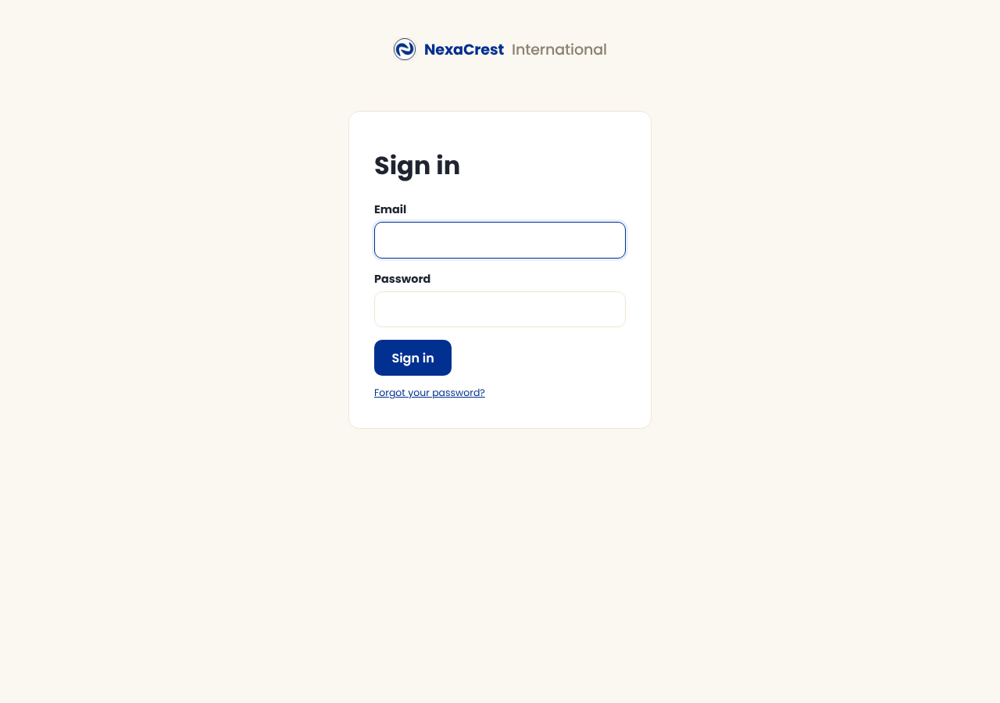
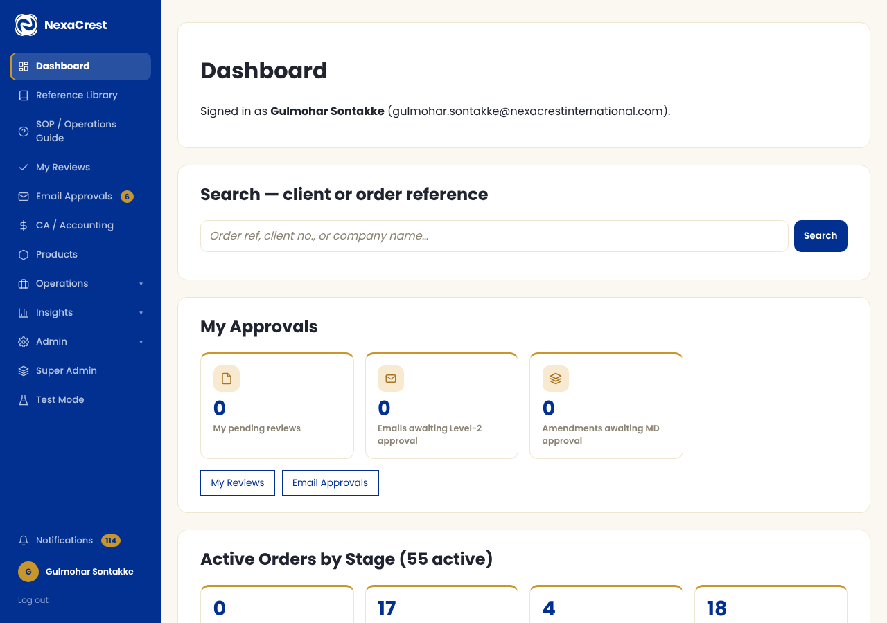
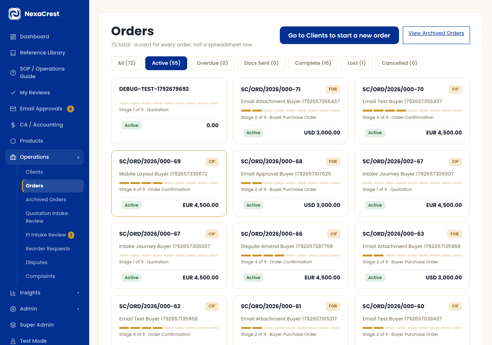
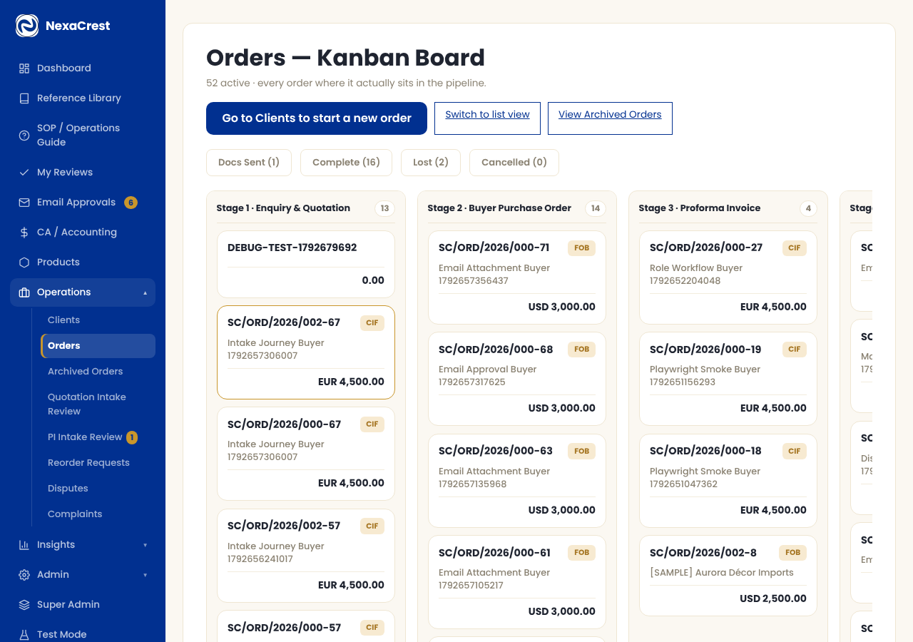
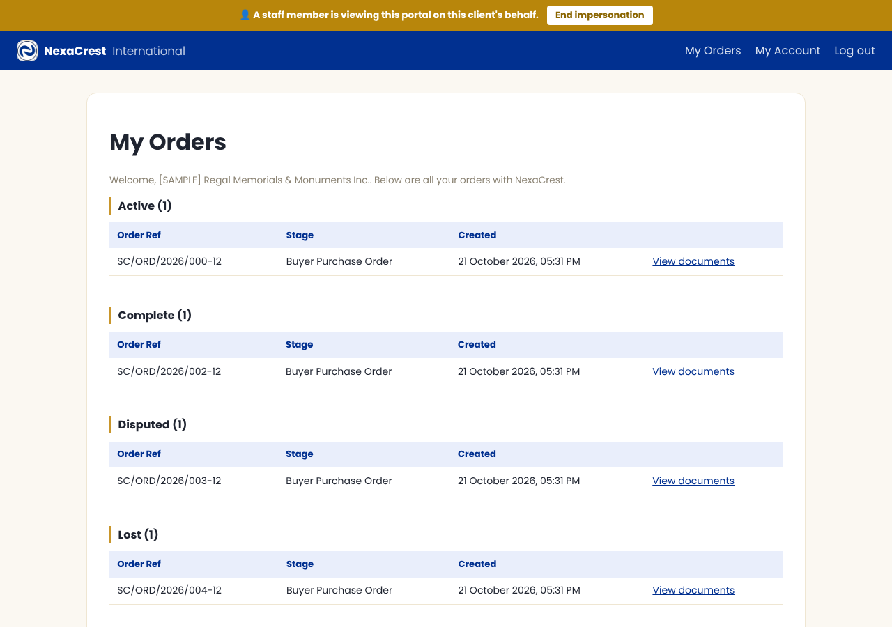

# Getting Started

## Read this first — before any other chapter

Every other page in this manual assumes you already know your way around
the application and tells you exactly what one specific screen does. This
chapter is different: it's for the **first hour** with the system, before
any of that makes sense yet — what this application actually is, how to
log in, what you're looking at once you do, and where to go next once
you're oriented. If you're brand new here, start now and don't skip ahead.
If you've been using the system a while and just need the detail on one
screen, you want the [full chapter list](./README.md) instead — this page
won't repeat what's already covered there.

## What is this, in one sentence

This is NexaCrest's own system for running an export order from the first
enquiry to the money being fully settled — one place to track a client,
an order, every document it needs, every payment against it, and every
conversation with the buyer, instead of scattered emails and spreadsheets.

## The big picture: one order, nine stages

Every single order — whatever it is, whoever the buyer is — moves through
the same **9 fixed stages**, always in the same order. You'll see this
exact sequence on every order's own page, as a row of numbered dots at
the top:

| # | Stage | In plain words |
|---|-------|-----------------|
| 1 | Enquiry & Quotation | A buyer asks; we quote. |
| 2 | Buyer Purchase Order | They send their own PO back. |
| 3 | Proforma Invoice | We invoice; their advance payment clears. |
| 4 | Order Confirmation | We confirm the order; they acknowledge it. |
| 5 | Supplier Purchase Order | We place the order with our own supplier. |
| 6 | Freight Payment | Freight gets paid (skipped automatically on FOB orders). |
| 7 | Packing & BL Instruction | Goods are packed, shipped, and the Bill of Lading is issued. |
| 8 | Commercial Invoice & Balance | We invoice the balance; it clears. |
| 9 | Document Despatch & Closure | Final documents go out; the order is settled. |

You never have to remember this list — every order page shows it to you,
always lit up to show exactly where that order stands right now. The
detail of each one of these nine stages — exactly which button to click,
what the system does for you automatically, what the buyer sees — is its
own chapter later in this manual ([Chapter 1](./01-stage1-enquiry-quotation.md)
through [Chapter 9](./09-stage9-despatch-closure.md)). You don't need to
read those yet. Come back to the one you need, when you need it.

A handful of other things can happen **alongside** this main pipeline at
any point — a client wanting to change payment terms (Amendments), a
dispute, a process complaint, a repeat order — each gets its own chapter
too (10 through 19). Again: not now. Just know they exist.

## Before you start: logging in

Staff sign in at the same place every time — there's no separate link for
different roles, what you see afterward depends on your account, not which
URL you used:

A few things that catch people out the first time:

- **Your very first login forces a password change.** That's deliberate —
  whatever password you were given to start with is never meant to be
  the one you actually use.
- **A second step may ask for a 6-digit code** sent to your email (this is
  two-factor authentication, and it isn't optional — see your Admin if
  you're not receiving the email).
- **Forgot your password?** The link is right there on this screen. You'll
  always see the same generic confirmation message whether or not the
  email you typed is a real account — that's intentional, not a bug.

## Finding your way around

Once you're in, everything lives behind the dark blue strip on the left —
the **sidebar**. This is the same on every single page, so it's worth
spending thirty seconds here before anything else:

A few things worth knowing about this sidebar before you start clicking
around it:

- **You will not see everything in the screenshot above.** What's listed
  depends entirely on your role — an Export Executive's sidebar looks
  different from an Accounts Executive's, which looks different again
  from an Admin's. If a chapter later in this manual mentions a screen
  you can't find, that's very likely just a permission you don't hold,
  not something broken — ask whoever manages Roles & Permissions.
- **Operations, Insights, and Admin are collapsible groups** — click the
  group name to open it and see what's inside. The system remembers which
  ones you had open.
- **"SOP / Operations Guide"** is this exact manual, reachable from inside
  the app itself at any time — you're looking at it right now, just
  outside the app. Bookmark it; you'll be back.
- **The bell icon and your name**, at the very bottom, are your
  notifications and your own account settings (including where to change
  your password later, any time you like).

## Your home screen: the Dashboard

This is what you land on every time you log in (the same screenshot
above). Top to bottom, it's built to answer "what needs me, right now":

- **Search** — the fastest way to jump straight to a client or an order
  if you already know its reference.
- **My Approvals** — anything specifically waiting on you: a document
  review, an email send you need to approve, an amendment needing
  sign-off.
- **Active Orders by Stage** — every order currently open, grouped by
  which of the 9 stages it's sitting in.
- **Overdue Payments** and **Compliance Expiry Warnings** — anything
  that's slipped past a deadline, so nothing quietly falls through.
- **Recent Activity** — the last few things that happened across the
  system, in case you've been away.

## Two ways to look at your work

Almost everywhere you see a list of orders (or disputes, or complaints,
or a few other queues), you can look at it two different ways — a
personal preference, set once on your own Account page, that doesn't
change what exists, only how it's shown to you:

**Standard** — the default: a card for every record, with a quick filter
row above it:

**Kanban** — the same records instead shown as a board, one column per
stage or status, drag-free — useful if you think visually:

Switch any time from **My Account**. Full detail: [Admin &
Settings](./15-admin-settings.md#ui-template-preference--standard-vs-kanban).

## A typical order, start to finish

Putting the pieces above together, here's the shape of a normal day:

1. A new buyer enquiry comes in → create the **Client**, then the
   **Order**, from the Clients screen.
2. The order moves through its 9 stages, one action at a time — each
   stage's own chapter tells you exactly what to click.
3. Along the way, the system **generates documents** for you (Quotation,
   Proforma Invoice, Packing List, and so on) — you review and approve
   them, and approval gates every send to the buyer.
4. The buyer has their **own portal** the whole time — they can download
   what's been sent to them, upload their own signed paperwork, report a
   payment, and talk to you directly, without ever emailing back and
   forth for the basics. More below.
5. Once everything ships and the paperwork is settled, the order closes —
   in two separate steps, not one (documents sent, *then* fully settled —
   see [Chapter 9](./09-stage9-despatch-closure.md) once you're there).

## The buyer's side of things

The client has their own, much simpler view of the same order — no
stages, no internal detail, just what concerns them:

You won't normally work inside this view yourself, but it helps to have
seen it once: whatever you send or confirm on the staff side is exactly
what shows up here, nothing more. Full detail: [Client
Portal](./12-client-portal.md).

## Conventions you'll see on almost every screen

A handful of small habits repeat throughout the whole application, once
you start noticing them:

- **A short grey line under most section headings** tells you what that
  section is for and when to use it — read it once, you probably won't
  need to again.
- **"To Be Confirmed"** is always spelled out in full on screen and on
  documents, never shortened to "TBC" — so nobody has to guess what an
  unfamiliar abbreviation means.
- **Orange/amber highlights** mark something that needs your attention —
  a pending approval, a notice, a badge count.
- **Forms are checked before they are sent.** A missing or wrong entry
  (an empty required field, a number with a comma, a reason that is too
  short, a "Re-enter" field that doesn't match) shows a red message right
  beside the field, and a closed step card holding it opens by itself.
  Fix it and press the button again. The server checks everything again
  after that.
- **Every action that matters is logged.** Staff actions, client actions,
  status changes — all of it is in the Audit Log, which is genuinely
  useful when you need to know "who did this and when," not just a
  compliance checkbox.
- **Notifications fire automatically** for almost everything — a client
  action, an approval you're waiting on, a deadline coming up. Check the
  bell icon; it's built to be worth checking.

## Where to find the detail

This chapter is deliberately shallow — enough to get you moving, nothing
more. Once you know roughly where things are, every other chapter in this
manual goes deep on exactly one topic, screen by screen:

- [Full chapter list (README)](./README.md) — the complete table of
  contents, including the 9-stage pipeline, every module alongside it,
  and the CA / Accounting section.
- [00-introduction.md](./00-introduction.md) — once the app itself feels
  familiar, this is the next step up: the full conventions reference (how
  files are named, what every repeated visual pattern means) for when
  you want the complete picture rather than the quick version above.

You'll reach for this manual constantly in your first few weeks, less and
less after that — that's the idea. It's reachable from inside the app any
time, from the sidebar, so you never have to go hunting for it.

## Quick reference — "I need to…"

| If you need to… | Go to… | Full detail |
|---|---|---|
| Set up a new buyer/order | **Clients** → create client → create order | [Chapter 1](./01-stage1-enquiry-quotation.md) |
| Check where an order currently stands | Open the order — the 9-dot tracker is at the top | [Chapter 00 above](#the-big-picture-one-order-nine-stages) |
| Generate or re-send a document | Inside the order: generate it in its own step, review and send it in **Document Review & Approval** | [Document Review & Approval](./13-document-review-approval.md) |
| See what's overdue or needs approval | **Dashboard** | *(this chapter)* |
| Handle a buyer wanting to cancel | **Disputes** | [Chapter 11](./11-disputes.md) |
| Handle a buyer flagging a process issue (no cancel intent) | **Complaints** | [Chapter 19](./19-complaints.md) |
| Change payment terms after the PI is out | **Amendments**, from the order page | [Chapter 10](./10-amendments.md) |
| Run a report | **Insights → Reports** | [Chapter 14](./14-reports.md) |
| Check who did what and when | **Insights → Audit Log** | — |
| Manage roles, users, or company settings | **Admin** | [Chapter 15](./15-admin-settings.md) |
| Rehearse something without touching real data | **Test Mode** (if you have access) | [Chapter 16](./16-test-mode.md) |
| CA / Accounting work | **CA / Accounting** | [CA Overview](./ca-01-overview.md) |

## Your first week

- [ ] Log in, set your real password, confirm you're receiving 2FA codes.
- [ ] Spend ten minutes just clicking through the sidebar — nothing will
      break, every screen here is safe to just look at.
- [ ] Open one real, active order and follow its 9-stage tracker top to
      bottom.
- [ ] Find the **SOP / Operations Guide** link and bookmark it.
- [ ] Set your preferred view (Standard or Kanban) on **My Account**.
- [ ] Read the chapter for whatever you'll actually be doing first —
      not every chapter, just that one.
- [ ] If something you expect to see isn't there, ask about your
      permissions before assuming it's missing.

Welcome aboard — everything past this page, you'll pick up as you go.
