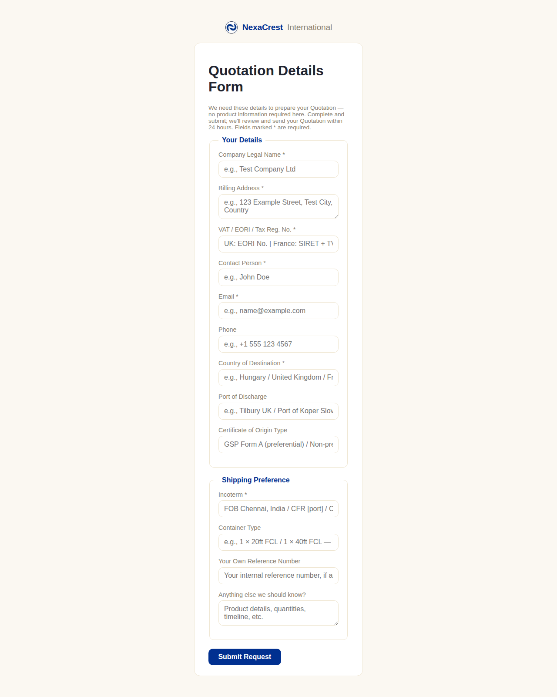
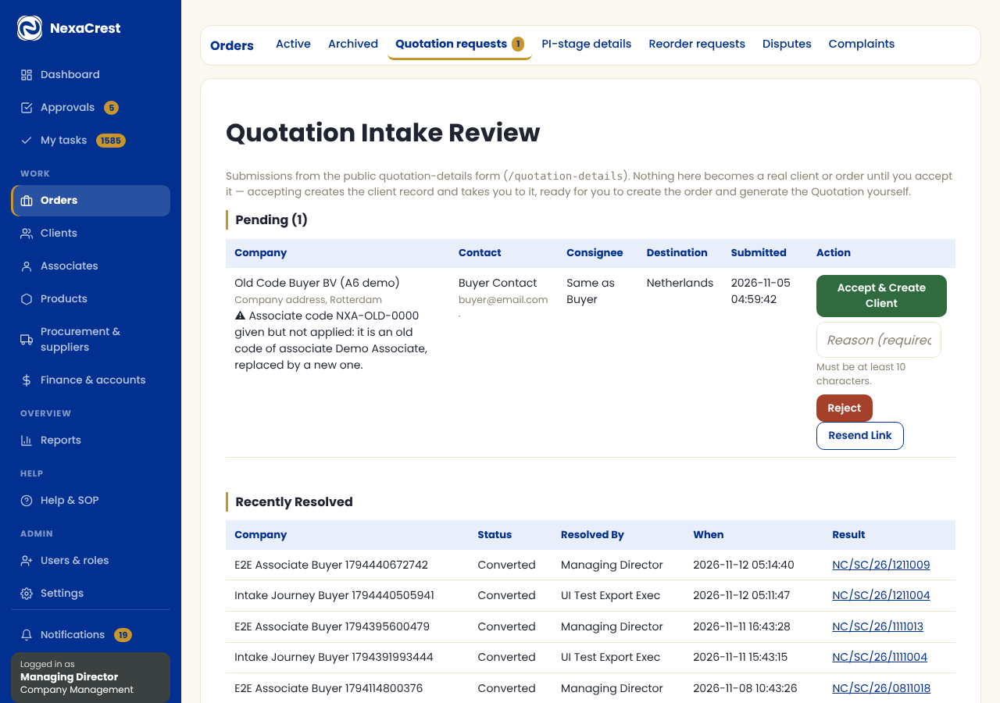
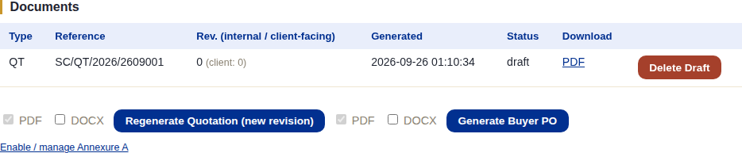
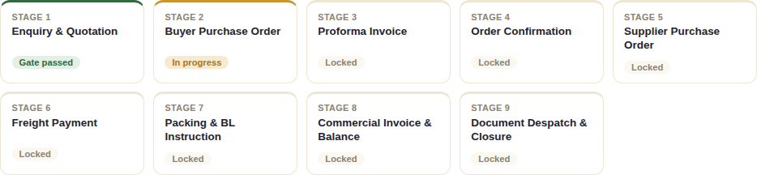

# Stage 1 — Enquiry & Quotation

## What this stage is for

Turning a buyer's interest into a real client record and a first Quotation
(QT) document. This is the only stage where the order doesn't exist yet —
everything before this point is either a public web form or a staff-entered
client record.

## The system does this automatically

- Nothing yet — Stage 1 is the one stage that always starts with a human
  action (either the buyer submitting the public form, or staff creating
  the client directly). There's no order to auto-progress until one exists.
- Once the Quotation is **approved** (or, while document e-mails to buyers are sent — Settings › E-mail — once it is **sent** to the buyer), the system marks
  Stage 1 as **gate passed** and unlocks Stage 2 by itself — there is no
  button for this. Generating the Quotation alone does not pass the gate
  (see the "one rule that applies to every stage" note in the
  [introduction](./00-introduction.md)).
- The system auto-generates the **Buyer Inquiry Ref** (e.g.
  `NC/SC/26/2009001`) the moment a client record is created — staff never
  type this themselves.

## What staff do

An order can start from either of two paths:

### Path A — buyer submits the public form themselves

The buyer fills in `/quotation-details` — a public page, no login needed
(shareable link, e.g. sent from a Zoho lead). It only asks for company/
shipping details, deliberately **not** product details (those come later,
at the PI stage):

The Billing Address on this form is structured — Line 1 (required),
Line 2, City (required), Postcode, Country (required) — same pattern as
the Consignee section just below it on this same form, since documents
need these as discrete fields rather than one free-text blob. The older
single-field Billing Address column is composed automatically from these
parts behind the scenes, so every existing report or screen that reads it
keeps working unchanged. **Container Type** is a dropdown (Settings › Lists › Dropdown lists, `container_type`), not free text, with a
"Not sure yet" option for a buyer who genuinely doesn't
know yet — same admin-managed-list mechanism as Certificate of Origin Type.

That submission lands in **Orders › Quotation requests**
(`/client-intake`) as a pending row. The **Quotation requests** item on the Orders menu bar carries a count (e.g. "Quotation requests **2**") whenever
something is waiting — a live count, not cached, so it appears the
moment a buyer submits and disappears the moment staff accept or reject
it. No badge means the queue is empty; staff don't need to open the
screen just to check. Staff review it here and either:

- **Accept & Create Client** — creates the real client record and takes
  you straight to it, ready to create the order.
- **Reject** (with a reason, at least 10 characters) — if it's not a
  genuine enquiry.
- **Resend Link** — the buyer gets a one-time self-correction link by
  email right after submitting (good for 7 days), so they can fix a typo
  themselves without staff involvement. If that email never arrived, or
  the buyer comes back after it's expired, staff click **Resend Link** on
  the pending row to re-send a fresh one — this is the only recovery path,
  since an expired link can't be reused.

#### A buyer introduced by an associate (owner decision D-217)

When the buyer opens the form through an associate's link (`/invite/…`)
or code link (`/quotation-details?code=NXA-…`), the associate is picked up
automatically and carried as a **hidden field** — the buyer sees the same
form as everyone else: no checkbox, no associate name, no code box. After
**Submit Request** the buyer is e-mailed a 6-digit code and confirms the
request on the next page (**Confirm your request**, code valid 30
minutes).

On Quotation Intake Review (list or board) such a row shows
"**Associate: <name> — buyer’s e-mail verified**" and any warnings: the
buyer used the associate's own e-mail or phone, a free-mail address, an
e-mail domain not matching the website, the e-mail is not verified yet, or
the company is already another associate's client.

- Accept is refused until the buyer has entered the code.
- If another associate's registration of the same company was completed
  earlier and is still pending, decide that one first (the first completed
  registration wins).
- On Accept the client is linked to the associate for 12 months; the
  associate is told and gets a registration certificate. Reject tells the
  associate, with the reason.
- A plain enquiry from a company that is already an associate's client is
  recognised (name, VAT number, e-mail domain or phone) and the associate
  is told.

The full associate system is [Chapter 24](./24-associates.md).

Accepting **only creates the client** — it does not create an order or a
Quotation automatically. Staff still do that next, exactly as in Path B.
When you then open **Add Order** for that client, the Incoterm, Container
Type and discharge port the buyer gave on the public form are already
pre-selected — carried over from their submission instead of silently
sitting on FOB (the form's own fallback default) regardless of what the
buyer actually asked for. Double-check them against the submission before
saving; they're a starting point, not locked in.

### Path B — staff create the client and order directly

For a walk-in enquiry that didn't come through the public form: **Clients →
Add Client** (`/clients/create`), fill in the same details by hand, save.
Then from that client's page, **Add Order** to create the order shell
(buyer inquiry ref, incoterm, payment preset, etc.).

**Billing address in parts (D-346, owner decision 12 Nov 2026).** The Add
Client, Edit Client and Duplicate Client forms have no single "Billing
Address" box any more. Fill in **Billing Address Line 1 \***, Line 2,
**City / Town \***, Postcode and **Billing Country \*** — Line 1, City /
Town and Billing Country are required (the form checks them before it
sends, and the server refuses the save with "Company legal name, Billing
Address Line 1, City / Town and Billing Country are required."). The app
builds the address that documents and Zoho show from these parts, always
the same way: **Line 1, Line 2, City Postcode, Country** — e.g. "1 Test
Street, Unit 4, Birmingham B1 1AA, United Kingdom" (empty parts are
left out). The public Quotation and PI-details forms build it the same way.

An older client saved before the parts existed may have only the old single
box. Its Edit form shows, under the address fields, "Address on file (old
single box): … — copy it into the boxes above." Copy it into Line 1, City /
Town, Postcode and Country; the save needs those parts.

**One email per client** (QA Round 5, owner decision 2026-10-28). The
client portal logs in by email, so two clients can't share one. Saving a
client — new, duplicated, edited, or accepted from Quotation Intake Review
— with an email another client already uses is refused, and the message
names that other client. If the enquiry is really from the same buyer,
create the order under their existing client record instead. The database
itself refuses a shared email too (QA Round 6, R6-N16), so two people
saving the same email at the same moment can't both succeed — the second
sees "Another client already uses this email".

### Duplicating a client

A client's page has a **Duplicate** button (same permission as Add Client).
Use it to re-onboard a near-identical but genuinely distinct entity under
its own Buyer Inquiry Ref — a sister company, a corrected legal entity, or
a buyer that re-registered under new billing details — without re-typing
every field by hand. It opens the same Add Client form, pre-filled from the
source client's details, but posts to a separate duplicate-save endpoint
instead of the ordinary create: the new record always gets its own
brand-new Buyer Inquiry Ref and is never confused with the source.

The save is refused if nothing was changed — an exact copy with zero
differences from the source serves no purpose the original record doesn't
already serve, so change at least one field before saving. The client's
page also shows which client it was duplicated from, and which duplicates
were made from it, so the relationship stays visible later.

### Buyer / Consignee / Notify Party details (per client)

Every client record carries three separate detail blocks, matching the
Developer Spec's own document numbering and reflecting how export
paperwork actually works — the company paying the invoice, the company
receiving the cargo, and the party to notify on arrival are often three
different entities:

- **Buyer Details** — the client's own company name, structured billing
  address (Line 1 \*, Line 2, City / Town \*, Postcode, Billing Country \*;
  the address documents and Zoho show is composed from these parts as
  "Line 1, Line 2, City Postcode, Country" — D-346), VAT/EORI,
  and contact details. Always independently entered — there's no "same
  as" checkbox here.
- **Consignee Details** — defaults to a checked **Same as Buyer?**
  checkbox. While checked, the consignee fields are disabled on the form
  and the Consignee block resolves from whatever the Buyer block
  currently holds, so staff never re-type anything on the Consignee side.
  Unchecking it enables an independent set of fields (company name,
  structured address, VAT/EORI, contact person, phone, email) for a
  client whose goods genuinely ship to a different company than the one
  paying for them.
- **Notify Party** — defaults to a checked **Same as Consignee?**
  checkbox, resolving from whatever the Consignee block *itself* resolved
  to (so if Consignee is also "same as Buyer", Notify Party shows the
  Buyer's details too). Unchecking it enables independent fields for a
  freight-forwarder/agent that needs notifying on arrival but isn't the
  consignee itself. Notify Party only appears on the documents the
  Developer Spec defines it for (Proforma Invoice, Packing List,
  Commercial Invoice) — the Quotation, Order Confirmation, and Buyer PO
  never show a Notify Party section.

90-item backlog "standalone order" follow-on: all of the above describes
how the **client record itself** resolves these — and, by extension,
what a *brand-new* order starts from the moment it's created. An
*existing* order's own documents never re-read any of this live: the
Buyer/Consignee/Notify Party details (and every toggle above) are
snapshotted onto the order's own row once, at creation, and again
whenever that specific order's own PI-details form is accepted (Chapter
3) — never on a later, unrelated edit to the client record or to another
order for the same client. A correction made on the admin Clients form
(or on a different order's PI-intake) only ever changes what a *new*
order will start from; it never reaches back into an order already
created.

**Certificate of Origin Type** is a dropdown (same admin-managed list the
order-creation form itself uses, e.g. Non-Preferential), not a free-text
field — this keeps the value consistent with whatever CAPEXIL actually
issues, rather than depending on each buyer or staff member typing the
same term the same way. The client's own Quotation details and PI details
forms use the same dropdown (plus "Not sure — please confirm with me"),
and an older loosely typed answer such as "GSP Form A" is matched to its
option rather than dropped. Whatever the client chose follows them: it is
saved on the client record when the request is accepted (shown on the
client's page as **Certificate of Origin Type**), the New Order form
starts with it selected, and the order page's At a Glance panel shows the
order's own value.

On the Quotation, the selected type prints in **Documents to be provided**
("Certificate of Origin — Non-Preferential — Issued by CAPEXIL", or
"GSP Form A (Preferential)" when that is selected). While no type is chosen
yet (empty or "To Be Confirmed"), the line reads simply "Certificate of
Origin Issued by CAPEXIL" — the same on the Proforma Invoice and the
Commercial Invoice, PDF and Word (owner, 12 Nov 2026, D-349). The Port of
Discharge prints in **Shipping / Commercial Terms**. The Proforma Invoice prints the type in **Export Documentation**
and the buyer's PO / reference number as the last row of **Buyer Details**,
only once one has been entered (owner, 1 Nov 2026, D-223).

This same **Same as Buyer?** self-service — not just a staff-only admin
screen — is also built into the two client-facing forms that create or
confirm this data in the first place:

- The public **`/quotation-details`** form (Path A, above) carries a
  **Consignee Details** section with its own **Same as Buyer?** checkbox,
  so a buyer can tell NexaCrest up front that their goods ship to a
  different company, before staff ever touch the record. Never a Notify
  Party section here, matching the Developer Spec's own document-data
  requirements — the Quotation never shows one.
- The per-order **`/pi-details/{token}`** form (Chapter 3) carries both a
  **Consignee Details** and a **Notify Party** section, each with its own
  checkbox, since Notify Party first becomes relevant at the PI stage.

Either way, accepting the submission (Quotation-stage) or applying it
(PI-stage) copies the buyer's own checkbox state and structured fields
straight onto the `clients` row — the exact same columns the admin Clients
form reads and writes — so there's only ever one Consignee/Notify Party
story for a given client, however it was captured. Applying the PI-stage
form also writes that same confirmed data onto the order it was
submitted for (see the standalone-order note above) — the client record
update governs what any *future* order starts from; the order-level
write is what makes *this* order's own documents correct immediately,
without waiting on anything else.

#### Whether the Consignee/Notify Party sections print when identical to the Buyer

Two Admin Settings rows (**Settings › Company**, Documents group) — **Always show
Consignee Details section** (`always_show_consignee_section`) and
**Always show Notify Party section** (`always_show_notify_party_section`)
— control whether a buyer-facing document (Quotation, Proforma Invoice,
Order Confirmation, Packing List, Commercial Invoice) prints the CONSIGNEE
DETAILS / NOTIFY PARTY section at all when its content is identical to
the Buyer Details already shown above it. Both default to **on**
(matching the system's original behaviour of always printing every
section), so turning this on changes nothing on any existing document
until an Admin deliberately switches one off.

With a setting switched **off**, that section is omitted whenever it
resolves to the Buyer's own details — "Same as Buyer?" checked for
Consignee, or "Same as Consignee?" checked for Notify Party while the
Consignee itself is also "Same as Buyer?". The moment either section is
genuinely different from the Buyer — whichever checkbox produced that
difference — it **always prints**, regardless of what either setting is
set to. Neither setting can ever hide information that is actually
different from the Buyer; they only control whether a *redundant* repeat
of the Buyer's own details is shown a second time.

When a section is omitted this way, every section number after it on that
document shifts up to close the gap (e.g. Quotation's "4. PRODUCT / ORDER
DETAILS" becomes "3." when Consignee is hidden) — the document's section
numbering is always computed fresh for each generated document, never
left with a gap.

### Agreement T&C Footer (per client)

Some buyers negotiate a clause specific to their own commercial agreement
with NexaCrest — e.g. a pre-shipment inspection right, or a specific
dispute-resolution forum — that isn't part of the company's general
numbered T&C list and shouldn't be added there for every other buyer.

On a client's **Edit** page, a separate **Agreement** section holds a
free-text **T&C Footer**. Whatever is entered there shows as an extra,
unnumbered note — "Special Terms (per Client Agreement)" — on every
Quotation, Proforma Invoice, Order Confirmation, Buyer PO and Commercial
Invoice generated for that client, in addition to the standard numbered
terms. It shows even on a Commercial Invoice, which otherwise carries no
numbered T&C clauses at all.

This field has its own **Save Agreement Footer** button, separate from the
main **Save Changes** button above it, and is never affected by the
client's data lock: once a client's other details lock permanently (see
Stage 3's PI-details consent), the main form can no longer be saved by
anyone but a Super Admin with a reason — but the Agreement T&C Footer stays
editable by any staff member with client-management access at any time,
since it's a staff-authored annotation of an externally-negotiated term,
not a client-submitted identity detail the lock exists to protect. Every
change here is still fully audit-logged.

#### Agreement file, expiry, force-expire, and renew

The footer text is one half of the agreement; the other half is the actual
signed copy of it, with an expiry date so the footer doesn't keep printing
on new documents after the agreement itself has lapsed. On the same
client's page, an **Agreement File & Expiry** form (Edit page) and a
status widget (client's own page) handle this:

- **Upload** — a PDF/DOC/DOCX file plus an optional **Expiry Date**.
  Uploading always starts the agreement fresh: any previous Force Expire
  is cleared the moment a new file is saved, regardless of its prior
  state. Leaving Expiry Date blank means no automatic expiry — the
  agreement then stays active until someone deliberately clicks **Force
  Expire**.
- **Status** shows as **Active**, **Expired** (past its own expiry date),
  or **Force-Expired** (the manual override, below) — and the footer text
  only prints on a newly generated document while the status is Active.
  Force-Expired always wins over a future expiry date; an expired-by-date
  agreement is distinct from one that was deliberately force-expired, but
  both stop the footer from printing.
- **Force Expire** — ends the agreement immediately, regardless of its
  expiry date — e.g. the client breached a term and staff don't want to
  wait for the natural expiry date to arrive. Fully audit-logged.
- **Renew** — resets the expiry date (and, optionally, replaces the file
  itself, if the underlying signed document actually changed) and clears
  Force Expire. The Renew button and its date field only appear (are not
  greyed out) within 30 days of the current expiry date, or once it has
  already passed — this is a staff workflow nudge against renewing a
  fresh agreement early for no reason, not a security gate: nothing
  server-side blocks an early renewal if someone genuinely needs one.

The file itself downloads only through the client's own page
(permission-gated, same `manage_orders` tier as everything else on this
screen) — never a public link.

### Both paths converge here — generating the Quotation

**Payment terms that need approval** (owner decision 2026-10-28; wording D-269).
If the order's payment preset is marked **Requires MD approval** (by
default: Established Buyer — Post-BL, Extended Terms — Post-BL, and
Irrevocable Letter of Credit at Sight), Step 1 shows a yellow box *Payment
terms need approval first*, and the Generate Quotation button is
hidden until the terms are approved. Anyone holding **Approve payment
terms** (by default Admin, Managing Director, Executive Director,
Sales/Export Manager, Sales Director and Finance Director — editable under
Roles & Permissions) sees an **Approve payment terms** button there;
everyone else sees *Waiting for approval by someone who can approve
payment terms (…)*, with the roles that hold the permission named in the
brackets. The names are read from Roles & Permissions each time, so they
stay right when a role is given or loses the permission. The approvers get a notification when such
an order is created. Once approved, the box turns green and says who
approved and when, and the Quotation can be generated and sent as usual.
Sending a Quotation is refused too while the terms wait for approval.
A second person approves the terms of an order: whoever created the order
cannot approve its terms, whatever their permissions. The only exception
is a person whose role is ticked for this rule in **Users & roles › Self-approval rules** (default: Managing Director and Executive Director; see
[Chapter 15](./15-admin-settings.md)); the audit log then records it as
PAYMENT_TERMS_SELF_APPROVED (owner decisions 1 Nov 2026, D-216 and D-221;
replaces D-117). Terms of a cancelled or lost order
cannot be approved (QA Round 6, R6-N13).

Insurance belongs to CIF only (owner decision D-049): on a CFR or FOB order
any indicative insurance amount is cleared when the order is saved — the
documents already print NIL / "buyer arranges insurance" for those.

On the order page, open **Step 1 · Prepare Quotation** (section **A ·
Order Booking**) and click **Generate Quotation** (badge **1a**). A PDF is
always made; tick **DOCX** as well if you want an editable Word copy for
internal use. Once one exists, the button reads **Regenerate Quotation (new
revision)**.

**Price check first** (owner decision D-245 P2, 4 Nov 2026). The Quotation is
refused — like the Proforma Invoice — while a line picked from Products is below
the lowest price of whoever sells the order, below the product's minimum price,
or picked from a product with no price set, unless the MD has approved it; Step 1
shows the reason in red, e.g. "Line 1 is below the lowest price for this order —
raise it, or ask the MD to approve it, before the Quotation (order page →
Products)." See [Pricing](./27-pricing.md#prices-on-order-lines-phase-p2).

The new QT document appears in the documents table as a **draft** — it
still needs to go through [review and approval](./13-document-review-approval.md)
before it's the final, sendable version. A draft can be deleted (**Delete
Draft**) if it was generated by mistake — see that same chapter for when
that's appropriate.

**Step 2 · Send Quotation to Client** has no button of its own. Sending
happens in **Document Review & Approval**: assign a reviewer, get it
approved, then:

- **Buyer e-mails sent (the default):** use **Send to Buyer (deferred, 2-level approval)**
  on the approved Quotation. Stage 1 passes once it is actually sent.
- **Buyer e-mails held (Testing mode on, or the buyer *Documents* switch off in Settings › E-mail):** the Quotation counts as sent the moment it is
  approved, and Stage 1 passes then. Send the PDF to the client yourself.

Either way, the stage tracker then shows Stage 1 passed:

**Step 3 · Client Accepts Quotation** has no button either — the buyer
accepts outside the system (a reply, a call, a signed copy). Once you are
satisfied they have accepted, move on to Step 4a (Buyer's PO, [Chapter
2](./02-stage2-buyer-po.md)).

## Annexure A — Product Specification and/or Additional Terms

Annexure A is an optional attachment staff can turn on for an order
(**Edit Annexure A ›** button in Step 1 of the order page). Once enabled, it's
appended to every buyer-facing document that supports it (QT, PI, OC, Buyer
PO, Packing List, Commercial Invoice) as a guaranteed, never-skippable
appendix, and can also be generated as its own standalone document, whose
own meta table prints the order's own Order Ref alongside the Quotation/PI
reference it's attached to.

From the Annexure A management screen (`/orders/{id}/annexure`), a **content
mode** dropdown decides what Annexure A actually shows:

- **Product Specification (current view)** — the structured per-product
  table (dimensions, finish, components, technical notes, photos) staff fill
  in below the dropdown. This is the original, only mode Annexure A used to
  have. A photo can be attached right away on the "Add Product Entry" form
  itself, or added afterward (and more added later) with the saved entry's
  own **Add image** field — either way works, and nothing is required to be
  uploaded at either point. Above the product table, a fixed amber "Note:"
  banner (default wording: product images/drawings are for reference only
  and may show optional accessories not included in the quoted price) is
  admin-editable — Settings › Company → `annexure_product_note` — same
  governed-text pattern as the BL type/consignee instructions.
- **Additional Terms** — a free-form rich-text block, entered through a
  small on-screen WYSIWYG editor (bold/italic/underline/strikethrough,
  headings, quote, bullet/numbered lists, inserted images, links). Use this
  for anything that doesn't fit the product table — a special clause, an
  inspection condition, a one-off note agreed with the buyer.
- **Both** — prints Product Specification first, then Additional Terms,
  in the same document/appendix.

Switching the dropdown only changes what's printed — it never deletes either
section's saved content, so staff can go back and forth without re-entering
anything. If the selected mode has nothing saved yet, the generated document
shows a plain "No product entries/additional terms have been added yet"
line rather than an empty gap.

Additional Terms supports pasted or inserted **images** (via the editor's
Image button) but not video or audio: a generated PDF or Word document
can't play embedded media, so there was nothing to gain by accepting it.
Content is sanitized on save (and again every time a document is generated)
to a fixed set of safe formatting tags — scripts, event handlers, and
remote/relative image sources are stripped automatically.

**One save for the whole page** (owner decision D-341, 12 Nov 2026). Change
whatever you need on the page — the content dropdown, any product entry's
fields, a new image for an entry (jpg, png or webp, up to 5 MB) and the
Additional Terms — and click **Save all changes** once (the button is at the
top and at the bottom of the page). Everything is saved together. If
something is wrong — a product entry without a name, or an image of the wrong
type or too large — nothing is saved: the page comes back with the message
beside the field and what you typed still there; correct it and click
**Save all changes** again. **Remove Entry** and an image's **×** still act at
once (after their confirmation), and **Add Product Entry** at the bottom
still adds an entry by itself. If you changed something and try to leave the
page without saving, the page asks *"You have unsaved changes on this page —
leave without saving?"*.

**Generate and Regenerate.** In Step 1 of the order page the button reads
**Generate Annexure A** the first time and **Regenerate Annexure A (new
revision)** once an Annexure A document exists.

If the order's standalone Annexure A document has already been approved or
sent to the buyer, this screen shows a warning banner saying so, and every
Save/Add/Remove button on it asks for confirmation before going ahead —
editing here never changes what the buyer already received; staff need to
generate a new revision and get it re-approved for the change to actually
reach them. This is a reminder only, never a hard block, the same
"tracking aid, not a lock" treatment used elsewhere in this system (see
[Chapter 9](./09-stage9-despatch-closure.md)'s Close Order hint). Resending
an Annexure that was already sent once gets the same treatment on the Send
to Buyer screen — a warning and a second confirmation, not a block.

Once you have changed Annexure A after its approved (or sent) revision was
generated, the banner says *"You changed Annexure A after Rev.1 was approved —
generate the new revision, then approve and send it."* with a button
**Generate the new revision ›** (for staff who may generate documents). It
makes the new revision and takes you back to the order page; then take it
through review, approval and sending as usual
([Chapter 13](./13-document-review-approval.md)).

### Annexure B (as shipped) and lines "As per annexure" (owner decision D-336, 12 Nov 2026)

**A line whose sizes are in the annexure.** When the sizes of a product line
are given piece by piece in Annexure A (for example 12 slabs of 180 × 120 × 15
and 6 of 250 × 150 × 20), open the line (**Edit** or **+ Add product**) and
in step 3 *Size and quantity* tick **As per annexure** instead of typing a
Length / Width / Thickness. Those three fields then show "As per annexure"
and stay empty; still enter the **Qty** — it is the line's total (e.g. 8.801
CBM). "Qty To Be Confirmed" and "As per annexure" cannot both be ticked. The
products table then shows "As per annexure" in the Size column.

On the Quotation, Buyer PO, PI and OC the line prints **8.801 (as per Annexure
A)** in the Qty column and **Dimensions: As per Annexure A** in its detail
row. These documents are refused until Annexure A is included and has at least
one product entry: *Line 1 says "As per annexure" but Annexure A has no product
yet — add it in Annexure A (order page › Annexure A), then generate again.*

**Annexure B — as shipped.** If what is shipped differs from what was quoted,
open Annexure A and click **Annexure B (as shipped) ›** next to the title. The
button appears once the order has reached the Commercial Invoice step (Step 11)
— before that the page says *"Annexure B can be made at the Commercial
Invoice step."* (D-341). The first time, while Annexure B is empty, the page
offers one button, **Start Annexure B from a copy of Annexure A** (products,
images, terms and content are copied), and a small link **Start empty
instead**. After that it is the same screen as Annexure A: tick **Include
Annexure B on this order's documents**, change what is different and click
**Save all changes**; **Copy everything from Annexure A** starts again from A
(you are asked "Replace Annexure B with a copy of Annexure A?"). **‹ Annexure A (as quoted)** goes back. Annexure B is
printed only with the Commercial Invoice and Packing List (see
[Chapter 8](./08-stage8-ci-balance.md)); the Quotation, Buyer PO, PI and OC
always keep Annexure A.

### Number of pieces and the detailed product table (owner decision D-339, 12 Nov 2026)

New orders print a **detailed product table** on the Quotation, Buyer PO, PI,
OC, Commercial Invoice and Packing List: Material / Colour, Surface / Finish,
the size L × W × H, the measure of one piece (CBM, SQM or SQFT), the **No. of
pieces**, the measure of all pieces, the price per unit, the price per piece
and the total. Orders that existed before 12 Nov 2026 keep the old table —
their documents do not change.

**Entering a line with sizes (e.g. CHM Black P6, 180 × 80 × 13 cm, 25 pieces,
priced per CBM).** Open the line (**Edit** or **+ Add product**). In step 3
*Size and quantity* choose the unit (**CBM**), type **Length 180**, **Width 80**,
**Thickness 13** and **No. of pieces 25**. The **Qty** is worked out for you
(4.680 CBM — "worked out: 25 × 0.1872 CBM") and cannot be typed; the box under
the fields shows *This line: 0.1872 CBM per piece · 25 pcs = 4.680 CBM · USD
365.04 per piece · total USD 9,126.00*. For SQM and SQFT only Length and Width
are needed (e.g. 60 × 60 tiles, 500 pieces = 180.00 SQM). For **PCS** the Qty is
the number of pieces. The server works the quantity out again when you save;
without the pieces the line is refused: *Product line: enter the No. of pieces —
with the size given, the quantity is worked out from the pieces.*

**A line without sizes** (CBM-only or SQM-only quote, random blocks): leave
Length / Width empty and **No. of pieces** empty, type the **Qty** as before, and
use **Size note** for what the buyer should read under the line (e.g. "Random
sizes, as available"). If no line of the order has a size, the documents print
the short table (Material, Finish, Thickness, Qty, price, total).

**Lines "As per annexure"** work as before (no pieces); on the documents the
size columns read "As per Annexure A" and the grey row "Qty as per Annexure A".

**The price.** When you pick a product, or change the unit, the size or the
thickness, the quote price is filled in **in the line's unit** (e.g. USD 39.00
per SQM for a 2 cm tile from USD 1,950.00 per CBM). Once you type your own
price it is never replaced. Next to the price you see your floor in the line's
unit, e.g. *Your floor: USD 37.20 per SQM — this price is 4.8% above*. Below the
floor the line goes to the MD for approval as before.

**What the documents show.** All lines in one unit: the headings name the unit
(CBM, SQM, SQFT). Different units on one order: each figure names its unit
("0.1872 CBM", "1,950.00 /CBM") and the totals are given per unit ("Totals by
unit: 4.680 CBM · 180.00 SQM · 20 PCS"). Services, charges and goods sold by
Set, Lot, Ton or RMT stay in the small table below. The line total is always
quantity × unit price, exactly as before. The Packing List shows the same table
without prices.

### Prices and products are fixed once the Quotation is approved (owner decision D-342, 12 Nov 2026)

The moment the order's **first Quotation is approved**, the order keeps the
exchange rate its prices were worked out at and every line's price — "the
same exchange rate and the same prices for all other documents, not a single
change". The PI, OC, Buyer PO and CI use exactly these prices; a new rate
later changes nothing on this order.

From then on the products table on the order page is **read-only**: it shows
"Prices and products are fixed by the approved Quotation of <date> — change
them through an Amendment (Order page › Amendments › Products & prices)." No
one can add, edit, copy or remove a line, or change the order's currency —
not with an override, not the Super Admin. If the buyer wants more slabs,
another size, a line less or a lower price, raise a **Products & prices
amendment** (SOP 10). A price can never go up after the Quotation.

### Rupee amounts, Total CBM and the Word copy (owner decision D-343, 12 Nov 2026)

**Orders in INR.** On the documents of an order in Indian Rupees every amount
uses Indian grouping: **1,75,000.00** per CBM, total **15,40,175.00**, advance
**6,16,070.00**. Orders in USD, EUR and other currencies print as before
(1,540,175.00). The amount in words, quantities, CBM and weights do not change.
The internal CA financial annexure (CAFIN) is not affected.

**Total CBM.** On a new order (detailed product table) the Weight & Volume box
of the Quotation and PI shows the **Total CBM** worked out from the lines — for
CHM Black P6 180 × 80 × 13 × 25, 140 × 70 × 13 × 25 and 120 × 60 × 13 × 10 it
prints **8.801**. Lines with a size and pieces count their pieces × size; a CBM
line without a size counts its quantity; a SQM / SQFT line with a thickness
counts area × thickness. If one goods line cannot be turned into CBM (a SQM
line without a thickness, PCS without a size, Ton, Set …) the box keeps
"To Be Confirmed" — an estimate typed on the order is never printed on a new
order, so the box can never disagree with the product table. Older orders
print as before.

**Word copy.** The Word copy (DOCX) of every document now has the same
section headings and numbers as the PDF — Buyer Details, Consignee Details and
Notify Party as separate sections, and the Legal Terms & Definitions section —
so the Quotation's Word copy reads "5. SHIPPING / COMMERCIAL TERMS", like the
PDF.

## What the client does (or doesn't)

- **If they came through Path A**, they filled the public form — that's
  their only action at this stage. They are not notified of acceptance or
  rejection automatically; staff communicate the Quotation itself once it's
  ready (there's no client-portal login yet at this point — that only
  exists from Stage 3 onward, once the client's own portal account is
  provisioned).
- **If they came through Path B**, they've done nothing in the system yet
  — the whole stage is staff-only until the Quotation reaches them (by
  **Send to Buyer**, or by staff emailing the PDF themselves while buyer e-mails are held).
- Either way, the client cannot see or act on anything inside this system
  at Stage 1 — there's no client-portal screen for the Quotation stage, and
  no portal login exists for them yet at all (unless they are a returning
  client from an earlier order). Their portal account is only created
  automatically once the advance payment clears, or the Letter of Credit
  is confirmed usable (Stage 3 → 4) — see
  [Chapter 3](./03-stage3-pi-advance.md).

## What happens next

Stage 2 (Buyer Purchase Order) is unlocked the moment the Quotation is
approved (buyer e-mails held) or sent (buyer e-mails sent). See
[Chapter 2](./02-stage2-buyer-po.md).

## Order lines: goods, services and charges (D-215)

Each product line has a **Line type**:

- **Goods** — as always: description, dimensions, finish, quantity, unit,
  price and an HS code from the master list.
- **Service** — work NexaCrest does, for example installation supervision.
  It needs its **SAC code** (6 digits starting 99, e.g. 998719) instead of
  an HS code. On the Quotation, Proforma and Order Confirmation it shows
  "Service · SAC Code … · Invoiced separately on our Export Service
  Invoice". It is not part of the goods FOB value, so the advance, balance
  and Commercial Invoice are for the goods only; the service is invoiced on
  its own Export Service Invoice.
- **Charge** — a single amount such as a testing fee; no HS code needed.

The Commercial Invoice, Packing List, COO preparation, Supplier PO and BL
Instruction list goods and charges only. An order with goods only prints
exactly as before.

### Product categories and their attributes (D-215)

**Products → Categories** (for whoever manages the product catalogue) lists
the product categories and the attributes each one's order lines carry.
**Natural Stone** is today's products: its attributes are Dimensions and
Finish, and it cannot be changed — stone lines and every document print
exactly as before.

To sell something else (e.g. ceramic tiles), add a category with up to 6
attributes (e.g. Size, Grade, Colour). On the order page, a product line's
**Category** then offers it; choosing it shows that category's attribute
fields. The Quotation, Proforma Invoice and Commercial Invoice (PDF and Word)
print the line's detail row as "Size: … · Grade: … · Colour: … · HS Code: … ·
Country of Origin: India", in the category's order; an attribute left empty
prints "To Be Confirmed". A category can be made inactive: new lines no longer
offer it, existing lines keep it.

### "Pick from Products" and the price check (D-240; owner decision D-245 P2, 4 Nov 2026)

The New Order form and the order page's add / edit line forms have **Pick from
Products**. On a **USD order** a goods line must be picked from it while Products › Pricing › Pricing settings → "Goods lines must be picked from Products" is on (the default): a goods
line typed by hand is refused ("Pick this goods line from Products — on a USD
order goods lines cannot be typed by hand (service and charge lines can)."),
beside the picker in the browser and again on saving. Service and charge lines,
and orders in other currencies, can still be typed. Picking a product fills the description, HS code and
selling unit, shows its specifications and — on a USD order, for people who may
see selling prices — fills the **quote price of whoever sells the order** (staff,
or the client's associate at their commission level). The price stays editable;
below the seller's lowest price a red note appears beside it and the saved line
goes to the MD for approval; below the product's minimum price the line is
refused. **Every document (QT, PI, OC, CI …) prints the line's own price.** The
whole flow — who sees what, the MD's approval, the PI waiting, the figures fixed
at the PI — is in [Pricing](./27-pricing.md#prices-on-order-lines-phase-p2).

### Quoting in any unit — piece size (owner decision D-270, 11 Nov 2026)

You can quote a line in any unit of its category. Natural Stone: **CBM, SQM (m²),
SQFT (sq ft), PCS, TON and RMT** (Set or Lot only if the MD adds them in Products ›
Categories). The product's prices are per its own unit (per CBM from 50 mm), so the
app converts your price before checking it — you never have to switch to CBM.

1. Pick the product and its options. **Thickness** and **Size / format** start on
   **"Choose…"** and must be chosen — the price depends on them (owner decision D-348,
   12 Nov 2026). Until both are chosen no price is filled and the line says "Choose the
   Thickness and Size / format to see the price."; saving without them is refused ("Line 1:
   choose the Thickness and the Size / format — the price depends on them."). The other
   options start on their usual first choice.
2. Enter the **piece size in cm** — Length, Width, Thickness (decimals allowed):
   - **PCS** needs all three (e.g. 180 × 80 × 13);
   - **RMT** needs width and thickness;
   - **SQM / SQFT** need the thickness (or a Thickness option that has one);
   - **CBM** and **TON** need nothing extra (Ton uses the weight per CBM of the
     category — stone 2.7 t — or the product's own figure).
3. The **Thickness** box and the **Thickness option** follow each other: type 3 and
   "30 mm" is chosen; type 13 and "Other, 50 mm or more" (the per-CBM thick-stone option)
   is chosen (no manual price needed) — a small green note says "set from Thickness (cm)
   13". A Thickness option you chose yourself is never changed by the typed thickness.
   Below 5 cm with no matching option, choose the Thickness yourself.
4. The **Dimensions** text fills itself ("180 × 80 × 13 cm"); you may still change it.
   It prints on the documents as before.
5. Enter the price per your unit. The box under the price shows the quote and your
   lowest **per your unit** and the product's figures **per CBM** (e.g. "1 piece =
   0.1872 CBM; your price = USD 2,644.23 / CBM").

If a size is missing the field asks for it ("Enter the length — needed to compare a
price per piece."); the line is **not** called too low and is **not** sent to the MD.
A saved line without its size shows **Size needed** and holds the Quotation until you
enter it. A Set or Lot line cannot be converted, so it goes to the MD for approval.
For a second size, use **Duplicate** on the line and change the sizes and price.

### The Products section on the order page (owner decisions D-271 – D-273, 11 Nov 2026)

- One table: each line shows its **options as labels** under the description, then
  size, qty, unit, price, total, a **price-check badge** and **Edit / Duplicate /
  Delete**. An option that has since been switched off shows in red "“…” is no
  longer offered — choose again": open **Edit** and choose a new one.
- The bar above the table sums up the price check, e.g. "2 lines OK · 1 line needs
  MD approval (line 3) — the Quotation waits for it." — **Show** jumps to Price check.
- The **Total** row shows the goods value, about how many CBM and how many containers
  (8 CBM each). Lines without a size or quantity are left out of the CBM and named.
- **+ Add product** (top right) and **Edit** open a panel on the right in four steps:
  1 Product · 2 Options · 3 Size and quantity · 4 Price (with the reference box). The
  description, Dimensions text, finish, line type, HS / SAC code and category are under
  **More**. Charges and services are listed below the products in the same style.
- **Duplicate** makes an exact copy right below, marked "copy of line N" — every
  option, the size, product, material and price-request link. The MD's approval is not
  copied: the copy is checked at once and, if below your lowest price, goes to the MD.

### Export Service Invoice (D-215)

When an order has at least one service line, the **Products** card on the
order page shows **Generate Export Service Invoice** (for staff who generate
documents and see selling prices). The Export Service Invoice (reference
`SC/ESI/YY/DDMMNNN`) lists the service lines only — service, SAC code,
quantity, unit, rate and amount — with their total, our bank details
("Please quote ESI No. … in your wire transfer remarks") and the LUT
declaration for export of services without IGST. There is no Incoterm on it.
It goes through Document Review & Approval like every other customer
document, and can be made as PDF and DOCX.

The buyer pays the services against the Export Service Invoice, as their own
amount. The advance and balance stay a percentage of the goods FOB value, as
before. An order without service lines cannot have an Export Service
Invoice; the app says "This order has no service lines — the Export Service
Invoice is only for services."
