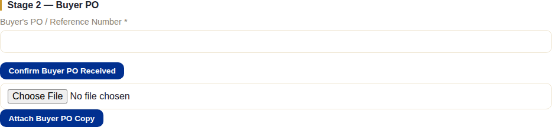
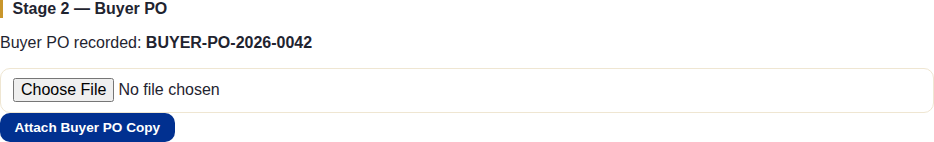
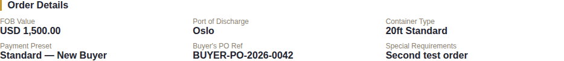
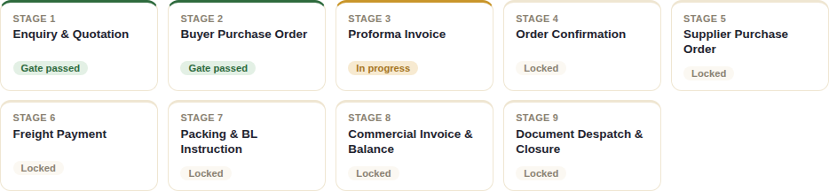

# Stage 2 — Buyer Purchase Order

## What this stage is for

Getting the buyer's own Purchase Order — their formal commitment to the
order — on file before staff issue the Proforma Invoice.

## The system does this automatically

- Nothing until staff act. There's no client-portal step here at all (the
  buyer doesn't yet have portal access — see Stage 3).

## What staff do

Step 4 on the order page has four sub-steps, done in order:

1. **4a · Generate Buyer PO** — produces the BUYERPO PDF: NexaCrest's own
   purchase-order-style document, pre-filled with everything from the
   Quotation, with a blank "Buyer Acceptance" section at the end for the
   buyer to sign and return. This is the document that gets sent out —
   generating it does **not** pass the gate.

2. **4b · Send Buyer PO Action Link** *(optional)* — generates a
   no-login link (emailed to the client when they have an email on file,
   and shown with **Copy Link** to send any other way). On that page the
   buyer **downloads the Buyer PO** from 4a (available once it is approved,
   or sent while email is on), signs it, and **uploads the signed copy
   with their PO number**. When they do, **Step 4 completes by itself**:
   the copy is attached (4c), their PO number is recorded and Stage 2's
   gate passes (4d), and the order's team is notified. The same link is
   used again at Step 6b for the Order Confirmation. If the buyer can't
   use it, carry on with 4c and 4d yourself — 4b never blocks them.

3. **4c · Attach Buyer PO Copy** — keep the buyer's actual signed PO on
   file. Staff upload the copy the buyer emailed, **or the buyer uploads
   it themselves** through the Buyer Action Link (4b) or their client
   portal; either way it appears in this list, marked "The buyer
   (self-uploaded)" or "Staff". Every upload is kept, nothing
   overwritten. Attaching a copy does **not** set the reference number or
   pass the gate on its own.

4. **4d · Confirm Buyer PO Received** — type the buyer's own PO reference
   number. **This is the action that passes Stage 2's gate** and
   completes Step 4 (unless the buyer already did it through the link).
   While a copy is required (see the wet-signature gate below) this
   sub-step shows "Attach the buyer's signed PO copy in Step 4c first"
   instead of the form until one is on file.

> **Common confusion this causes:** if staff attach the buyer's PO copy but
> never separately type the reference number into "Confirm Buyer PO
> Received," the order's **Buyer's PO Ref** in the "At a Glance" panel at the top
> panel will still read a plain "NIL" — even though a file is clearly on
> record. The system
> now shows *"Not yet recorded — N file(s) attached"* instead of a bare NIL
> in that situation, precisely so this half-done state is visible rather
> than looking like nothing happened at all.

> **Wet-signature gate:** by default (**Admin & Settings → the
> `wet_signature_required_buyer_po` toggle**, on unless an Admin has
> turned it off), typing the reference number alone is **not** enough —
> "Confirm Buyer PO Received" (4d) is refused until at least one file is
> on record under "Attach Buyer PO Copy" (4c). This closes the loophole where
> a stage could be confirmed "signed" with zero physical evidence ever
> attached to the order. Turn the toggle off only for a workflow that
> genuinely doesn't need the physical copy.

Once confirmed, the order updates immediately:

## What the client does (or doesn't)

The buyer's role here happens **entirely outside the system**: they receive
the Buyer PO document (however staff send it), sign the "Buyer Acceptance"
section by hand, and return it. There's no client-portal screen for this at
this exact moment — they have no portal login yet at all at this point.
Getting their signed PO back to staff (email, courier, whatever channel) is
on them, but nothing in the system tracks or reminds them to do it — unless
staff send the **Buyer PO Action Link** (Step 4b above), which gives the
buyer a public, no-login page — laid out like the Quotation details form,
with numbered sections — to download the Buyer PO and upload the signed
copy with their PO number, before any portal account exists.

Once the client does get portal access (from Stage 3 onward, once a PI-stage
or OC-stage link has been generated — see [Chapter 12](./12-client-portal.md)),
a **"Buyer PO" section on their order page** lets them upload a scanned copy
of their own signed PO themselves, rather than relying solely on emailing it
to staff and waiting for a staff member to attach it internally. This writes
to the exact same `order_buyer_po_documents` table the internal upload uses,
so every copy — staff- or client-uploaded — shows up together with full
version history (an upload never overwrites an earlier one).

**This self-upload option — on both the Buyer Action Link and the portal —
closes once the advance payment is marked cleared** (90-item backlog #19):
by then the Buyer PO has already done its job and staff have already built
later documents against the copy on file, so a further self-upload is
refused, with a message pointing the buyer to their NexaCrest representative
if they genuinely need to submit an updated copy. Before that point, it's
available "at any time" as described above.

## What happens next

Stage 3 (Proforma Invoice) unlocks the moment "Confirm Buyer PO Received"
is submitted. See [Chapter 3](./03-stage3-pi-advance.md).
