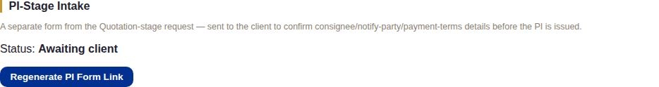
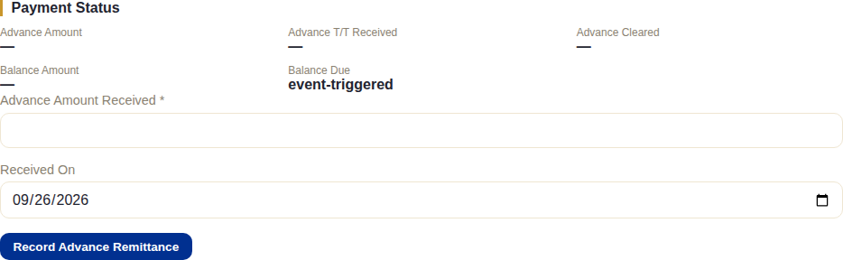
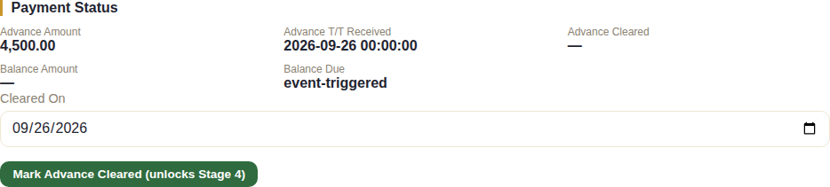
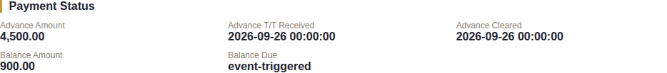
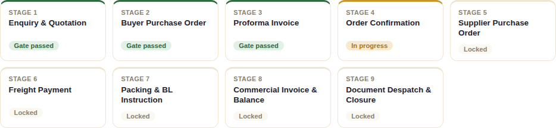

# Stage 3 — Proforma Invoice / Advance Payment

## What this stage is for

Locking down the exact shipment details the buyer will be invoiced on (who
receives the goods, which port, which Incoterm, how payment will actually be
split) and then generating the PI itself, whose real purpose is to trigger and
collect the advance payment before production or procurement begins.

## The system does this automatically

- **Nothing progresses this stage on its own.** The one thing the system
  does automatically is the client-portal login: the moment staff mark the
  advance payment cleared (or, on a Letter of Credit order, confirm the LC
  usable), a client login is created behind the scenes —
  the buyer never had to ask for one and staff never had to create one by
  hand. See "What happens next" below.
- The Balance Due date shown in Payment Status has no fixed date yet when
  the advance is cleared (gap list G-2, owner 1 Nov 2026):
  - **Balance before shipment** (e.g. *Standard — New Buyer*): it reads
    **"event-triggered"** — the balance is due when the goods are ready to
    ship, not on a calendar date.
  - **Balance against the BL** (e.g. *Established Buyer — Post-BL*) and
    every **Letter of Credit** order: it reads **"set when the scanned BL
    is sent to the buyer (Step 11b)"**. The day staff mark the scanned BL
    sent, the due date becomes that day plus the order's balance days
    (7 on the standard presets). Only then can it show as overdue — on
    the dashboard, the order list and as a daily reminder.

## What staff do

On the order page this is **Step 5 · Proforma Invoice & Payment**, worked
in this order:

| Sub-step | Cash advance order | Letter of Credit order |
|---|---|---|
| **5a** | Generate PI Form Link | same |
| **5b** | Apply the Client's PI-Stage Confirmation | same |
| **5c** | Generate Proforma Invoice | same |
| **5d** | Record Advance Remittance | Record LC Details |
| **5e** | Mark Advance Cleared | Confirm LC Usable |

Which column applies comes from the order's payment preset: an order on a
Letter of Credit preset (e.g. *Irrevocable Letter of Credit at Sight*)
shows "payment method for this order: **Letter of Credit**" above 5d and
the LC cards; every other order shows **Cash Advance**. Each sub-step opens
once the one before it is done. If the client won't use the PI-stage form,
open **Client won't use the PI-stage form? Skip it** in 5a or 5b, give a
short reason and press **Skip PI Form — go to Generate PI**.

### First, optionally: the PI-stage intake form

This is a **second, separate confirmation step** from the Quotation-stage
intake in Chapter 1 — different form, different purpose, different review
queue. Once the Quotation is out, staff can generate a one-time link
(**Generate PI Form Link** in Step 5a — **Regenerate PI Form Link** once
one exists; **Copy Link** copies the current one) and send it to the buyer to
confirm the exact details that will appear on the PI and later shipping
documents — consignee details, notify party, port of discharge, confirmed
Incoterm, container type, payment-terms confirmation, and Country of Origin
type — fields the Quotation stage never asked for.

The buyer fills in **Consignee Details** and **Notify Party** here the same
way staff would on the admin Clients form: a **Same as Buyer?** checkbox
(Consignee) and a **Same as Consignee?** checkbox (Notify Party), both
checked by default. Leaving a box checked means that section's fields stay
disabled and resolve dynamically from whichever party it's "same as" —
exactly the always-fresh resolution described in Chapter 1 — so a buyer
only needs to uncheck a box and fill in independent details when the goods
genuinely ship to, or need notifying, a different company than their own.

The "Your Details" section (company name, billing address, consignee,
VAT/EORI/tax no., contact person, email, phone) and the Incoterm/port of
discharge/container type fields in Shipping Details arrive **pre-filled**
from the client record and the order itself — the buyer already gave this
information at the Quotation stage, so they only need to review it and
correct anything that's changed, not retype it from scratch. Of the
genuinely new fields, acceptance-of-quotation reference, buyer PO/reference
no., changes from quotation, and special document requirements start
blank — but Payment Terms Confirmation does not: it arrives **pre-filled**
with this order's own exact payment-terms sentence (advance %, trigger
condition, balance %, balance-trigger wording), computed the same way the
PI document itself prints it, so the buyer reviews and confirms real terms
rather than typing an answer to a vanishing example. If the buyer edits a
pre-filled value and the submission is later rejected, their own corrected
answer is what reappears on the form when they come back — never the
original client-record default.

The Billing Address field here is structured the same way as the
Quotation-stage form (Chapter 1) — Line 1 (required), Line 2, City
(required), Postcode, Country (required) — rather than one free-text
blob, since documents need these as discrete fields. The older
single-field Billing Address column is composed automatically from these
parts behind the scenes.

This step is **entirely optional and never blocks anything** — staff can
generate the PI without it ever being sent or completed. When a submission
does come back, it lands in **Orders › PI-stage details**
(`/pi-intake-review`), separate from the Quotation-stage queue — each has
its own live count on its own Orders menu-bar item (PI-stage details), so the two never get
confused with each other — where staff either:

- **Accept** — this is the authoritative correction point for the client's
  identity fields: accepting **overwrites the live client record** with
  exactly what the buyer confirmed (the PI Form spec requires these fields
  to match official documents exactly) — including the Consignee/Notify
  Party "Same as X?" flags and every structured field underneath them —
  locks the client's data from further edits, and — if the buyer supplied
  one — records the Buyer's PO Ref on the order. 90-item backlog
  "standalone order" follow-on: that same confirmed Buyer/Consignee/
  Notify Party data is also written onto *this order's own* snapshot
  columns at the same moment, so this order's documents reflect the
  correction immediately. Accepting it also counts as saving the client:
  the client's other running orders follow the corrected details — at once
  where nothing is issued yet, through an approved request where a
  document is already issued (D-337; see
  [SOP 17](./17-order-edit-duplication.md#buyer-details-after-the-client-is-corrected-d-337)). Everything else on the submission
  (payment-terms confirmation, confirmed Incoterm/port,
  quotation-acceptance reference, any changes from the quotation) stays
  visible on the order for staff to read before generating the PI, but is
  never auto-written into the order's own structured fields — except the
  **Certificate of Origin Type**: the one the client confirmed is written
  onto the client record *and* this order, so the PI, CI and Certificate
  of Origin worksheet print it. A blank ("not sure") answer keeps the
  value already on file.
- **Reject** (with a reason) — the buyer can resubmit via the same link.

### Generating the PI

In **Step 5c**, click **Generate Proforma Invoice** (PDF always; tick DOCX
for an editable copy). Generating the PI **does not pass Stage 3's gate** —
the gating action here is a payment event (5e). But 5e is refused until the
PI is **approved** (buyer e-mails held) or **sent** to the buyer (buyer e-mails sent), so take it through
[Document Review & Approval](./13-document-review-approval.md) first.

### Price check before the PI (owner decision D-245 P2, 4 Nov 2026)

**Generate Proforma Invoice** is refused while a line picked from Products is
below the lowest price of whoever sells the order, below the product's minimum
price, or picked from a product with no price set — e.g. "Line 1 is below the
lowest price for this order — raise it, or ask the MD to approve it, before the
Proforma Invoice (order page → Products)." Step 5c shows the same in red.

The **Price check** inside the Products card lists those lines with **Ask MD to
approve line N**; only the MD (permission "Manage pricing") approves, down to the
minimum price and never below, with a reason. An approval holds while the line
keeps that price. The line prices and the exchange rate were already fixed when
the order's first Quotation was approved (D-342) — the PI uses exactly those
prices (if no Quotation was approved, approving this PI fixes them, D-370), and a line can be changed only through a Products & prices amendment
([Amendments](./10-amendments.md)); when the PI is generated each checked line's
figures are stored on the line as well. The Quotation (Step 1) is checked the
same way. Details:
[Pricing](./27-pricing.md#prices-on-order-lines-phase-p2).

- The Price check is never on a document or in the client portal.

**What the PI asks the buyer to pay** (owner decision 2026-10-28). Under the
second **TOTAL PI VALUE** the PI (PDF and Word) prints an amber box:

- **ADVANCE PAYABLE NOW** — the advance amount, its % of the FOB value, and
  "due by" the PI's own Valid Until date;
- the **balance**, marked "not payable now", with the order's balance terms
  (and, on CFR, that freight is — on CIF, that freight & insurance are —
  paid against the Debit Note);
- **Bank charges:** "All bank charges outside India are for the Buyer's
  account — please remit the full amount (charges option "OUR")."

Payment Terms ends with: "The order is confirmed, and production starts,
only once the advance is received in our account as cleared funds." Every
buyer payment deadline on the PI, in PDF and Word alike, is in **Calendar
Days**. Since 12 Nov 2026 (D-355) the lines under the PAYMENT TERMS heading
sit in a light grey-blue box with a navy left edge, with only the money
figures in bold — the same on the Quotation.

**No advance** (owner decision 2026-10-28 — e.g. the *Irrevocable Letter of
Credit at Sight* preset, 0% advance): the box reads **"NO ADVANCE PAYABLE —
the full FOB value … is payable by Letter of Credit."** (or "… as below" on
any other 0% terms) with the order's payment terms under it, never
"ADVANCE PAYABLE NOW: 0.00". The cleared-funds sentence is left out, and the
PI Validity clause asks only for acceptance within the validity period.
Payment Terms show no "0% Advance" lines: they read "100% Payment on FOB
Value by Letter of Credit — …" and "100% Amount: …", and the Production
Commencement clause says production starts once the Letter of Credit is
opened and confirmed by NexaCrest's bank. The **Quotation** carries the same
Payment Terms and production clause, and its bank-details notes speak of
"payment", not "advance payment". The **Order Confirmation** reads "This
order is confirmed upon receipt of the Letter of Credit against the
referenced Proforma Invoice", and its Payment Status shows one row,
"Payable by Letter of Credit", instead of the advance rows.

### Recording and clearing the advance payment

Before anything is recorded, Payment Status shows everything blank:

This is two separate steps, deliberately kept apart so a wire transfer that's
been sent but not yet reconciled against the bank statement isn't confused
with money that's actually landed:

1. **Record Advance Remittance** (5d) — the card shows the **advance due**
   (e.g. *USD 3,000.00 — 40% of the order value USD 7,500.00*) and fills it
   in. Enter what the bank actually received. An amount above the whole
   order value is refused. The form shows, read-only, **Buyer to pay now**
   with the working (*advance due USD 3,000.00 − already received USD
   0.00*; owner request 3 Nov 2026) — the same line is on every buyer
   remittance form (freight, balance, milestones). When the amount differs from the advance still
   due, choose a reason under **"Why is it different?"** (owner, 2 Nov
   2026) — the first receipt must say why if it is more than 1% off, and
   any amount above what is still due always must, so a typing mistake
   can't flow into the Order Confirmation. The reason is a **drop-down of
   the usual reasons** (e.g. *Intermediary / correspondent bank charges
   deducted*, *Buyer deducted an agreed discount*, *Buyer paid extra —
   adjust against balance*), kept by Admin under **Settings › Lists › Remittance difference reasons** (Stage 15 SOP). Only the reasons that fit the
   amount typed are offered — less than due: bank-charges and
   buyer-paid-less reasons; more than due: buyer-paid-more reasons — and
   the server checks the same. When none fits, choose **"Other — type the
   reason"**: type the reason in your own words (at least 10 characters)
   and choose how to treat it. The reason chosen or typed is kept on the
   receipt, shown in the receipt history, and added to the payment's
   description ("· Reason: …"). Each reason is treated one of three ways:
   - **Bank charges deducted by the banks** — the advance counts as
     received in full. The charges (filled in with the difference; change
     them if the bank's advice shows another figure; at most the
     *max_bank_charges_pct* setting, 3% of the amount due) become an order
     cost "Bank Charges" with a description built from the facts (rule
     D-212: "Bank charges deducted from <buyer>'s advance remittance for
     order <ref>: received USD 4,980.20 of USD 5,000.20 due, charges USD
     20.00 (₹1,812.00) · bank ref <UTR>"), and go to Zoho Books with the
     customer payment at the next sync (hourly, or Sync now), so the
     invoice is settled in full there too.
   - **Buyer paid less (short payment)** — recorded as received; record the
     rest when it arrives, or a manager with "Approve short payment" clears
     the advance short and the difference is carried into the balance.
   - **Buyer paid more** — recorded; the balance due goes down by the same
     amount.
   A line under the form shows what will be saved, e.g. *Due USD 5,000.20 ·
   Received USD 4,980.20 · Difference USD 20.00 → recorded as bank charges
   ₹1,812.00 (cost) — advance counted as fully received*. The receipt
   history shows each receipt's reason and any bank charges.

   **Our bank's charges on this credit** (optional, owner 2 Nov 2026) — when
   our own bank debits an inward-remittance fee for this credit (for
   example SBI's fee + GST, debited separately in rupees), type it here from
   the bank advice. It is booked at once as an order cost **"Bank Charges"**
   (paid from the company account) with the description *"Our bank's inward
   remittance charges on <buyer>'s <advance / freight / balance /
   milestone> remittance for order <ref>, ₹<amount> incl. GST · bank ref
   <UTR>"*, so nobody books it again later. It does not change the amount
   received or clearing. Like every Bank Charges cost it is **not** sent to
   Zoho Books — the CA books bank charges from the bank statement (owner
   decision 29 Oct 2026). Leave it empty when the bank charged nothing or
   the fee is not yet known.
   Staff type the amount received, the date and — from the bank's credit
   advice — the **INR credited by the bank (₹)**, once the buyer's T/T
   notification comes in (owner decision D-244, 4 Nov 2026). The exchange
   rate is no longer typed: the form shows **Exchange rate (worked out: ₹ ÷
   USD)** live and read-only, and reads back "We received USD 1,800.00;
   ₹149,850.00 credited by the bank — exchange rate worked out ₹83.2500" as
   you type. That rupee figure becomes the leg's INR actual at once (the
   sum of the receipts when the buyer paid in parts), so the CA register,
   profit, CAFIN and the Zoho Books payment all use what the bank really
   credited.
   - **Bank's rate on the advice** (optional): type the rate printed on the
     advice to check the INR. If amount × that rate and the INR credited
     are **₹1 or less** apart (rounding), it saves as it is. **More than
     ₹1** apart, the form asks **"Why is the INR different from the bank's
     rate?"** and will not save without an answer (the server checks the
     same):
     - *The bank deducted its charges — book the difference as Bank
       Charges*: the difference is booked at once as an order cost **Bank
       Charges** (company account, linked to the receipt) with the
       description *"Bank charges deducted in rupees from <buyer>'s advance
       remittance for order <ref>: USD 1,800.00 at the bank's rate ₹83.2500
       = ₹149,850.00, credited ₹149,348.00, charges ₹502.00 · bank ref
       <UTR>"*. The receipt is then valued at the bank's rate, so the
       charges are counted once — as the cost — and go to Zoho Books with
       the customer payment as bank charges (the cost itself is not sent to
       Zoho, as for every Bank Charges cost). Only possible when less
       arrived than amount × the bank's rate.
     - *I typed something wrong — let me correct it*: nothing is saved; the
       form takes you back to the INR credited — correct the amount, the INR
       or the bank's rate.
     - *Other reason — type it*: at least 10 characters; kept on the
       receipt and in the audit log; the rate stays the one worked out from
       the INR.
   - **INR not known yet — enter the rate**: tick it when the bank has not
     told you the rupees yet. The old **Exchange rate** box comes back
     (required) and the INR stays empty; the CA INR Settlement Register then
     shows the amount at that rate marked **"estimated at recorded rate"**
     until someone with "Add/edit INR actual" enters the real INR in the
     INR actual box.
   - This is separate from **"Why is it different?"** above (the foreign
     amount that arrived compared with what was due, e.g. USD charges
     deducted on the way) and from **"Our bank's charges on this credit"**
     (a fee our bank debits separately): each is booked once, on its own.
   The receipts list shows each receipt's **INR credited** (or "not known
   yet") and, where the bank's rate differed, what was decided.
   The **Bank reference** (SWIFT / UTR /
   the reference on the bank's credit advice) is required too (rule D-212,
   2026-10-31): the payment's description — here and in Zoho Books — is
   built from it, so the payment can always be matched to the bank
   statement ("Advance received from <buyer> for order <ref> · USD 1,600.00
   at ₹84.10 · against Proforma Invoice <no.> · bank ref <ref>"). The freight
   and balance remittances work the same way. This does **not** pass the
   gate yet:

   **Paid in parts (gap list G-5, 1 Nov 2026).** If the buyer pays the
   advance (or the freight, the balance or a milestone) in more than one
   wire, record each wire as it arrives — the card then shows **Record
   Another Advance Receipt**. Each receipt is kept with its date, amount,
   rate, bank reference and who recorded it; the card lists them with
   **Due · received so far · still owed** (or "paid … more than due").
   The payment's totals (amount, latest date, the amount-weighted rate and
   the bank references, e.g. "bank ref UTR0001, UTR0002") are what the
   documents, Zoho Books and the reports use. Once a payment is cleared,
   no more receipts can be added to it.

   **Clearing while money is still owed** is refused ("Advance received so
   far: USD 1,500.00 of USD 1,800.00 due — USD 300.00 is still owed. …").
   Only a manager with **Approve short payment** (MD, ED, Admin, Finance
   Director) can clear it short, writing the reason (10–500 characters).
   A manager who recorded the receipts themselves is refused ("You recorded
   this payment's receipts, so a different manager with "Approve short
   payment" must clear it short.") unless their role is ticked in Users & roles › Self-approval rules (default MD and ED; QA Round 8, R8-N09).
   The shortfall is recorded and shown on the order with the reason and
   who approved it: on the advance it is **carried into the balance** (the
   balance is always the order value less the advance actually received);
   on the freight, the balance or a milestone it is **written off**, and
   the manager also chooses **what the short is**: an agreed discount, a
   settled buyer claim, or not paid by the buyer (D-245 P3; this decides an
   associate's commission, chapter 24).
   A middle milestone keeps one receipt (its line prints on the PI/OC);
   a short one is cleared the same way.

   

2. **Mark Advance Cleared (unlocks Stage 4)** (5e) — staff confirm only once
   the funds have actually been verified against the bank statement, and
   enter the **Cleared On** date. Only staff who can clear payments see
   this button; others see "awaiting Accounts to confirm it cleared". A
   confirmation dialog spells out exactly what this does before it happens:
   *"Mark the advance payment cleared? This unlocks Stage 4 and
   auto-provisions the client portal login — confirm the funds have
   actually landed first."* **This is the action that passes Stage 3's
   gate.**

   

### Letter of Credit orders: 5d Record LC Details, 5e Confirm LC Usable

On a Letter of Credit order there is no advance to record. Instead:

1. **Record LC Details** (5d) — the **Issuing Bank**, **LC Number**, **LC
   Amount** (required, in the order currency), **LC Charges** billed to
   the client, and optionally the LC document itself. This does not pass
   the gate.
2. **Confirm LC Usable (unlocks Stage 4)** (5e) — once the advising bank
   has confirmed the LC. The dialog warns that this unlocks Stage 4 and
   creates the client's portal login. **This is the action that passes
   Stage 3's gate** on an LC order. Like 5e on a cash order, it is refused
   until the PI is approved (email off) or sent (email on).

**LC dates and amendments** (gap list G-4, owner 1 Nov 2026). On an LC
order, the **Letter of Credit & Bank Loan** card under Step 5 holds:

- **LC issued on**, **Last shipment date**, **Deadline to present
  documents** and **LC expiry** — open **Record or change the LC dates**
  (Accounts/Export, "Manage payments"). The last shipment date and the
  presentation deadline cannot be after the expiry, and none of the three
  can be on or before the issue date. The bank can refuse to pay if one is
  missed, so each date is reminded **once, 7 days before**, to Admin/MD
  and the order's assignees (daily alerts job). While a date is within 7
  days or past, and the bank has not yet paid under the LC, the card opens
  by itself and shows **LC date within 7 days** / **LC date passed**.
- **LC amendments** — **Record an LC amendment**: the date (today or
  earlier), the amendment number or reference, what changed, and
  optionally a copy (PDF or image). Every amendment stays listed, oldest
  first. If an amendment changes a date, update the LC dates as well.
- Loan interest stays one total, in Order Financials (below).

The **Payment Action Link** box is not shown on an LC order's 5d. When the
bank later pays under the LC, that money is recorded in **Step 12a → LC
Payment Received** (see [Order
Financials](./ca-08-order-financials.md#4-letter-of-credit--bank-loan)); a
bank loan taken against the LC is recorded there too.

If the buyer has self-reported a payment through their own portal (see
[Client Portal](./12-client-portal.md)), it appears further down this same
section under **Client-Reported Payments** — purely informational, and the
page explicitly warns staff to always verify against the actual bank
statement before recording anything above, never to record a payment based
on the client's self-report alone.

### The Payment Action Link (owner request 2026-10-27)

A no-login link where the client sends their payment details: the
**bank reference number (transaction ID, UTR or SWIFT reference)**, the amount, the date, the
account they paid from, and a **screenshot or bank receipt of the payment (required)** (buyer
wording D-330). It shows **payment only** — never
the Buyer PO or the Order Confirmation — and only **one payment at a time**:

| Where the order is | What the client sees on the link |
|---|---|
| Document for the next payment not issued yet | "Nothing to pay right now", naming the next payment |
| PI issued, advance not cleared | **Advance Payment** — Download Proforma Invoice, the amount due, the form |
| Advance details sent | "We're checking your advance payment" (no form) |
| Debit Note issued (CFR/CIF only), freight not cleared | **Freight and insurance** — Download freight bill (debit note), the amount, the form |
| CI issued, balance not cleared | **Balance Payment** — Download Commercial Invoice, the balance due, the form |
| Every payment cleared | "All payments received — thank you" |

How the client gets it:

- **Automatically in the email** — the Proforma Invoice, Debit Note and
  Commercial Invoice emails end with *"PAYMENT DETAILS: once you have
  completed the payment, please upload the payment screenshot together with
  the transaction details … on this secure link"*. It is the same link
  each time.
- **From the order page** — Steps **5d**, **9c** and **11c** each have a
  **Payment Action Link** box (optional, never locks a step): copy the
  current link, or **Generate & Email Payment Link** (which replaces any
  older link).

When the client sends their details, the order team is notified. Like every
client self-report this is **information only** — staff still check the bank
statement and record the remittance in 5d / 9c / 11c themselves.

### The order keeps its own terms once the PI is approved (owner decision D-262, 6 Nov 2026)

The moment the **first PI of an order is approved**, the order keeps its own copy of
everything a later change in Admin could otherwise alter. From then on, every document of
that order (OC, CI, PL, COO, AMD, BLE, CAFIN and the rest, and any re-issue) prints these
kept values, and the order's gates and money use them:

| Kept with the order | What a later change in Admin no longer does to this order |
|---|---|
| The T&C clauses (title, text, set, show/hide) for every document type | An edited or retired clause is not printed on its documents |
| The quantity shortfall tolerance % and the quotation / PI validity days | The tolerance printed and the packing gate (Step 7) stay at what the buyer agreed to |
| The company details: bank, branch, account, SWIFT, IFSC, LUT, RCMC, IEC/PAN, GSTIN, addresses, director, phone, e-mail, RBI purpose codes, disclaimer | A new bank account or LUT number is not printed on this order |
| The product category settings (packing words, quality documents, clause set) | A category edit does not change its packing words or quality documents |
| The payment preset's "Requires MD approval" flag (the preset name was already kept) | Ticking or unticking the flag later neither blocks nor frees this order |
| The pricing exchange rate (for a USD-per-unit commission or incentive on a non-USD order, D-245) | A new rate does not change the commission or incentive of this order |
| Each line's Zoho item | The CI goes to Zoho Books with the item it was approved with |

**Before the PI is approved** nothing is kept yet: a quotation and an unapproved PI follow
today's settings, exactly as before. A new order therefore prints exactly as it always did.

**A real change (for example a new bank account).** The Managing Director can open the
order, Step 1, and use **Refresh company details on this order** in the box "Kept with this
order since the PI was approved". A reason of at least 10 characters is required, and the
browser asks "Use today's company details (bank, LUT, IEC, address) on this order's next
documents?" first — Cancel changes nothing. Only the
company details are replaced with today's (bank, LUT, IEC, address and the rest); the
clauses, tolerance and validity days stay as kept. The change is written to the audit log
with the old and new values and the reason. Documents already issued are not changed; the
next document prints the new details.

## Payment Snapshot and Payment Ledger

Two read-only panels sit right above Payment Status on the order page, and
stay there for the rest of the order's life (they fill in further as
freight and balance legs happen in later stages):

- **Payment Snapshot** — a compact at-a-glance summary of the Advance,
  Freight, and Balance legs, each shown as either an amount + status
  ("5,000.00 USD — Received, pending clearance") or status only
  ("Received, pending clearance") depending on what the viewer is
  permitted to see (below).
- **Payment Ledger** — a single chronological table of every
  payment-related event recorded against the order so far: each leg's
  remittance-received and cleared events, plus every client-self-reported
  payment (see below) — consolidating what used to be scattered across the
  Payment Status kv-grid and the separate Client-Reported Payments table.
  It is purely a read-only history; nothing here can be edited — use the
  forms in Payment Status (or the freight/balance equivalents at their own
  stages) to record a new event.

  **Full ledger for Order Financials holders** (owner decision
  2026-10-26): staff with `manage_order_financials` (Admin/MD/ED by
  default) see every money event on the order in the same table — each
  buyer remittance with the exchange rate recorded with it and its INR
  value, the supplier's advance and balance payments, every expense
  (ECGC premium, inspection fee, travel, CHA, port and bank charges, …),
  and any export benefit claimed/received — with **In (₹)** / **Out (₹)**
  columns and totals underneath: received from the buyer, export benefits,
  paid to the supplier, expenses, and the **net so far**. Everyone else
  keeps the buyer-receipts view above. **Full Status** likewise shows the
  freight leg and exchange rates, plus supplier payments, expenses and net
  for the same Order Financials holders. Every figure comes from the
  order's own records.

**Amounts are permission-gated**, the same way as Payment Status itself:
anyone who can view the order sees each leg's status, but the actual
figures are only shown to staff who can manage payments or close the order
(`manage_payments` or `close_orders` — Accounts, Export, Logistics, Admin/
MD/ED by default, Super Admin always). A role or a per-user override that
carries `manage_orders` without either of those two permissions sees "Only
shown to Accounts/Logistics/Export staff" instead of a number — "only able
to see the needed things."

## What the client does (or doesn't)

- **PI-stage intake form**, if staff sent it: the buyer fills in consignee/
  notify-party/shipping/payment-term-confirmation details on a public,
  no-login page (`/pi-details/{token}`) and must tick a confirmation box
  stating the details are correct before submitting — this is the same
  consent that permanently locks their data once staff accept it.
- **The advance payment itself** happens outside the system — the buyer
  wires the funds. They send us the payment details (screenshot,
  transaction ID, amount, date) on the **Payment Action Link** that comes
  with the PI email (see above); staff still confirm against the bank
  statement.
- **Self-reporting a payment** (optional): once their portal login exists,
  the buyer can submit a payment report themselves — but at this exact
  point in Stage 3 they don't have a portal login yet, since it's only
  created once the advance is cleared. The portal's own self-report screen
  therefore only ever actually gets used for a *later* leg (freight at
  Stage 6, balance at Stage 8). For the advance payment specifically
  (90-item backlog #48), the buyer instead gets a narrow self-report option
  on their Buyer Action Link page (see [Chapter 2](./02-stage2-buyer-po.md)
  and [Chapter 4](./04-stage4-order-confirmation.md)) — transaction ID/UTR,
  amount, date, and an optional screenshot, writing to the same
  `client_payment_reports` table the portal uses. Like the portal's own
  version, this is purely an informational note to staff, never a stage
  gate or a payment record by itself; staff still verify the real bank
  statement by hand before marking the advance cleared above. This option
  on the Buyer Action Link disappears once the advance is marked cleared —
  there's nothing left to report by then.

## Payment milestones — the order's own schedule (D-215)

Most orders are paid as advance + balance. When a buyer agrees to pay in
more steps (for example 30% advance, 50% on shipment, 20% on delivery),
give the order its own schedule **before the advance is cleared**:

1. On the order page, open **Payment Overview** and scroll to **Payment
   schedule**.
2. Open **Change the schedule** and fill one row per step between the
   advance and the balance: its **%** of the FOB value and **when it is due**
   (e.g. "on shipment — within 3 Calendar Days of receiving the scanned
   Bill of Lading"). Up to 4 milestones. The balance becomes what is left;
   the advance, milestones and balance always add up to 100%.
3. Click **Save Payment Schedule**, then **regenerate the Proforma Invoice**.
   Its Payment Terms section then shows one bullet per milestone with its
   amount; the Order Confirmation shows one "Payment Due" row per milestone.

Leave every row empty to go back to plain advance and balance. The schedule
is fixed once the advance is cleared or any milestone money is recorded;
after that, change it with a payment terms amendment.

Each milestone is its own payment:

- **Record the remittance** (Accounts): amount received, the day's exchange
  rate, the bank reference (UTR / SWIFT — required) and the date. The app
  writes its description from the facts, e.g. "Milestone 2 (50% on shipment
  — …) received from <buyer> for order <ref> · USD 2,250.00 at ₹84.10 ·
  against Proforma Invoice <PI no.> · bank ref UTR778899". A note you add is
  appended, never a replacement.
  The amount cannot exceed the whole order value. If it differs from the
  milestone due by more than 1% (for example, bank charges deducted), the
  form asks you to tick "The amount received differs from the milestone
  due" before it saves.
- **Mark it cleared** once your bank confirms. The next revenue sync sends it
  to Zoho Books as a customer payment with that description — applied to the
  Commercial Invoice once the CI is in Books, held until then otherwise.
- The **balance cannot be marked cleared** until every milestone is cleared.

The **Commercial Invoice** shows one row per milestone (received or pending,
with its date and bank reference), counts the milestones received in
"Subtotal already paid", and asks only for what is left as "Balance due now"
(FOB value minus the advance and the milestones received); its verification
line reads "Advance + Milestones + Balance = FOB Value". The buyer's pay-now
link and payment page ask for the same balance. Orders without milestones
print exactly as before.

Not changed by milestones: the Quotation (it prints advance and balance as
before) and the CA financial annexure (CAFIN), which still counts advance and
balance only — a change to those needs the owner's double confirmation first.

## What happens next

The moment staff mark the advance payment cleared (or confirm the LC
usable):

- **Stage 4 (Order Confirmation)** unlocks — see [Chapter 4](./04-stage4-order-confirmation.md).
- **The client portal login is created automatically**, behind the scenes,
  for this order's client — nobody has to remember to do this by hand. This
  is the earliest point in the pipeline the buyer can log in and see
  anything in the system themselves; everything before this stage (the
  public intake forms) required no login at all.
