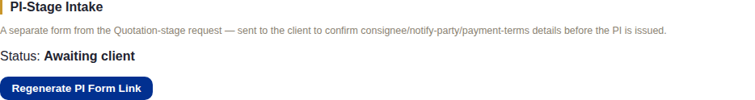
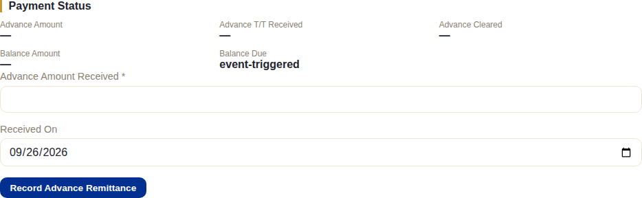
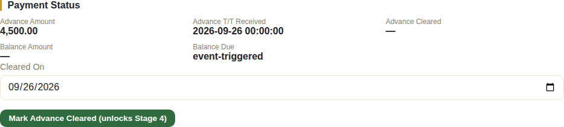
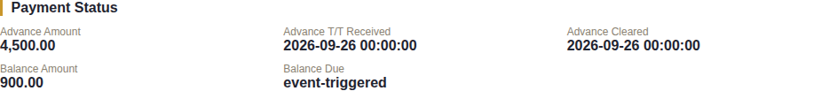
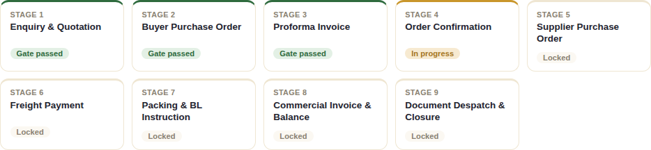

# Stage 3 — Proforma Invoice / Advance Payment

## What this stage is for

Locking down the exact shipment details the buyer will be invoiced on (who
receives the goods, which port, which Incoterm, how payment will actually be
split) and then generating the PI itself, whose real purpose is to trigger and
collect the advance payment before production or procurement begins.

## The system does this automatically

- **Nothing progresses this stage on its own.** The one thing the system
  does automatically is the client-portal login: the moment staff mark the
  advance payment cleared, a client login is created behind the scenes —
  the buyer never had to ask for one and staff never had to create one by
  hand. See "What happens next" below.
- The Balance Due date shown in Payment Status reads **"event-triggered"**
  rather than a fixed date — the balance isn't due on a calendar date, it's
  due when a later event (typically BL issuance, per the order's own
  payment terms) happens. The system doesn't try to guess that date ahead
  of time.

## What staff do

### First, optionally: the PI-stage intake form

This is a **second, separate confirmation step** from the Quotation-stage
intake in Chapter 1 — different form, different purpose, different review
queue. Once the Quotation is out, staff can generate a one-time link
(**Regenerate PI Form Link**, on the order page) and send it to the buyer to
confirm the exact details that will appear on the PI and later shipping
documents — consignee details, notify party, port of discharge, confirmed
Incoterm, container type, payment-terms confirmation, and Country of Origin
type — fields the Quotation stage never asked for.

The buyer fills in **Consignee Details** and **Notify Party** here the same
way staff would on the admin Clients form: a **Same as Buyer?** checkbox
(Consignee) and a **Same as Consignee?** checkbox (Notify Party), both
checked by default. Leaving a box checked means that section's fields stay
disabled and resolve dynamically from whichever party it's "same as" —
exactly the always-fresh resolution described in Chapter 1 — so a buyer
only needs to uncheck a box and fill in independent details when the goods
genuinely ship to, or need notifying, a different company than their own.

The "Your Details" section (company name, billing address, consignee,
VAT/EORI/tax no., contact person, email, phone) and the Incoterm/port of
discharge/container type fields in Shipping Details arrive **pre-filled**
from the client record and the order itself — the buyer already gave this
information at the Quotation stage, so they only need to review it and
correct anything that's changed, not retype it from scratch. Of the
genuinely new fields, acceptance-of-quotation reference, buyer PO/reference
no., changes from quotation, and special document requirements start
blank — but Payment Terms Confirmation does not: it arrives **pre-filled**
with this order's own exact payment-terms sentence (advance %, trigger
condition, balance %, balance-trigger wording), computed the same way the
PI document itself prints it, so the buyer reviews and confirms real terms
rather than typing an answer to a vanishing example. If the buyer edits a
pre-filled value and the submission is later rejected, their own corrected
answer is what reappears on the form when they come back — never the
original client-record default.

The Billing Address field here is structured the same way as the
Quotation-stage form (Chapter 1) — Line 1 (required), Line 2, City
(required), Postcode, Country (required) — rather than one free-text
blob, since documents need these as discrete fields. The older
single-field Billing Address column is composed automatically from these
parts behind the scenes.

This step is **entirely optional and never blocks anything** — staff can
generate the PI without it ever being sent or completed. When a submission
does come back, it lands in **Operations → PI Intake Review**
(`/pi-intake-review`), separate from the Quotation-stage queue — each has
its own live count badge on its own sidebar link, so the two never get
confused with each other — where staff either:

- **Accept** — this is the authoritative correction point for the client's
  identity fields: accepting **overwrites the live client record** with
  exactly what the buyer confirmed (the PI Form spec requires these fields
  to match official documents exactly) — including the Consignee/Notify
  Party "Same as X?" flags and every structured field underneath them —
  locks the client's data from further edits, and — if the buyer supplied
  one — records the Buyer's PO Ref on the order. 90-item backlog
  "standalone order" follow-on: that same confirmed Buyer/Consignee/
  Notify Party data is also written onto *this order's own* snapshot
  columns at the same moment, so this order's documents reflect the
  correction immediately and permanently — a later, unrelated edit to the
  client record (or an acceptance on a different order for the same
  client) never reaches back into it. Everything else on the submission
  (payment-terms confirmation, confirmed Incoterm/port,
  quotation-acceptance reference, any changes from the quotation) stays
  visible on the order for staff to read before generating the PI, but is
  never auto-written into the order's own structured fields — except the
  **Certificate of Origin Type**: the one the client confirmed is written
  onto the client record *and* this order, so the PI, CI and Certificate
  of Origin worksheet print it. A blank ("not sure") answer keeps the
  value already on file.
- **Reject** (with a reason) — the buyer can resubmit via the same link.

### Generating the PI

From the order page, under **Documents**, **Generate Proforma Invoice**.
Unlike the Quotation, generating the PI **does not pass Stage 3's gate** —
this is the one stage where the gating action is a payment event, not a
document.

**What the PI asks the buyer to pay** (owner decision 2026-10-28). Under the
second **TOTAL PI VALUE** the PI (PDF and Word) prints an amber box:

- **ADVANCE PAYABLE NOW** — the advance amount, its % of the FOB value, and
  "due by" the PI's own Valid Until date;
- the **balance**, marked "not payable now", with the order's balance terms
  (and, on CFR, that freight is — on CIF, that freight & insurance are —
  paid against the Debit Note);
- **Bank charges:** "All bank charges outside India are for the Buyer's
  account — please remit the full amount (charges option "OUR")."

Payment Terms ends with: "The order is confirmed, and production starts,
only once the advance is received in our account as cleared funds." Every
buyer payment deadline on the PI, in PDF and Word alike, is in **Calendar
Days**.

**No advance** (owner decision 2026-10-28 — e.g. the *Irrevocable Letter of
Credit at Sight* preset, 0% advance): the box reads **"NO ADVANCE PAYABLE —
the full FOB value … is payable by Letter of Credit."** (or "… as below" on
any other 0% terms) with the order's payment terms under it, never
"ADVANCE PAYABLE NOW: 0.00". The cleared-funds sentence is left out, and the
PI Validity clause asks only for acceptance within the validity period.
Payment Terms show no "0% Advance" lines: they read "100% Payment on FOB
Value by Letter of Credit — …" and "100% Amount: …", and the Production
Commencement clause says production starts once the Letter of Credit is
opened and confirmed by NexaCrest's bank.

### Recording and clearing the advance payment

Before anything is recorded, Payment Status shows everything blank:

This is two separate steps, deliberately kept apart so a wire transfer that's
been sent but not yet reconciled against the bank statement isn't confused
with money that's actually landed:

1. **Record Advance Remittance** — the card shows the **advance due**
   (e.g. *USD 3,000.00 — 40% of the order value USD 7,500.00*) and fills it
   in. Enter what the bank actually received. An amount above the whole
   order value is refused; an amount that differs from the advance due by
   more than 1% (bank charges aside) needs the tick **"The amount received
   differs from the advance due"** — so a typing mistake can't flow into
   the Order Confirmation. Staff type the amount received, the
   date, and the **@ Exchange Rate** (₹ per 1 unit of the order
   currency) it was received at, once the buyer's T/T notification comes in. The rate is
   required and is recorded together with the remittance; the form reads
   back "Received USD 1,800.00 at today's exchange rate of ₹83.2500
   (= ₹149,850.00)" as you type. The freight and balance remittances work
   the same way. This does **not** pass the gate yet:

   

2. **Mark Advance Cleared (unlocks Stage 4)** — staff confirm only once the
   funds have actually been verified against the bank statement. A
   confirmation dialog spells out exactly what this does before it happens:
   *"Mark the advance payment cleared? This unlocks Stage 4 and
   auto-provisions the client portal login — confirm the funds have
   actually landed first."* **This is the action that passes Stage 3's
   gate.**

   

If the buyer has self-reported a payment through their own portal (see
[Client Portal](./12-client-portal.md)), it appears further down this same
section under **Client-Reported Payments** — purely informational, and the
page explicitly warns staff to always verify against the actual bank
statement before recording anything above, never to record a payment based
on the client's self-report alone.

### The Payment Action Link (owner request 2026-10-27)

A no-login link where the client sends their payment details: the
transaction ID / UTR, the amount, the date, their bank, and a **screenshot
or bank remittance advice (required)**. It shows **payment only** — never
the Buyer PO or the Order Confirmation — and only **one payment at a time**:

| Where the order is | What the client sees on the link |
|---|---|
| Document for the next payment not issued yet | "Nothing to pay right now", naming the next payment |
| PI issued, advance not cleared | **Advance Payment** — Download Proforma Invoice, the amount due, the form |
| Advance details sent | "We're checking your advance payment" (no form) |
| Debit Note issued (CFR/CIF only), freight not cleared | **Freight & Insurance** — Download Debit Note, the amount, the form |
| CI issued, balance not cleared | **Balance Payment** — Download Commercial Invoice, the balance due, the form |
| Every payment cleared | "All payments received — thank you" |

How the client gets it:

- **Automatically in the email** — the Proforma Invoice, Debit Note and
  Commercial Invoice emails end with *"PAYMENT DETAILS: once you have
  completed the payment, please upload the payment screenshot together with
  the transaction details … on this secure link"*. It is the same link
  each time.
- **From the order page** — Steps **5d**, **9c** and **11c** each have a
  **Payment Action Link** box (optional, never locks a step): copy the
  current link, or **Generate & Email Payment Link** (which replaces any
  older link).

When the client sends their details, the order team is notified. Like every
client self-report this is **information only** — staff still check the bank
statement and record the remittance in 5d / 9c / 11c themselves.

## Payment Snapshot and Payment Ledger

Two read-only panels sit right above Payment Status on the order page, and
stay there for the rest of the order's life (they fill in further as
freight and balance legs happen in later stages):

- **Payment Snapshot** — a compact at-a-glance summary of the Advance,
  Freight, and Balance legs, each shown as either an amount + status
  ("5,000.00 USD — Received, pending clearance") or status only
  ("Received, pending clearance") depending on what the viewer is
  permitted to see (below).
- **Payment Ledger** — a single chronological table of every
  payment-related event recorded against the order so far: each leg's
  remittance-received and cleared events, plus every client-self-reported
  payment (see below) — consolidating what used to be scattered across the
  Payment Status kv-grid and the separate Client-Reported Payments table.
  It is purely a read-only history; nothing here can be edited — use the
  forms in Payment Status (or the freight/balance equivalents at their own
  stages) to record a new event.

  **Full ledger for Order Financials holders** (owner decision
  2026-10-26): staff with `manage_order_financials` (Admin/MD/ED by
  default) see every money event on the order in the same table — each
  buyer remittance with the exchange rate recorded with it and its INR
  value, the supplier's advance and balance payments, every expense
  (ECGC premium, inspection fee, travel, CHA, port and bank charges, …),
  and any export benefit claimed/received — with **In (₹)** / **Out (₹)**
  columns and totals underneath: received from the buyer, export benefits,
  paid to the supplier, expenses, and the **net so far**. Everyone else
  keeps the buyer-receipts view above. **Full Status** likewise shows the
  freight leg and exchange rates, plus supplier payments, expenses and net
  for the same Order Financials holders. Every figure comes from the
  order's own records.

**Amounts are permission-gated**, the same way as Payment Status itself:
anyone who can view the order sees each leg's status, but the actual
figures are only shown to staff who can manage payments or close the order
(`manage_payments` or `close_orders` — Accounts, Export, Logistics, Admin/
MD/ED by default, Super Admin always). A role or a per-user override that
carries `manage_orders` without either of those two permissions sees "Only
shown to Accounts/Logistics/Export staff" instead of a number — "only able
to see the needed things."

## What the client does (or doesn't)

- **PI-stage intake form**, if staff sent it: the buyer fills in consignee/
  notify-party/shipping/payment-term-confirmation details on a public,
  no-login page (`/pi-details/{token}`) and must tick a confirmation box
  stating the details are correct before submitting — this is the same
  consent that permanently locks their data once staff accept it.
- **The advance payment itself** happens outside the system — the buyer
  wires the funds. They send us the payment details (screenshot,
  transaction ID, amount, date) on the **Payment Action Link** that comes
  with the PI email (see above); staff still confirm against the bank
  statement.
- **Self-reporting a payment** (optional): once their portal login exists,
  the buyer can submit a payment report themselves — but at this exact
  point in Stage 3 they don't have a portal login yet, since it's only
  created once the advance is cleared. The portal's own self-report screen
  therefore only ever actually gets used for a *later* leg (freight at
  Stage 6, balance at Stage 8). For the advance payment specifically
  (90-item backlog #48), the buyer instead gets a narrow self-report option
  on their Buyer Action Link page (see [Chapter 2](./02-stage2-buyer-po.md)
  and [Chapter 4](./04-stage4-order-confirmation.md)) — transaction ID/UTR,
  amount, date, and an optional screenshot, writing to the same
  `client_payment_reports` table the portal uses. Like the portal's own
  version, this is purely an informational note to staff, never a stage
  gate or a payment record by itself; staff still verify the real bank
  statement by hand before marking the advance cleared above. This option
  on the Buyer Action Link disappears once the advance is marked cleared —
  there's nothing left to report by then.

## What happens next

The moment staff mark the advance payment cleared:

- **Stage 4 (Order Confirmation)** unlocks — see [Chapter 4](./04-stage4-order-confirmation.md).
- **The client portal login is created automatically**, behind the scenes,
  for this order's client — nobody has to remember to do this by hand. This
  is the earliest point in the pipeline the buyer can log in and see
  anything in the system themselves; everything before this stage (the
  public intake forms) required no login at all.
