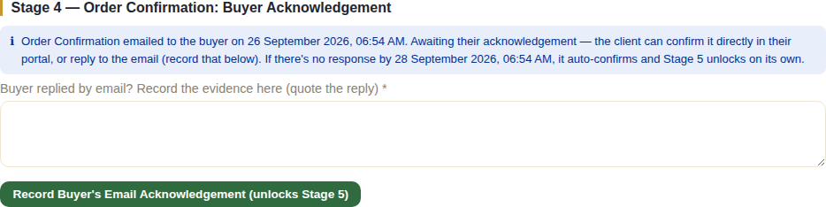
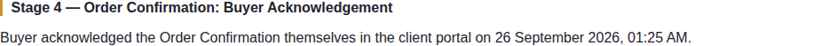
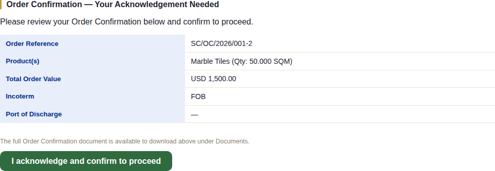
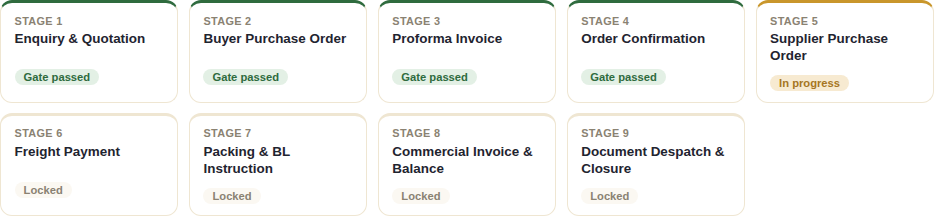

# Stage 4 — Order Confirmation

## What this stage is for

Getting the buyer to formally acknowledge the Order Confirmation (OC) —
NexaCrest's own document restating the full order terms — before production
or procurement begins on the supplier side. Unlike Stage 2's Buyer PO (which
the buyer signs and returns), this one is designed to resolve on its own
even if the buyer never responds at all.

## The system does this automatically

- The acknowledgment clock starts the moment the OC is actually **emailed**
  to the buyer (not when it's generated, and not when it's merely approved
  internally) — see
  [Document Review & Approval](./13-document-review-approval.md) for the
  full draft → review → approved → sent path every document goes through
  first. The window defaults to 48 hours and is admin-configurable
  (`oc_ack_auto_confirm_hours` in Company Settings) — useful to shorten
  while testing.
- If the buyer neither acknowledges in their portal nor replies by email
  within that window, a scheduled routine **auto-confirms** the OC
  on their behalf and passes Stage 4's gate automatically — the order is
  never permanently stuck waiting on a buyer who simply doesn't respond.

## What staff do

Generate the Order Confirmation from the order page under **Documents**
(**Generate Order Confirmation**), same as any other document, then take it
through the normal review/approval/send cycle before it reaches the buyer —
see [Document Review & Approval](./13-document-review-approval.md) for that
full workflow. Generating or even approving the OC does **not** pass Stage
4's gate by itself; only the acknowledgment (by whichever of the three paths
below) does. On the order page this is **6a** Generate the OC, **6b**
Send the Buyer Action Link (the same link sent at Step 4b for the Buyer PO
— send it again, or regenerate it if it has expired), then **6c** Record
the Buyer's Acknowledgement — completed by the buyer
(link or portal) or by staff.

Once the OC has actually been emailed, the order page shows exactly where
things stand and offers the one thing staff can still do here — record an
acknowledgment that arrived by a channel other than the portal:

If the buyer replies to the email itself rather than using their portal
(common in practice), staff use **Record Buyer's Email Acknowledgement** —
this requires typing in the evidence (quoting the buyer's reply is normal
practice) before it's accepted; there's no way to record this without some
note attached. Once submitted, this **passes Stage 4's gate** directly.

This action no longer requires the OC to have actually been emailed first —
only that it's been **generated**. If the send itself is stuck (a hosting
SMTP problem, or a deferred send still waiting on Level-2 approval — see
[Document Review & Approval](./13-document-review-approval.md)), staff can
still record the acknowledgment and move the order forward instead of being
stuck waiting on a send that may never complete. This is also how staff
handle a buyer who cannot use the portal at all (no email, not
tech-comfortable, etc.) — recording what the buyer confirmed by phone or in
person, with that conversation described as the evidence note.

By default any user who can manage the order can use this. An admin can
restrict it to a specific permission instead — turn on
`oc_ack_override_restricted` in Company Settings, then grant the **Override
buyer Order Confirmation acknowledgment** permission only to the roles who
should have it (Roles & Permissions). Turning the restriction on does not
retroactively change anyone's access until permissions are also edited.

Once resolved by any of the three paths, the section simply shows how and
when:

### Buyer Action Link — a fourth path, with no portal login at all

The buyer's own portal acknowledgement above only becomes available once
their portal account exists (Stage 3 onward), and even then requires them
to have already consumed their one-time set-password link. For a buyer
who isn't comfortable logging into a portal at all, or whose portal access
simply isn't set up yet, the order page offers a **Buyer Action Link**
widget (just below this section) — a single public, no-login link covering
both this stage's acknowledgement and Stage 2's Buyer PO upload in one
place.

Click **Generate Buyer Action Link** (or **Regenerate...** once one
already exists) to create it; if the client's email is on file it's
emailed to them automatically, and either way the link is also flashed
back to staff to copy and hand over directly. The link works for 90 days,
and generating a new one immediately invalidates whichever one came
before it — there is only ever one live link per order. Opening it needs
no login at all. The page is laid out like the Quotation details form —
a wide card, a summary bar (products, order value, Incoterm) and numbered
sections with a status on each: **1 · Your Purchase Order** (download the
Buyer PO, upload it signed with the PO number — see [Chapter
2](./02-stage2-buyer-po.md)), **2 · Order Confirmation** (the order summary
and the acknowledge button, once the OC is issued), and — while the
advance payment hasn't cleared yet — an Advance Payment self-report form
(90-item backlog #48; see [Chapter 3](./03-stage3-pi-advance.md)) — nothing
else; no documents, other payment figures, or chat, which stay
portal-login-only. Acknowledging or uploading through this link goes
through the exact same checks and writes as the portal path above, so it
counts identically toward Stage 4's gate. The Buyer PO upload form itself
(on this link and on the portal alike) disappears once the advance clears
— 90-item backlog #19, see [Chapter 2](./02-stage2-buyer-po.md) — since by
then there's nothing left for a further self-upload to usefully change.

## What the client does (or doesn't)

This is the first stage where the buyer has real work to do **inside the
system itself** — their portal account exists from Stage 3 onward, and this
is its first real action. Logging in, they see a dedicated banner asking for
exactly one thing:

Clicking **I acknowledge and confirm to proceed** is the buyer's entire
role at this stage — a single button, deliberately with **no decline or
dispute option** presented here. This isn't the moment to raise a
disagreement; a genuine dispute has its own separate channel further along
(see [Disputes](./11-disputes.md), where enabled for that order) once
there's something concrete to dispute. Clicking it **passes Stage 4's gate**
immediately.

If the buyer does nothing at all — doesn't log in, doesn't reply to the
email — nothing further is expected of them either: the 48-hour auto-confirm
takes over on its own.

## What happens next

Whichever of the three paths resolves it (buyer clicks acknowledge in the
portal, staff record an email reply, or the 48-hour auto-confirm), the
result is identical — Stage 5 unlocks:

See [Chapter 5](./05-stage5-supplier-po.md) for Supplier Purchase Order.
