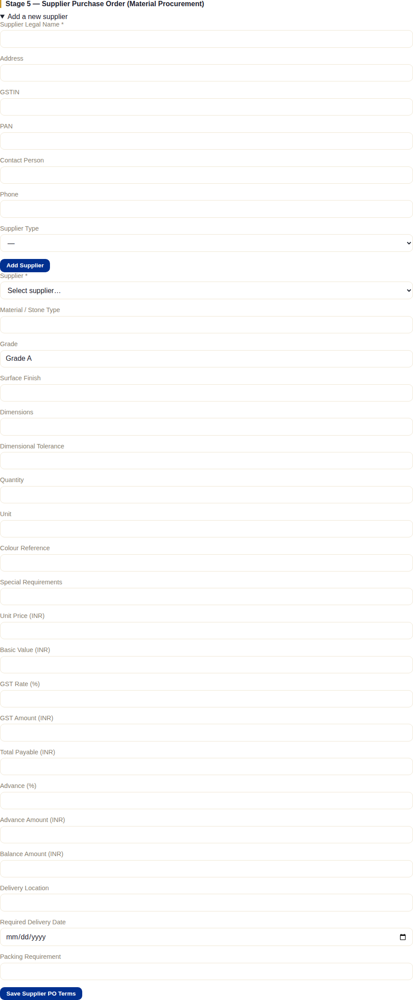
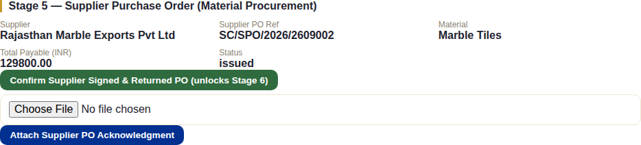
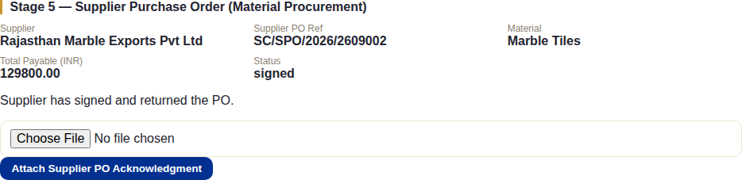
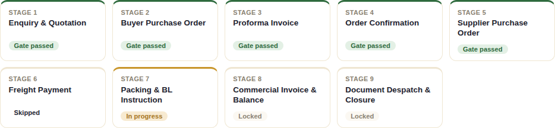

# Stage 5 — Supplier Purchase Order (Material Procurement)

## What this stage is for

Placing the actual procurement order with the supplier who will produce or
supply the material — a completely separate document and workflow from
anything the buyer sees, since the buyer never sees the Supplier PO or
knows who the supplier is.

## The system does this automatically

- Nothing progresses on its own — every action here is staff-entered, since
  this is an internal procurement step with no client involvement at all.
- **The FOB auto-skip**: the moment Stage 5's gate passes, the system checks
  the order's Incoterm. If it's **FOB**, Stage 6 (Freight Payment) is
  automatically marked **skipped** and Stage 7 unlocks immediately in its
  place — since on an FOB order the buyer arranges and pays for freight
  themselves, there's nothing for NexaCrest to collect at that stage. On a
  **CFR/CIF** order, Stage 6 unlocks normally instead. See
  [Chapter 6](./06-stage6-freight.md).

## What staff do

Stage 5 unlocks the moment Stage 4's gate passes. Suppliers are picked from
the **Suppliers** directory (Admin → Suppliers — see
[Chapter 15](./15-admin-settings.md#admin--settings)); there is no longer an
"add supplier" form on the order page. If the supplier isn't listed yet,
someone with the `manage_suppliers` permission (Admin/MD/ED by default) adds
it there first — the order page links straight to it. Then pick the supplier
and fill in the Supplier PO's material specification and commercial terms:

**Supplier Type**, **Surface Finish**, **Unit**, **GST Rate**, and
**Dimensional Tolerance** are all admin-editable dropdowns (same
`manage_dropdown_options` screen as Container Type/COO Type — see
[Chapter 15](./15-admin-settings.md#admin--settings)), not free text.
Supplier Type offers **Quarry Owner**, **Processor (Job-Work Basis)**
(a unit that processes material supplied by/on behalf of someone else, not
one that owns the quarry or the factory itself), **Trader**, and
**Factory Owner** — four genuinely distinct roles, not overlapping labels.
A supplier can hold **more than one** type in the directory (e.g. Quarry
Owner *and* Factory Owner). When the supplier picked on **Save Supplier PO
Terms** has several, a **Supplier Type for this order** dropdown appears and
staff choose the one that applies — it is what prints on the Supplier PO. A
supplier with a single type has it recorded automatically.

**Delivery Location** is a dropdown of the *selected supplier's own*
factory addresses, repopulating the moment a different supplier is
picked — a supplier with none yet shows only **Other (not listed) —
specify**, which reveals a free-text box. A supplier's factory addresses
are managed on its own page in the Suppliers directory, and can also be
added from the **Manage factory addresses** section on the order page —
a label (optional) plus the address; each added address is immediately available in every
Supplier PO Terms form's Delivery Location dropdown for that supplier,
on this order and any other. Whatever Delivery Location text was
actually selected or typed is saved directly onto that Supplier PO's own
record — editing or removing a factory address later never changes a
Supplier PO that already used it. 90-item backlog "standalone order"
follow-on: the same holds for the supplier's own legal name, address,
city/state, GSTIN, PAN, phone, email, WhatsApp, contact person (with their
phone/WhatsApp), and the supplier type chosen for this order — picking a
supplier on **Save Supplier PO Terms** copies those details onto that
Supplier PO's own record at that moment, so the order is self-contained:
editing, deactivating or deleting the supplier in the directory later
never changes a Supplier PO already saved against them.

**Basic Value, GST Amount, Total Payable, Advance Amount, and Balance
Amount auto-calculate** as Quantity, Unit Price, GST Rate, and Advance %
are filled in (Basic Value = Unit Price × Quantity; GST Amount = Basic
Value × GST Rate; Total Payable = Basic Value + GST Amount; Advance/Balance
split Total Payable by Advance %). This is a convenience, not a lock — every
auto-filled figure stays a plain, directly-editable field, so a genuine
exception (a negotiated lump-sum total that doesn't follow the formula, for
instance) can still be typed in by hand after the fact.

**Save Supplier PO Terms** creates the internal procurement record (and
generates the Supplier PO reference) — it does **not** generate the document
or pass any gate by itself. From **Documents**, **Generate Supplier PO**
produces the actual PDF, pre-filled with everything just entered, with a
blank acceptance section for the supplier to sign. Once terms are saved, the
section shows what's on file and offers the one action that matters here:

Exactly like Stage 2's Buyer PO, the last two sub-steps are done in this
order:

1. **7c · Attach Supplier PO Acknowledgment** — upload the supplier's
   actual signed copy, kept on record with version history. Like the Buyer
   PO's attachment, this **does not by itself confirm the signature or
   pass the gate**. The supplier doesn't always send one back, so 7c also
   offers two other ways forward:
   - **Generate Supplier Link** — a no-login link (like the Buyer Action
     Link) where the supplier uploads their signed PO / acknowledgment
     themselves. It's emailed to the supplier when the PO has their email,
     and shown on the card with **Copy Link** to send any other way. It
     works for 60 days; regenerating it cancels the old one. The page shows
     the supplier only the PO reference and what has been received — no
     prices, no buyer. The order's team is notified when they upload, and
     the file lands in the order's `07-supplier-po/received/` folder.
   - **Skip — supplier did not acknowledge** — record why (reason of at
     least 10 characters, audit-logged). This completes 7c and opens 7d
     without an acknowledgment on file.
2. **7d · Confirm Supplier Signed & Returned PO** — the button staff click
   once the supplier's countersigned copy is back and attached. **This is
   the action that passes Stage 5's gate** (and triggers the FOB auto-skip
   check above). While a copy is required (see the wet-signature gate
   below) this sub-step shows "Attach the supplier's signed acknowledgment
   in Step 7c first" instead of the button until one is on file (or the
   skip is recorded).

> **Document-generated gate:** "Confirm Supplier Signed & Returned PO" is
> also refused if the Supplier PO document itself was never generated —
> the supplier can't have signed and returned a document they were never
> actually sent. Unlike the wet-signature gate below, this one has no
> toggle: saving terms alone was never enough for the gate to pass, and
> now neither is confirming a signature with no SUPPO document on record
> either.

> **Wet-signature gate:** by default (**Admin & Settings → the
> `wet_signature_required_supplier_po` toggle**, on unless an Admin has
> turned it off), clicking "Confirm Supplier Signed & Returned PO" is
> **not** enough on its own either — it's refused until at least one file
> is also on record under "Attach Supplier PO Acknowledgment" (7c), or 7c's
> "supplier did not acknowledge" skip is recorded with its reason. Same
> loophole this closes as on the Buyer PO side: a stage confirmed "signed"
> with zero physical evidence ever attached. Turn the toggle off only for
> a workflow that genuinely doesn't need the physical copy.

Below the signing actions, staff with the Order Financials permission
(the same one that unlocks the Order Profitability Sheet — Admin/MD/ED
and Super Admin by default) record the supplier's payments as two sub-steps of their own:
**7e · Supplier Advance Paid** (the last card of Step 7) and
**10a · Supplier Balance Paid** (the first card of Step 10, before
packing — it can be marked any time after the Supplier PO, even long
after this stage has passed), each with its own date and amount.
Previously only the amount owed to a supplier was ever recorded —
nothing tracked whether or when it was actually paid, so "today's
supplier payments" had no data to report on at all. Each button
disappears once that leg is marked paid; the paid date then feeds the
Reports hub's **Today's Payments** view (see Chapter 14).

Once confirmed:

## What the client does (or doesn't)

**Nothing at all, and they're never shown anything about it.** The Supplier
PO, the supplier's identity, and the procurement terms are entirely internal
to NexaCrest — nothing here reaches the client portal, and no client-facing
document at any stage references this transaction. This is the one stage
in the whole pipeline with zero client involvement in either direction.

## What happens next

Confirming the supplier's signature passes Stage 5's gate — and, since this
running example order is on **FOB** terms, that same action immediately
auto-skips Stage 6:

On a CFR/CIF order, Stage 6 (Freight Payment) unlocks normally instead of
being skipped — see [Chapter 6](./06-stage6-freight.md) for that path.
Either way, [Chapter 7](./07-stage7-packing-bl.md) (Packing & BL
Instruction) is where both paths meet again.

## Production & Estimated Shipment — and where its history lives

The order-detail page carries a standing "Production & Estimated
Shipment" panel (just above Stage 6) where staff post free-text progress
updates — e.g. "Cutting and finishing in progress — 30% complete" and
"Week of 15 October 2026." It isn't gated to Stage 5 specifically; anyone
with `manage_orders` can post an update any time Stage 4 or later is
unlocked, independent of which stage is currently active.

Every update to either field is audit-logged — who posted it, when, and
the exact old/new text — the moment it's saved, under action types
`PRODUCTION_STATUS_UPDATED` and `EST_SHIPMENT_DATE_UPDATED`. Re-saving the
same text twice does not create a duplicate entry. The panel itself links
straight to the order's own Audit Log page ("view update history") so this
is never a dead end — click through any time to see the full trail of who
said what, and when, without digging through the general Audit Log and
filtering by order number.

**Changing the estimated shipment date automatically tells the client** —
it posts a message into that order's own [Order Updates
conversation](./12-client-portal.md#inside-an-order) ("The estimated
shipment date for your order has been updated to: ...") the same way a
staff reply there does, so it shows up in their client-portal thread and,
if an email address is on file, in their inbox too. There's no separate
notification mechanism for this one field — it reuses the same channel
every other order-update message already goes through.

**A reminder fires automatically as shipment approaches**, too — every day
the estimated shipment date is within the next 7 days (and not yet
passed) for a still-active order that has a **Pre-Shipment Inspection**
compliance task that isn't marked Skipped, everyone who manages orders
gets a reminder to confirm production completion and prepare for the
3rd-party inspection. See the [Compliance
Checklist](./09-stage9-despatch-closure.md#compliance-checklist) in
Stage 9 for that task, and
[Order Financials](./ca-08-order-financials.md#4-travel-expenses--factory-visits)
for recording the travel cost of these factory visits.
