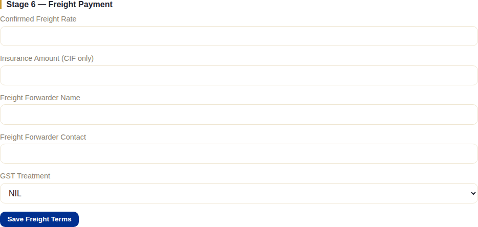
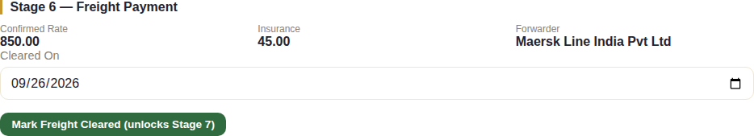
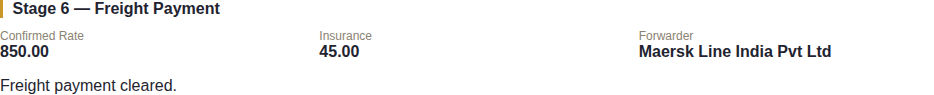
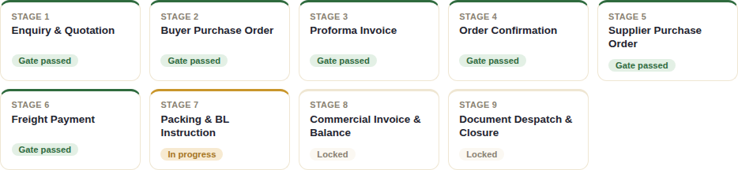

# Stage 6 — Freight Payment

## What this stage is for

Collecting the freight and insurance charges from the buyer on **CFR and
CIF orders only** — where NexaCrest arranges and pays the shipping line,
then recovers that cost from the buyer via a separate Debit Note. On an
FOB order this whole stage is irrelevant, since the buyer books and pays
for their own freight directly.

The internal code for this document type stays **FDN** (the **Generate
Freight Debit Note** button, the reference number's old `SC/FDN/…`
pattern pre-dating this change, and this chapter's own wording below all
still say "Freight Debit Note") — only the printed document's own title
changed, to plain **"Debit Note"**, since it's a buyer-facing paper and
"Freight" in the name was confusing it with a line item rather than the
document itself. New reference numbers generated after the rename use
`SC/DN/{YYYY}/{DDMM}{NNN}` instead of `SC/FDN/…`; a Debit Note generated
before the rename keeps its original `SC/FDN/…` reference — it is never
retroactively renumbered.

> This chapter uses a **second example order** (a CIF order to a Norwegian
> buyer) rather than the main running example — SC/ORD/2026/001-2 is on FOB
> terms, so Stage 6 auto-skips for it entirely (see the end of
> [Chapter 5](./05-stage5-supplier-po.md)). Everything else about this
> second order's journey through Stages 1–5 is identical to what the
> earlier chapters already covered.

## The system does this automatically

- **The FOB/CFR/CIF branch is decided automatically**, the instant Stage
  5's gate passes — staff never choose whether to skip this stage; the
  order's own Incoterm decides it. See [Chapter 5](./05-stage5-supplier-po.md)
  for the FOB skip path.
- Nothing else progresses without a staff action — there's no client
  involvement at this stage in either direction.

## What staff do

On a CFR/CIF order, Stage 6 unlocks as a normal stage once Stage 5 passes:

**Save Freight Terms** records the rate NexaCrest actually agreed with the
shipping line/forwarder (confirmed freight rate, insurance amount on CIF
orders) and the **Freight Forwarder**, chosen from the **Logistics
Partners** directory like the supplier in Step 7a comes from the
Suppliers directory (owner request 2026-10-27). The directory has a
**Freight Forwarder** service type for them (alongside CHA and
Transportation) — add one at Logistics Partners → Add Partner. Their name
and contact are copied onto the order when the terms are saved. This
is internal record-keeping only and doesn't pass any gate. From **Documents**, **Generate Freight Debit
Note** then produces the FDN — the actual invoice sent to the buyer for
these charges.

The Debit Note itself states payment is due within **3 Calendar Days**
of its own date (previously "3 working days" — every buyer payment
obligation across the system now counts in Calendar Days, not Working
Days, for consistency). Its GST/IGST line always reads "NIL — Freight
recovery is a pure cost reimbursement, not a taxable service supply." This
is a fixed, non-configurable statement, not a per-order choice — freight
recovery is never treated as a taxable service supply, so there is no
Freight Terms setting for it to depend on, and no internal CA guidance
text ever reaches a document the buyer actually sees.

Recording and clearing the payment itself follows the exact same
two-step pattern as the advance payment in Stage 3:

1. **Record Freight Remittance** — the amount and date once the buyer's
   payment notification comes in. Does not pass the gate yet:

   

2. **Mark Freight Cleared (unlocks Stage 7)** — only once the funds are
   verified against the actual bank statement, same caution as every other
   payment-clearing action in this system. **This is the action that passes
   Stage 6's gate.**

   

## What the client does (or doesn't)

The buyer pays the freight charge by wire transfer against the Debit Note.
The Debit Note email carries the **Payment Action Link** (see
[Chapter 3](./03-stage3-pi-advance.md#the-payment-action-link-owner-request-2026-10-27)),
where the buyer downloads the Debit Note and sends the payment screenshot
and transaction details; staff can also send the link from Step 9c. Staff
still verify against the bank statement and record it themselves.

## What happens next

Clearing the freight payment passes Stage 6's gate and unlocks Stage 7:

This is the same place the FOB path from Chapter 5 also arrives at — from
here on, FOB and CFR/CIF orders follow an identical process. See
[Chapter 7](./07-stage7-packing-bl.md) for Packing & BL Instruction.
