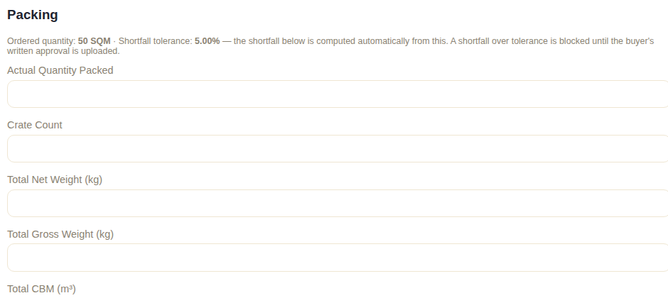
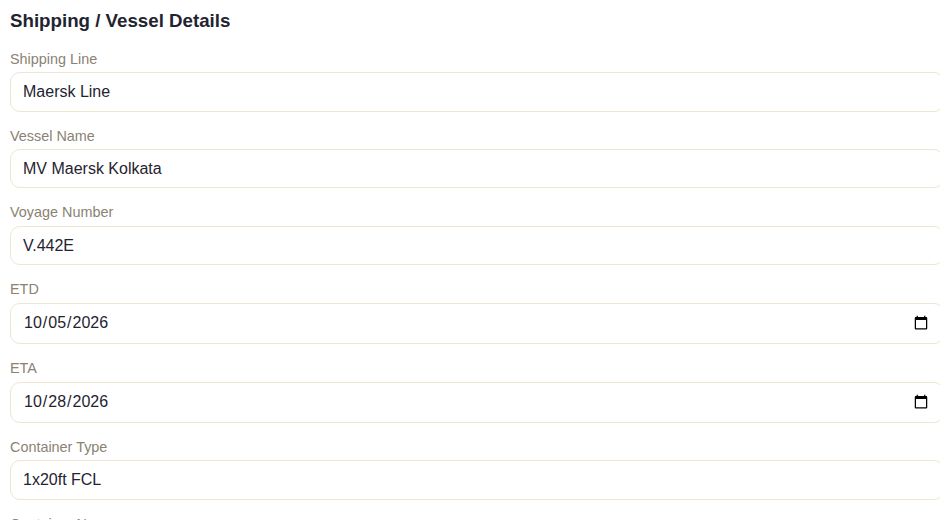
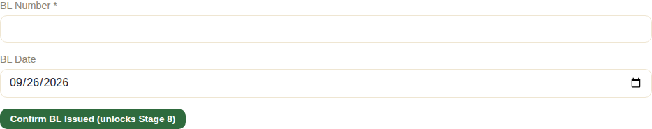
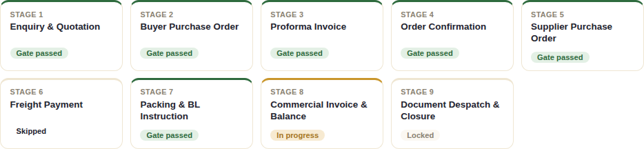

# Stage 7 — Packing & BL Instruction

## What this stage is for

Recording exactly what was physically packed and shipped (crate-by-crate),
capturing the vessel/shipping details, and confirming the Bill of Lading
(BL) once the vessel actually departs — the point at which the goods are
formally handed to the carrier.

This is the stage where **FOB and CFR/CIF orders converge again** — whichever
path an order took through Stage 5/6, they arrive here identically.

## The system does this automatically

- **The shortfall tolerance check runs automatically.** The moment staff
  open this section, the system already knows the ordered quantity (from
  the order's product lines) and the configured tolerance percentage, and
  computes the shortfall live as staff enter the actual quantity packed —
  staff never calculate this by hand:

  

- If the shortfall comes out **within tolerance**, nothing further is
  required. If it's **over tolerance**, the system blocks proceeding until
  the buyer's written approval of that shortfall is uploaded as evidence —
  this is a hard rule, not a warning.

## What staff do

Three things happen in this section, each building toward the BL:

1. **Save Packing & Crates** — actual quantity packed (with its own unit,
   defaulting to the order's own product unit when the order has one
   comparable unit across its lines), crate count, weights, CBM, packing
   date, and a crate-by-crate breakdown (marks & numbers, dimensions,
   pieces, weight, HS code per crate). Each crate's **Product** is picked
   from this order's own product lines, and its **HS Code** comes from
   that product's record — it is shown read-only and can't be typed (the
   server sets it again on save, whatever the form sends). Once saved, **Generate Packing
   List** produces the PL document, which prints the quantity with its
   unit.
2. **Save Shipping Details** — shipping line, vessel name, voyage number,
   ETD/ETA, number of containers, container number(s), and seal number.
   Number of Containers is a simple count distinct from Container No. —
   it covers multi-container shipments (e.g. one product split across 2
   containers) without needing a structured per-product-line assignment;
   staff still record the actual container number(s) as free text:

   

   Right below this form, its own labeled **"BL Instruction Sheet"**
   section explains what the sheet covers and where each field on it comes
   from (shipper/consignee/notify party, shipment and container details
   from above, cargo description from the order's products, and the
   mandatory BL-type instruction from Settings) before offering **Generate
   BL Instruction Sheet**, which produces the instruction document sent to
   the shipping line/forwarder telling them exactly how to issue the Bill
   of Lading. Anything left blank in Shipping/Packing above shows as "To Be
   Confirmed" on the generated sheet.

   The BL Type and BL Consignee Instruction rows only appear when the
   order's payment preset has **"Include BL Type / BL Consignee
   Instruction"** checked (Payment Presets, under Admin & Settings) — some
   payment terms (e.g. balance paid before shipment) don't need NexaCrest
   to retain the BL as leverage, so that preset can have the checkbox
   unchecked and the sheet simply omits both rows for every order on it.
   Both seeded presets ship with it checked (unchanged behavior).
3. **CHA Draft BL Review** — after the BL Instruction Sheet and packing
   list go out to the CHA, the draft Bill of Lading they send back for
   checking goes through its own review loop here, before the real BL is
   ever confirmed:

   - **Log Draft BL for Review** — upload the CHA's draft (PDF, Word, Excel, an image, an email or a zip — any common format). This
     starts a new, numbered round.
   - For that round, staff decide **Approve** or **Request Revision**
     (with notes explaining what needs to change). A revision request
     doesn't end the loop — the CHA's corrected draft gets logged as the
     *next* round, same as the first, and the cycle repeats until a
     round is actually approved.
   - **At most one round can be awaiting a decision at a time** — the
     upload form for a new round only appears once the current round has
     been approved or sent back for revision, so there's never ambiguity
     about which draft is the one actually under review.

   Every round stays on record (who uploaded it, when, its decision, and
   any revision notes), so the back-and-forth with the CHA over a
   tricky BL is never lost once it's resolved. This review loop is
   purely a staff/CHA back-and-forth with no gate of its own — it never
   blocks or is required for **Confirm BL Issued** below; it exists so
   mistakes get caught on a draft rather than on the BL the shipping
   line actually issues.
4. **Confirm BL Issued** — once the shipping line actually issues the BL,
   staff type its number in here, with an optional scanned-copy upload on
   the same form. **This is the action that passes Stage 7's gate.** If
   the scanned copy isn't in hand yet, confirm with just the number and
   attach the copy afterward from the same section once it arrives.

   

Once confirmed:

5. **Shipping Bill** (CA advice, 2026-10-29) — in the same step, below
   the BL: the customs **shipping bill number**, its **date** and the
   **customs exchange rate** printed on it (₹ for 1 unit of the order
   currency). The Commercial Invoice and the Debit Note go to Zoho Books
   at this rate, so the GST return matches the shipping bill — they wait
   in the Zoho sync until it is recorded. It can be corrected later
   (**Update Shipping Bill**); an invoice already in Zoho Books keeps the
   rate it was sent at. Needs the shipping permission.

## What the client does (or doesn't)

Nothing at this stage — packing, vessel booking, and BL issuance are all
internal/carrier-side activities with no client-portal screen or action
involved. The buyer finds out what shipped and how only once the relevant
documents (Packing List, and later the scanned BL copy in Stage 8) are sent
to them.

## What happens next

Confirming the BL number passes Stage 7's gate and unlocks Stage 8:

See [Chapter 8](./08-stage8-ci-balance.md) for Commercial Invoice & Balance
Payment.
