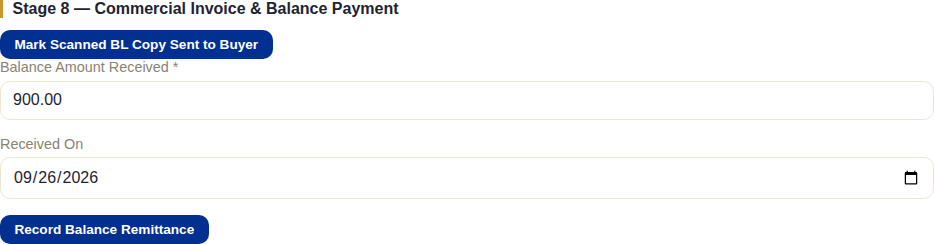
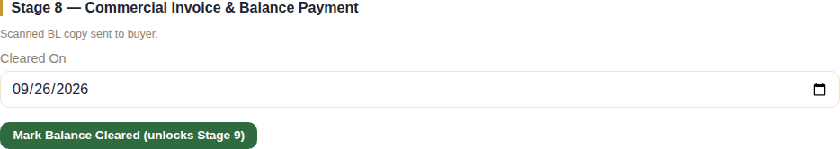
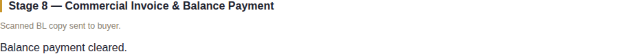
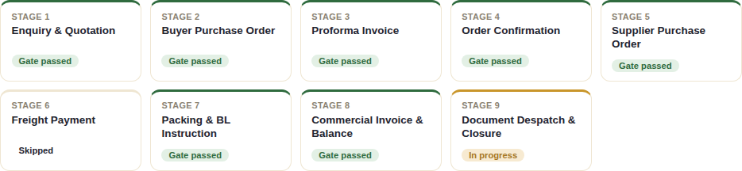

# Stage 8 — Commercial Invoice & Balance Payment

## What this stage is for

Issuing the Commercial Invoice (CI) — the final, legally definitive invoice
for the shipment, replacing the Proforma Invoice — and collecting the
remaining balance payment before the final closure stage.

## The system does this automatically

- The balance amount is already known from the payment preset applied back
  at order creation, so the **Balance Amount Received** field arrives
  pre-filled with the expected figure — staff aren't calculating it by hand,
  though they can still adjust it if what actually landed differs.
- Nothing else progresses without a staff action.

## What staff do

On the order page this is **Step 11 · Commercial Invoice & Balance**
(section **C · Shipment & Balance**): **11a** Generate Commercial Invoice,
**11b** Mark Scanned BL Copy Sent to Buyer, **11c** Record Balance
Remittance, **11d** Mark Balance Cleared. It bundles two independent
things — sending the buyer proof of shipment, and collecting final
payment:

**Mark Scanned BL Copy Sent to Buyer** (11b) is a simple confirmation that the
buyer has been sent a copy of the Bill of Lading now that it's been
issued — purely a record-keeping checkbox, it doesn't affect the gate.

**Upload the scanned BL copy first.** On a CFR/CIF order the CI is made
against the BL, so Step 11a shows a reminder until the scanned BL copy is
attached in Step 10f ("Attach Scanned BL Copy"), and a download link to it
once it is. (An FOB order raises its CI before shipment, so no reminder.)

**Generate Commercial Invoice** (11a) produces the CI — pre-filled with the
actual shipped quantities and final figures rather than the estimates the
PI was built on. Take it through [Document Review &
Approval](./13-document-review-approval.md): 11d is refused until the CI is
approved (email sending off) or sent (email sending on). When the Zoho
Books integration is on, the approved CI goes to Zoho Books as an export
invoice at the shipping bill's customs rate (see [Zoho Books
Sync](./ca-03-zoho-sync.md)).

The CI's **BALANCE DUE NOW** line states the order's own balance terms (the
same sentence as the PI), in the PDF and the Word file alike, and its Bank
Details end with a **Bank Charges** row — the same sentence as the PI:
"All bank charges outside India are for the Buyer's account — please remit
the full amount (charges option "OUR")." (Owner decision 2026-10-28; until
then the Word CI always said "within N days of BL date", even on orders
whose balance is due before shipment.)

**Invoice date** (owner decision 2026-10-27). Step 11a has an **Invoice
date (printed on the CI)** field just above the Generate button. It is
**today** by default; pick an earlier date when the CI must carry the BL
date. A future date, or a date before the order was created, is refused
(in the browser and again on the server). The chosen date is what the
CI's **DATE** box prints, and the COO preparation sheet's "Invoice No. &
Date" line shows the same date — including when the CI is later approved
and re-rendered. CIs generated before this change keep their own dates.
The old warning comparing the recorded BL date with today is gone: the BL
date on file is not a reliable record of the actual BL date.

The CI's own Section A keeps **FOB Value** as its own separate line
regardless of Incoterm — required for the Indian Shipping Bill and IGST
refund — but on a non-FOB order (CFR/CIF/etc.), **TOTAL COMMERCIAL
INVOICE VALUE** is FOB Value *plus* Freight & Insurance, not FOB Value
alone: the buyer-country customs/import-duty authority assesses duty
against the full CFR/CIF value, and a Commercial Invoice that understates
it risks customs delay or a penalty for the buyer. The Freight & Insurance
figure itself is whichever is on file — the actually-recorded Freight
Debit Note payment if it's cleared, otherwise the Stage 6 confirmed
freight+insurance figure. On a CFR order the buyer insures, so the line
reads **Freight** and carries freight only (QA Round 5, Q-R5-2); only a
CIF order adds insurance. This only changes the CI; the Quotation,
Proforma Invoice, and Order Confirmation's own "Total ... Value" fields,
and Section B's advance/balance payment math on this same CI, are
unaffected — freight is still paid separately via its own Debit Note, not
folded into the advance/balance schedule. On an FOB order, Total
Commercial Invoice Value is simply the FOB Value, same as before.

The CI's own Section 7 "Balance Due Now" clause states the order's own
payment-preset balance wording — the same sentence the Quotation,
Proforma Invoice, and Buyer PO already print (e.g. "before shipment"
for a Tier 1 preset, "against scanned copy of Bill of Lading" for a
Tier 2 one), including that preset's own day count. External QA report
L-06: this used to hardcode the Tier 2 (against-BL-copy) wording and a
separate company-wide day count on every CI regardless of which preset
the order was actually on, so a Tier 1 order's CI wrongly told the buyer
their balance was due against a scanned BL copy — a term they never
agreed to.

Recording and clearing the balance payment follows the same two-step
pattern as every other payment in this pipeline:

1. **Record Balance Remittance** (11c) — amount, date and **@ Exchange
   Rate** once the buyer's payment notification arrives. Refused until the Commercial Invoice above has
   actually been generated — the buyer can't be remitting against an
   invoice they were never sent — and, like every stage-gated action,
   until Stage 8 itself has unlocked.

   

2. **Mark Balance Cleared (unlocks Stage 9)** (11d) — the confirmation dialog here
   carries an extra warning beyond the usual "confirm the funds have
   landed": *"...and that the BL hasn't been released early if this is a
   post-BL preset"* — a reminder that some payment presets are specifically
   structured so the balance is due against the BL, and releasing the BL to
   the buyer before that payment clears would undermine the whole point of
   that preset. **This is the action that passes Stage 8's gate.**

   

**On a Letter of Credit order** the money the bank pays under the LC, once
the documents are presented, is also recorded in **Step 12a → LC Payment
Received** (date the bank paid, amount, rupees credited, bank charges).
That is what goes to Zoho Books as the buyer's payment against the CI —
see [Order Financials](./ca-08-order-financials.md#4-letter-of-credit--bank-loan).

## What the client does (or doesn't)

The buyer receives the scanned BL copy and the Commercial Invoice and wires
the balance payment outside the system. The CI email carries the **Payment
Action Link** (see [Chapter 3](./03-stage3-pi-advance.md#the-payment-action-link-owner-request-2026-10-27));
there the buyer sees the **balance due — the order value minus the advance
actually received** — downloads the CI, and sends the payment screenshot and
transaction details. Staff can also send the link from Step 11c. Staff still
verify against the bank statement and record the remittance themselves.

## What happens next

Clearing the balance payment passes Stage 8's gate and unlocks the final
stage:

See [Chapter 9](./09-stage9-despatch-closure.md) for Document Despatch &
Closure — the final stage.
