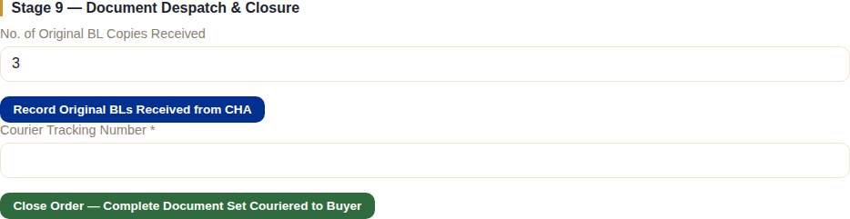
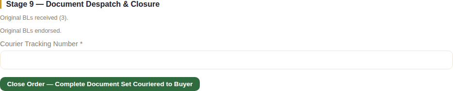
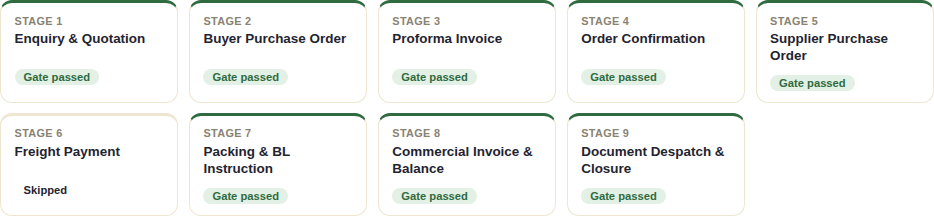

# Stage 9 — Document Despatch & Closure

## What this stage is for

Wrapping up the paperwork side of a completed shipment — getting the
original Bill of Lading copies back from the clearing agent, endorsing them,
and courying the complete final document set to the buyer — then closing
the order, in **two separate phases**: **Close Order** (the document set
has gone out — the buyer sees the order as done) and, once nothing
financial is still outstanding, **Mark Fully Settled** (the real, final
lock). See "Closing the order — two phases" below.

## The system does this automatically

- Nothing progresses without a staff action; this stage is purely
  administrative wrap-up.
- **Mark Fully Settled** (the second, final phase — not Close Order
  itself) marks the order **complete** in the system's own records
  (distinct from *archived*, which only affects visibility — see
  [Admin & Settings](./15-admin-settings.md)).
- **A pre-shipment inspection reminder fires automatically** for any
  order whose estimated shipment date is within the next 7 days and
  still has an unresolved **Pre-Shipment Inspection** compliance task
  (see "Compliance Checklist" below) — covered in detail in
  [Stage 5](./05-stage5-supplier-po.md#production--estimated-shipment--and-where-its-history-lives),
  since that's where the estimated shipment date itself is maintained.

## What staff do

Stage 9 unlocks the moment the balance payment clears in Stage 8:

On the order page this is **Step 13**, worked in this order (owner
sequence, 2026-10-26) — each sub-step opens once the one before it is
done:

- **13a · Generate COO Prep Sheet** (internal worksheet for the
  Certificate of Origin).
- **13b · Record Original BLs Received from CHA** — how many original
  Bill of Lading copies came back from the Customs House Agent.
- **13c · Save BL Endorsement Details** — who to endorse to, BL/vessel/
  voyage, ports and date.
- **13d · Generate / Print BL Endorsement** — the printable endorsement
  for the reverse of each original BL.
- **13e · Mark Original BLs Endorsed by NexaCrest** — confirms the
  originals have been endorsed (signed over) ready for the buyer.
- **13f · Close Order (Document Despatch)** — below.
- **13g · Government Benefits — Claimed & Received** (owner decision
  2026-10-27) — the benefits usually arrive after the buyer has paid in
  full, so they are recorded here, just before the order is settled: one
  table with a row per claim (claimed amount, reference, date; then the
  **received amount and date when the money lands**) and an empty row per
  eligible scheme not claimed yet, saved with one **Save Benefits**. A
  scheme the company won't claim — or whose money will never come — is
  **skipped with a reason** ("Skip — not claiming"; one scheme, or all
  still open at once; **Undo skip** reopens it). A wrong entry is fixed
  under **Correct or delete a recorded claim** (reason required). 13g is
  done once every eligible scheme is received or skipped (and every scheme
  was answered in 12b).
- **13h · Mark Fully Settled** — the final close (see "Closing the order
  — two phases" below); locked until 13g is done. Step 13 shows its green
  tick only once this is done. A user with "Override locked data" can
  still force it through from 13g with a reason (a benefit genuinely never
  arriving).

**Close Order — Complete Document Set Couriered to Buyer**: staff enter
the courier tracking number for the package containing the buyer's
originals (final CI, endorsed BL, Certificate of Origin, etc.) and
submit. **This is the action that passes Stage 9's gate** — but, since
the business closes an order in two separate phases (see "Closing the
order — two phases" below), it does **not** by itself mark the order
complete. It sets the order's status to **"Documents Sent"**
(`shipped_docs_sent`): the client-portal dashboard already shows this
order as **Complete** to the buyer from this moment, while internally
the order stays open and unlocked for recording any government export
benefit still due — see [Order
Financials](./ca-08-order-financials.md).

**Close Order requires both the BL Instruction Sheet** (Stage 7) **and
COO Prep Sheet** (below) **to be generated and approved/sent first** — a
real, server-side gate, not just a display hint. The goods have, by
construction, already shipped by the time Stage 9 is even reachable
(this stage only unlocks once the Stage 8 balance payment clears, which
itself sits downstream of the freight/BL stages), so this requirement
applies to every order reaching Close Order, with no exception for a
disputed order — a dispute never touches an order's own status or stage
progression (see [Disputes](./11-disputes.md)), so a disputed-but-shipped
order hits this exact same gate like any other. If either document is
still missing or not yet approved/sent, the normal Close Order form is
replaced by an error naming which one, plus — for whoever holds the
**"Override locked data"** permission — a privileged override form
requiring a reason (minimum 10 characters), logged to the audit trail as
`CLOSE_ORDER_DOCUMENT_GATE_OVERRIDE`. Anyone without that permission sees
only the error; Close Order itself stays unavailable to them until both
documents are in order.

This reverses an earlier, deliberate decision (see the Compliance
Checklist note below, and the two record-keeping steps above, which
*are* still non-blocking by design) that treated this the same way — the
business has since decided BLI/COO Prep are a hard requirement, not a
reminder, because an order that has already shipped needs this paperwork
regardless of what happens with the buyer afterward. An order that is
genuinely abandoned *before* shipping doesn't reach this gate at all: see
"Marking an order lost" below for why an order can no longer be marked
lost once a real Bill of Lading already exists on file.

## Closing the order — two phases

Despatching the documents and actually having nothing left outstanding
are two different moments, so closing an order is two separate actions,
not one:

1. **Close Order** (above) — the document set has gone out. Status
   becomes **"Documents Sent"** (`shipped_docs_sent`). The buyer's own
   portal already shows this order as **Complete** from this instant —
   whether a government export benefit is still outstanding internally
   has no bearing on what the buyer needs to know, so that distinction
   never reaches them (see [Client
   Portal](./12-client-portal.md#my-orders-the-dashboard)). Internally,
   though, the order is deliberately **not** locked yet.
2. **Mark Fully Settled** — appears once an order is in "Documents Sent"
   status, gated on `close_orders` (same permission as Close Order
   itself). **This is the real, final lock**: it sets the order to
   **complete**, after which nothing on it can be edited at all short of
   a privileged override elsewhere in the system. Clicking it is
   **blocked** while any of the following is still outstanding, checked
   in order — record/resolve the first one it finds, then try again:
   1. A government export benefit claim linked to this order still
      awaiting receipt — record it as received first (see [Order
      Financials](./ca-08-order-financials.md)).
   2. A Compliance Checklist task still **Not Started** or **Pending
      Approval** — approve it or mark it Not Applicable with a reason
      first (see "Compliance Checklist" below).
   3. An Export Benefit Scheme Eligibility row still **Pending** — mark
      it Eligible or Not Eligible first (see [Order
      Financials](./ca-08-order-financials.md#export-benefit-scheme-eligibility)).

   Every one of these three checks shares the same
   **"Override locked data"** reason-required escape hatch as the
   document gate above, for the rare case something genuinely can't be
   resolved and the order needs closing anyway.

   Once the order is settled, the final internal financial annexure
   (CAFIN) is **generated automatically** (owner decision 2026-10-28) —
   with the government benefits received, or without them if the order
   was not eligible. It is never shown to the client. If it cannot be
   generated, the order is still settled and a warning asks you to
   generate it from the CAFIN box (see [CA Overview](./ca-01-overview.md)).

The practical effect: a client never sees or cares about this internal
distinction, but staff can despatch documents and move on the moment
they're couriered, without the order sitting open indefinitely just
because a RODTEP or similar claim is still working its way through
government processing weeks later.

## BL Endorsement document

Once **Record Original BLs Received from CHA** has been ticked, a **BL
Endorsement** panel appears on the order page (gated on the same
`manage_shipping` permission as the two record-keeping steps above). It
has two parts:

1. **A small CRUD form** capturing the handful of endorsement-specific
   details not already held anywhere else on the order: **BL Number**,
   **Vessel / Voyage**, **Port of Loading** (pre-filled `Chennai, India` if
   nothing else on the order suggests otherwise), **Port of Discharge**,
   and **Date of Endorsement**. Saving this form is independent of — and
   does not touch — the Freight-stage shipping record; it can be edited
   and re-saved as many times as needed before (or after) generating the
   document.
2. **Generate / Print BL Endorsement** — appears once the form above has
   been saved at least once. Produces a one-page PDF, in NexaCrest's
   letterhead, meant to be physically written onto the reverse of each
   original Bill of Lading: it restates the saved BL Number, Vessel /
   Voyage, Port of Loading, Port of Discharge, and Date of Endorsement,
   alongside the order's PI/CI reference numbers, the "Pay to the order
   of" consignee (resolved live from the order's current Consignee
   details — same-as-buyer or independent, whichever applies right now),
   and the authorised signatory block.

Unlike every other buyer-facing document in the system, the BL Endorsement
skips the normal draft → in-review → approved cycle entirely — generating
it immediately marks it **approved** and makes it visible to the buyer in
their client-portal document list. This is deliberate: by the time staff
reach this step they have already confirmed every value on the CRUD form
one step earlier, so a second-person review of a mechanical restatement of
those same values adds no real check. Each regeneration (editing the form
and generating again) bumps the document's revision number on the same
reference rather than starting a new one.

## COO Prep Sheet document

Also on this stage's section, above the Original-BL record-keeping steps,
is a **"COO Prep Sheet"** panel with its own explanation and a single
**Generate COO Prep Sheet** button. It produces an internal worksheet
(never shown to the client) summarizing everything needed to apply for the
Certificate of Origin with the Chamber of Commerce — shipper, consignee,
shipment, and cargo details, reading the exact same order/shipping/
packing/product data the BL Instruction Sheet in
[Stage 7](./07-stage7-packing-bl.md) already draws from, so nothing here
needs re-entering. Like every other document type, it can be regenerated
as many times as needed if the underlying order data changes.

## Compliance Checklist

The "Compliance Checklist" is split in two by **when the task is done**
(set per task type by Admin in
[Compliance Task Types](./15-admin-settings.md) — "With the Supplier PO"
or "Before shipment"): the **with-the-Supplier-PO** part (Due Diligence,
ECGC Cover by default) is the first card of **Step 7**, and the
**before-shipment** part (Fumigation, Phytosanitary, Pre-Shipment
Inspection by default) is the first card of **Step 10**. Outstanding
tasks show amber but run alongside the other sub-steps — they never lock
them. Together they keep
track of pre-closure compliance tasks — ECGC Cover, Pre-Shipment
Inspection, Fumigation Certificate, Phytosanitary Certificate, Due
Diligence by default; Admin can add more. **A real row for every
active task type is written the moment the order is created** — never
left as a missing row standing in for "not applicable," so a report run
directly against the underlying table always has an explicit value for
every order. Each task's status is one of **Not Started** (the row's
own starting value), **Pending Approval**, **Approved**, **Not
Applicable** or **Skipped (give a reason)** (owner request 2026-10-27).
Both of the last two need a reason, since "not applicable to this order"
still has to be recorded, not silently left blank — but **Not
Applicable fills its reason in for you** ("Not applicable to this
order.", still editable), while **Skipped** clears it so one has to be
typed. Both are saved the same way and count as resolved; when the
order is reopened, the dropdown shows Not Applicable again if the saved
reason is that standard text.

Each card has **one Save Checklist button** that saves every row at once,
each into its own task — only the rows you changed are updated (so
untouched rows keep their "resolved by" stamp). The reason box appears
only for **Not Applicable** or **Skipped** and must then be at least
10 characters; if any row is invalid, **nothing** on the card is saved
and the message names the row.

For a repeat order where the whole checklist genuinely doesn't apply, a
**"Mark all remaining tasks Not Applicable"** action (appears only while
something is still outstanding) resolves every currently-unresolved task
in that part of the checklist in one submit with one shared reason, instead of skipping each task
individually Its reason box comes pre-filled with "Not applicable to this order." (editable).

Visibility of the whole panel, and every status change on it (including
the bulk action), is gated on the same `close_orders` permission that
gates the **Close Order** button above — "the person who has permission
to close the order must able to see this otherwise no meaning for
this." There is no separate permission for the checklist itself. Every
status change is recorded in the order's own
[Audit Log](./13-document-review-approval.md) under
`COMPLIANCE_TASK_STATUS_UPDATED`.

The checklist does not gate **Close Order** (phase 1) — closing
requires Stage 9's own gate, the courier tracking number, and (see
above) the BLI and COO Prep Sheet being approved/sent, but never the
checklist itself. It does, however, now gate **Mark Fully Settled**
(phase 2, see "Closing the order — two phases" above): any task still
**Not Started** or **Pending Approval** blocks it, the same way an
outstanding export benefit claim does — the checklist is still reached
and worked the same way regardless, but closing can no longer happen
while it has something genuinely unresolved on it.

## Marking an order lost

Any **active** order, at any stage, can be marked **lost** instead of
progressing further — the buyer walked away, the deal fell through,
whatever the reason (mandatory, free text). This locks the order the
same way closing it does (`is_locked`), and it shows up in reporting as
lost rather than active or complete.

**Once a real Bill of Lading already exists on file for the order**
(`order_shipping.bl_number` — set at [Stage 7](./07-stage7-packing-bl.md)
once the shipping line actually issues one), **it can no longer be
marked lost.** At that point the goods have genuinely shipped, so "lost"
(nothing ever shipped, buyer walked away before it did) no longer
describes reality — the order has to go through Close Order instead,
BLI/COO Prep requirement included, whatever is also happening
commercially with the buyer. Without this guard, marking an
already-shipped order "lost" would have been a side door around that
requirement.

## What the client does (or doesn't)

Nothing inside the system. The buyer receives the physical courier package
and, separately, whatever digital copies staff have already sent by email
at earlier stages. There's no client-portal acknowledgment step for
receiving the final document set — the courier tracking number is the
system's own record that despatch happened.

## What happens next

Closing the order passes Stage 9's gate immediately — the stage tracker
shows all nine stages resolved (eight "Gate passed," one "Skipped" for
this FOB example's Stage 6) the moment Close Order is submitted:

That alone isn't the end, though — see "Closing the order — two phases"
above: the one action still expected is **Mark Fully Settled**, once
nothing financial is left outstanding. Once that's done too, the order
remains in the system as a completed record — visible in
[Reports](./14-reports.md), still reachable from the client's own order
history, but with no further actions expected of anyone.
