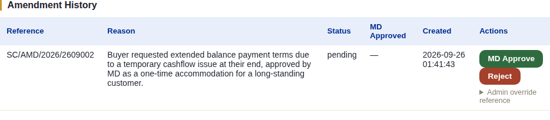
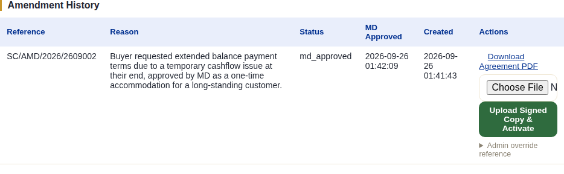
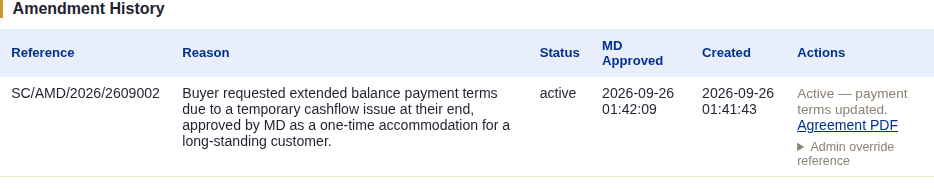

# Amendments

## What this module is for

Changing an order's **payment terms** — advance percentage, balance terms,
what triggers the balance (before shipment vs. against BL), balance days —
after the Proforma Invoice is already issued, in a way that's legally
binding on both parties rather than an informal email exchange. This exists
because payment terms are a hard commitment once the PI is out; changing
them needs its own paper trail, distinct from every other kind of order
edit.

Amendments can be raised on any order once a PI exists, regardless of what
stage it's currently at — this module isn't part of the 9-stage pipeline
and doesn't block or unlock any stage gate.

## Products & prices amendment (owner decision D-342, 12 Nov 2026)

Once the order's Quotation is approved, its products and prices are fixed
(SOP 01). Any change the buyer agrees to — more or fewer pieces, another size,
an extra line, a line dropped, a lower price — goes through a **Products &
prices** amendment. The order does not go back to the Quotation stage: it
carries on from where it is.

1. Order page › **Amendments** › **New amendment — Products & prices**.
2. Change only what the buyer agreed: L × W × H, No. of pieces (the quantity is
   worked out from them when the size gives the unit), or the quantity, the
   unit price, **Remove**; to add a line choose "Same product as line N" and
   enter its size, pieces / quantity and price.
3. **A price can only go DOWN.** A higher price is refused ("Line 1: USD
   1,950.00 is the price the buyer accepted in the Quotation — a price can only
   go down, with the MD's approval."). A lowered price shows "Price lowered
   (MD)" and is approved with the amendment.
4. **Check the changes** — the screen shows old → new for every line, the order
   total and what happens to the advance (e.g. "advance already received USD
   6,864.78; the extra USD 1,725.36 is added to the balance.").
5. Write the reason (e.g. "Buyer asked for 5 more slabs of 180 × 80 on 14 Nov
   (e-mail); discount on line 3 agreed by MD") and **Send to MD for approval**.
6. The MD approves (not their own request unless the self-approval rule
   allows) → **Generate Agreement Document** (the AMD PDF: 1. Products & prices
   — as amended, 2. Effect on payment, 3. Acceptance) → send it to the buyer →
   upload the **signed copy** → the amendment is **active**.

On activation the order's lines become the amended lines, each with its new
fixed price; the advance received stays credited and the difference goes to
the balance (more than the new total shows as excess); commission, incentive
and profit follow. The stage and the exchange rate do not change.

**Re-issue checklist.** The order page then shows "Amendment AMD-… activated —
re-issue checklist": generate the revised PI and OC if they were issued; ask
the buyer for a revised PO or tick "The signed amendment amends the Buyer PO";
Procurement gets a task in My tasks to revise the Supplier PO when quantities
changed; an issued CI / PL needs a revised copy and a credit / debit note in
Zoho Books for the difference. Documents not made yet use the amended figures.
Each row disappears once done.

Only one Products & prices amendment can be open on an order at a time.

## The system does this automatically

- Generates the amendment reference (e.g. `SC/AMD/26/2609002`) the moment
  a request is created.
- The moment a signed copy is uploaded, the system **activates the
  amendment and updates the order's live payment terms immediately** —
  staff don't separately go update the payment preset or terms anywhere
  else afterward.
- Every document generated for this order **after** the amendment goes
  active carries a visible note identifying which amendment is in effect
  and from when — so nobody downstream mistakes an old-terms document for
  current.

## What staff do

From **Amendments** on the order page, the full sequence is:

1. **Raise a New Amendment Request** — reason (required, min. 10
   characters), who requested it (importer or NexaCrest), and only the
   specific terms actually changing (advance %/amount, balance terms text,
   balance trigger, balance days, balance amount) — anything left blank
   stays unchanged — and, optionally, the **Effective From** date. This is staff data entry only; it doesn't touch the
   order yet.

   

2. **MD Approve** — sign-off from whoever holds the `approve_documents`
   permission is required before any amendment document exists at all;
   **Reject** is available instead if it shouldn't proceed. The person who
   requested the amendment cannot MD-approve it themselves unless their role
   is ticked in Users & roles › Self-approval rules (default MD and ED; logged as
   AMENDMENT_SELF_APPROVED).
3. **Generate Agreement Document** — produces the actual Payment Terms
   Amendment Agreement PDF, with a blank importer signature/designation/date
   section exactly like the AMD document discussed for Stage 2's Buyer PO —
   these fields are never pre-filled or editable anywhere in the system;
   the importer's actual signature only ever exists on the physical/scanned
   returned copy. NexaCrest's own side of the signature block — the
   signatory whose name/designation/seal print opposite the importer's —
   defaults to the Managing Director, configurable from Settings →
   Signatories → Per-Document-Type Default like any other document type
   (see Chapter 15).
4. **Upload Signed Copy & Activate** — once the importer's countersigned
   copy comes back, staff upload it here directly.

   

The moment that upload succeeds, the amendment is **active** and the
order's payment terms are already updated — there's no separate "apply"
step:

An **Admin override reference** option exists for correcting the amendment's
own reference number if needed (this internal reference is never printed on
any buyer-facing document, which is what makes it safe to allow editing at
all) — it requires a logged reason, same as every override in this system.

## What the client does (or doesn't)

Entirely offline. The importer receives the Agreement document (however
staff send it), signs and stamps it by hand, and returns the scanned copy —
there's no client-portal screen for amendments at all, and no way for the
buyer to request or view one from inside the system themselves. Getting the
signed copy back to staff is on the buyer, exactly like the Buyer PO and
Supplier PO wet-signature flows elsewhere in this system.

## What happens next

Nothing is unlocked or triggered in the 9-stage pipeline — the order simply
continues from wherever it already was, now under the amended terms. Any
document generated from this point on reflects the new terms and carries
the amendment reference note described above.
