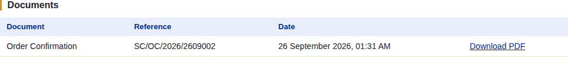
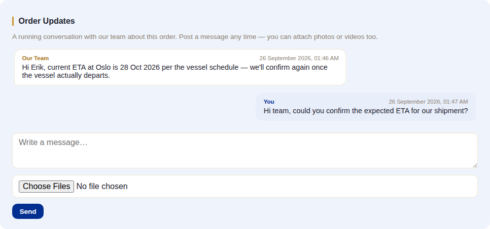
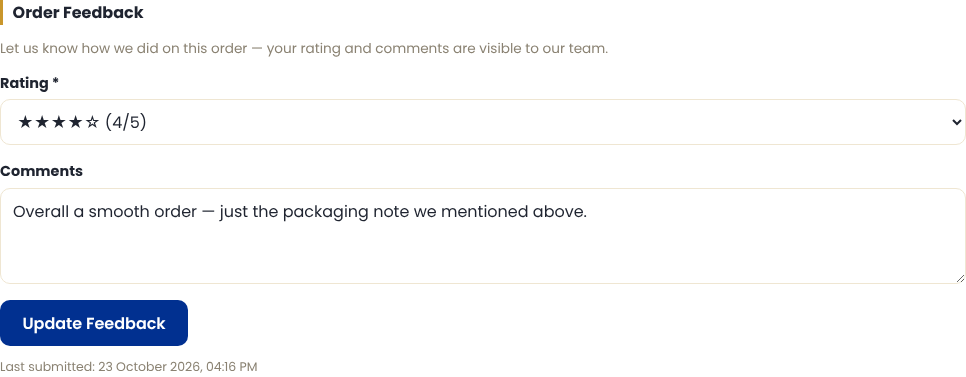
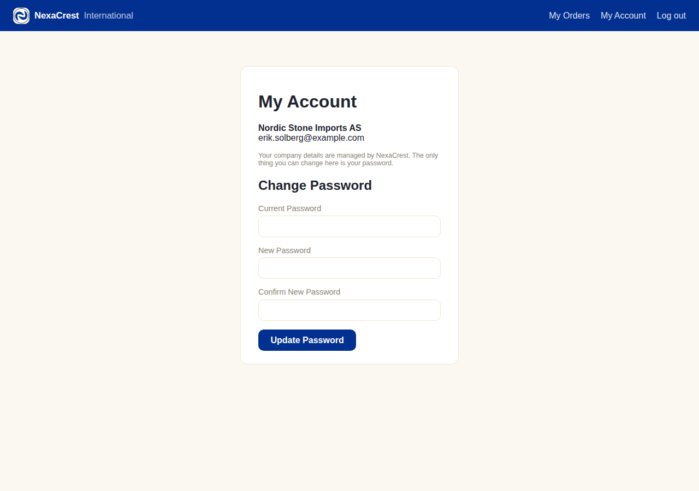

# Client Portal

## What this module is for

Everything the buyer can see and do themselves, gathered in one place. This
chapter is a reference to the portal as a whole — most of its individual
actions (acknowledging the OC, self-reporting a payment, raising a dispute)
already have their own detailed walkthrough earlier in this document; this
chapter shows how they fit together on the buyer's actual screens, plus the
two screens that don't belong to any single stage: the order list and the
account page.

## The system does this automatically

- **The portal login doesn't exist until Stage 3 → 4** (the advance payment
  clearing) — see [Chapter 3](./03-stage3-pi-advance.md). Before that point,
  the buyer has no way to log in at all, regardless of what they've done on
  public forms — except via staff impersonation, below.
- **Forgot password** — the sign-in screen has a "Forgot your password?"
  link. A buyer who requests a reset is always shown the same generic
  "if that address matches an account..." message, whether or not the
  email actually matches a client — the portal never confirms or denies
  that an address is in use. When it does match an active client with an
  active portal login, an email goes out with a reset link valid for 72
  hours, reusing the same one-time link mechanism as the initial "set
  your password" email. No more than 5 reset requests per client are
  honored within a rolling hour, to stop the feature being used to mail-bomb
  a buyer's inbox; further requests in that window still show the same
  generic message but send nothing.
- The buyer only ever sees the **final, approved/sent** PDF of a
  customer-facing document — never a draft, never an internal-only file
  type, regardless of what's requested. This is enforced on every single
  document download, not just filtered from the list.

## Staff access on behalf of a client ("Log in as this client")

Not every buyer can realistically use the portal themselves — a client
who created no email, a 70-year-old buyer with only a phone, or simply an
order that hasn't reached Stage 3 yet so no portal login exists at all.
For exactly this situation, staff can open a client-portal session on a
client's behalf from that client's own staff-side page, without needing
their password (there may not even be one yet) and without creating or
touching a `client_logins` row.

This is deliberately gated behind **three independent switches**, all of
which must be on before the "Log in as this client" button even appears:

1. **A permission** (`impersonate_client`) — who may use the feature at
   all. Granted to Admin/MD/ED/Super Admin by default, the same tier as
   other sensitive, wide-blast-radius actions (e.g. `manage_disputes`).
2. **A per-client toggle**, set on that client's own staff-side page
   ("Client Portal Access" section) — whether *this specific client* may
   ever be impersonated. Off by default for every client.
3. **A global kill switch** (Settings → `client_impersonation_enabled`) —
   off by default. With this off, the feature is unavailable for every
   client, no matter what permission a staff member holds or what any
   individual client's own toggle says.

All three hold → the button appears and works. Any one missing → it either
doesn't appear, or (if reached directly) is refused with a message naming
which gate is closed — the controller re-checks all three itself rather
than trusting the button's own visibility.

Once started, the portal shows an amber banner on every screen —
**"A staff member is viewing this portal on this client's behalf"** — with
an **End impersonation** button that returns to that client's own
staff-side page. The staff member's own login is untouched throughout:
starting or ending impersonation never logs them out of the staff app, and
the usual **ClientAuth** per-request checks are relaxed only for the
`client_logins`-row requirement (which may not exist yet) — the client
record itself must still be active, or the session is ended automatically
on the very next portal request.

Every start and end of an impersonated session is written to the audit
log (`CLIENT_IMPERSONATION_STARTED` / `CLIENT_IMPERSONATION_ENDED`), and
changing a client's own toggle is logged as
`CLIENT_IMPERSONATION_ALLOWED_CHANGED`. While impersonating, a staff member
can do anything the client themselves could do in the portal — download
documents, acknowledge the OC, upload the signed Buyer PO, self-report a
payment, raise a dispute, request a reorder — with one exception: changing
the client's own portal password still requires their current password
(see below), so impersonation on its own cannot be used to take over or
lock out a real client login.

### Resetting a client's portal password

A client who's genuinely locked out — forgot their password and can't
follow (or receive) the "Forgot password" email link — has no self-service
way back in, and impersonation doesn't help either (the client's own
Change Password form still needs their *current* password, which staff
never know). For exactly this case, that same client's staff-side page
("Client Portal Access" section) has a **Reset client-portal password**
action: enter a reason, and it generates a one-time temporary password,
shown once in the success banner for staff to hand over directly (phone,
in person — never emailed automatically, since the client typically
can't be reached by email right now). The client's next login is
required to change it, same as a staff account's own force-reset. Gated
on `manage_company_settings` (the same permission as the toggle above,
not `impersonate_client`), and every use is logged
(`CLIENT_PASSWORD_ADMIN_RESET`) to the Admin/MD/ED oversight tier. Only
works once the client already has a portal account (`client_logins`
row) — it resets an existing login, it does not provision one early.

## Order history visibility

By default every client sees every order they've ever had on their "My
Orders" dashboard, including ones marked complete or lost — the portal
has always shown the full history. This is configurable with the same
two-level pattern as "Log in as this client" above, just without a
permission gate, since it isn't a security-sensitive action:

1. **A global default** (Settings → `client_portal_show_order_history`)
   — on by default. Off = every client's dashboard shows active/disputed
   orders only, unless overridden per client (below).
2. **A per-client override**, set on that client's own staff-side page
   ("Client Portal Access" section) — a three-way choice: *Inherit
   global default*, *Always show full history*, or *Always show active
   orders only*. Whichever of the latter two is picked wins over the
   global default for that client specifically, in either direction.

Changing either one only affects what that client sees on their own
dashboard — it never hides, archives, or otherwise changes the orders
themselves, and has no effect on what staff see in the staff-side Orders
list or on that client's own page. Every change to a client's own
override is logged (`CLIENT_ORDER_HISTORY_VISIBILITY_CHANGED`).

## What the client sees and does

### My Orders (the dashboard)

The landing page after login — every order this client has, its current
stage name, status, and a link into each (or, when their order history is
not visible to them, their active/disputed orders only — see
[Order history visibility](#order-history-visibility) above).

**Orders are grouped by status** rather than shown as one flat list — a
lighter alternative to a full Kanban board, useful once a client has more
than a couple of orders on file and wants a quick visual split without the
drag-and-drop machinery staff get (see [Admin &
Settings](./15-admin-settings.md#ui-template-preference--standard-vs-kanban)
for that). The grouping uses the **label the client actually sees**, not
the system's raw internal status — so an order in **"Documents Sent"**
status (`shipped_docs_sent` — see [Stage 9's two-phase
closure](./09-stage9-despatch-closure.md#closing-the-order--two-phases))
and one already marked **complete** both land in the same **Complete**
group, since the buyer was never meant to see that internal distinction as
two separate buckets in the first place. Groups appear in a fixed,
most-relevant-first order (Active, Complete, Disputed, Lost, Cancelled),
and only a group with at least one order in it is shown — each rendered
group carries its own short, factual one-line description (e.g.
"Disputed — Being reviewed by our team"), so a client never has to guess
what landed an order in a given bucket:

### Inside an order

Opening an order (**View documents**) shows, top to bottom:

1. **Order Confirmation — Your Acknowledgement Needed** — only appears
   when there's a pending OC acknowledgment; see
   [Chapter 4](./04-stage4-order-confirmation.md) for the full mechanics.
2. **Documents** — every customer-facing document finalized so far, each
   with a direct PDF download; a short on-page line says as much, so the
   client knows these are final copies rather than wondering why nothing
   shows up before the first one is ready:

   

3. **Buyer PO** — lets the client upload a scanned copy of their own signed
   Purchase Order at any time, once they've signed it, rather than relying
   solely on emailing it to staff. Every past upload is listed (file name +
   upload date); re-uploading a corrected copy never removes the earlier
   one — see [Chapter 2](./02-stage2-buyer-po.md) for how this feeds the
   same record the internal staff-side upload writes to.
4. **Order Updates** — a running two-way chat thread with staff, separate
   from every stage-specific action. Either side can post a message and
   attach photos/videos/PDFs at any time; there's no approval step, it's
   simply a shared conversation log attached to the order:

   

5. **Report a Payment** — the buyer's own note that they've paid, covered
   in detail in [Chapter 3](./03-stage3-pi-advance.md) (Payment Status) —
   purely informational, staff still verify against the bank statement
   before recording anything themselves.
6. **Raise a Dispute** — only shown when staff have switched it on for this
   specific order; see [Disputes](./11-disputes.md). For cancel-intent
   messages only — a process flaw with no intent to cancel belongs in
   "Report a Process Issue" below instead, which is always available.
7. **Report a Process Issue** — unlike Raise a Dispute, this is **always**
   shown, regardless of order status or the dispute toggle above: a
   description box plus, once something's been submitted, the full
   two-way conversation with staff so far. See
   [Complaints](./19-complaints.md) for the complete picture, including
   who at NexaCrest sees and answers it.
8. **Order Feedback** — always available too: a 1-5 star rating plus
   optional comments on how this specific order went, distinct from the
   running Order Updates/Complaint conversations above. Submitting it
   again later replaces the earlier rating/comments rather than adding a
   second entry — there's no reason to stop a client revising their own
   feedback. Staff see the same rating and comments on that order's own
   page, and everyone holding `manage_orders` gets an in-app notification
   the moment feedback comes in.

   For a client who gives feedback over the phone or in person instead of
   through the portal, staff can record it directly from that order's own
   "Order Feedback" step (same 1-5 rating + comments, same gate — only
   once the order is Documents Sent or Complete). Logged under its own
   action type (`ORDER_FEEDBACK_RECORDED_BY_STAFF`) so the audit trail
   still shows it was staff-entered rather than a genuine client-portal
   submission.

   

### My Account

The only self-service screen outside a specific order — the buyer can
change their own password, nothing else. Company/contact details are staff-
managed and explicitly not editable here:

## What happens next

Nothing in the portal itself triggers pipeline progress except the two
specific actions already covered in their own chapters: acknowledging the
OC (passes Stage 4) and, indirectly, self-reported payments (which staff
still have to verify and record through the normal stage-payment actions
before anything actually clears).
