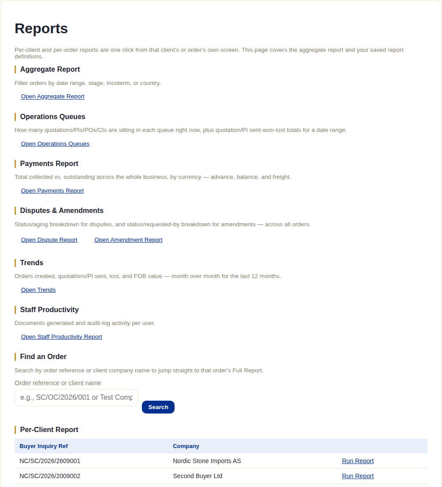
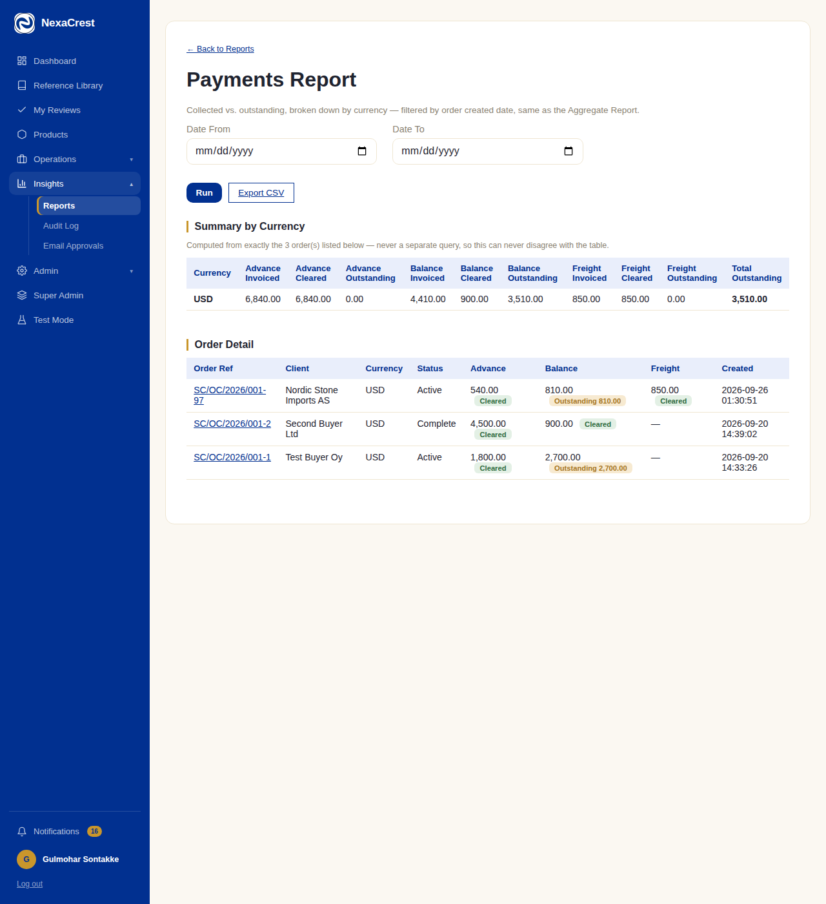

# Reports

## What this module is for

Answering business questions about the whole book of orders — money
collected vs. outstanding, what's stuck in which queue, how disputes and
amendments are trending, where the pipeline is bottlenecked — without
staff having to open every order individually.

## The system does this automatically

- Nothing progresses or changes because a report was run — every report
  here is **read-only**, purely a view over the same order/payment/document
  data covered in every earlier chapter.
- Every summary figure is **computed from the same rows the detail table
  below it shows** — never a separate query that could quietly disagree
  with the detail. The Payments Report states this explicitly on screen.
- **Reports show only the orders you may open** (owner decision
  2026-10-30, QA Round 6 Q-R6-4 / R6-N01): orders assigned to you, or
  every order if you hold **View all orders**; archived orders only with
  **View archived orders**. This covers the Aggregate, Payments, Today's
  Payments, Disputes, Amendments, Freight Cost and Order Profitability
  reports, the Client report and a client's page. Admin, MD, ED,
  Accounts, Viewer/Auditor and the CA see every order, as before.
- A link to a page you can't open (an order not assigned to you, a page
  your role doesn't have) is shown as plain text instead of a link that
  would answer "not permitted" (QA Round 6, R6-N02).

## What staff do

Everything starts from the **Reports** hub:

- **Aggregate Report** — filter orders by date range, stage, Incoterm, or
  country; the base report most others build on or reference. Its summary
  now also breaks down FOB value by customer and by country, not just by
  order count.
- **Operations Queues** — how many quotations/PIs/POs/CIs are sitting
  unresolved right now, plus sent/won/lost totals for a date range — the
  "what needs attention today" view.
- **Payments Report** — collected vs. outstanding, broken down by currency,
  across advance/balance/freight:

  

- **Today's Payments** — distinct from the Payments Report above, which
  filters orders by *created* date and shows their current status
  regardless of when a leg actually cleared. This instead answers "what
  actually cleared/was paid on this specific day", both directions:
  incoming (buyer advance/balance/freight, from the same clearing dates
  the Payments Report uses) and outgoing (the supplier's advance and
  balance — the payments recorded against the supplier's bills with **₹
  Mark Paid** in Steps 7e and 10a, shown on the date of the latest payment
  on that leg, with the total paid on it so far). The outgoing table is
  shown only to staff with **Manage supplier payments**. Payments to
  logistics partners are not listed here.
- **Debtors / Receivables Ageing** — every outstanding (not yet cleared)
  advance, balance or freight leg, bucketed Current, 1–30, 31–60, 61–90 and
  90+ days overdue. Advance and freight count from the order's creation
  date; the balance uses its own due date when one is set.

- **Dispute Report** / **Amendment Report** — status and aging breakdowns
  across every order, not just one at a time.
- **Trends** — orders created, quotations/PI sent, lost, and FOB value,
  month over month for the last 12 months.
- **Conversion Rate Report** — the same funnel as Operations Queues,
  shown as percentages.
- **Sales Performance Report** — the KPI/growth view: for any period (a
  preset — This/Last Month, This/Last Quarter, This/Last Half-Year,
  This/Last Year — or a custom date range), how many orders were created,
  quotations and PIs sent, how many were **won** and how many **lost**,
  the win rate, and the FOB value won by currency (currencies are never
  summed together). "Won" means **reached the PI stage** — the same
  sent/won/lost counts every other funnel-based report in this module
  already uses, never a second, divergent definition. A lost order is
  split into **lost before PI** vs. **lost after PI** (losing a live PI is
  a different problem than losing a quotation), and every individual lost
  order is listed with its own reason exactly as recorded — this report
  never invents a fixed category scheme for why an order was lost, since
  the reason is free text a staff member typed at the time. When both
  Date From and Date To are set, the report automatically compares against
  the **immediately preceding period of equal length** (e.g. This Month
  vs. Last Month, or a custom 15-day range vs. the 15 days before it) and
  shows a ▲/▼ percentage change per metric — a metric with nothing in the
  previous period shows "—" rather than a fake infinite percentage. This
  is the report to open when asking "how are we actually doing, and is it
  getting better or worse."
- **Freight Cost Report** — confirmed freight/insurance terms and
  invoiced freight, by forwarder, filtered by order creation date.
- **Product Sales Report** — which products / HS codes drive FOB value,
  highest first, filtered by order creation date.
- **Supplier Performance Report** — all-time, per supplier: average days
  from Supplier PO to signature, and the on-time % (packing date against
  the PO's required delivery date).
- **Order Profitability** — revenue, total cost, profit and margin % per
  order for any date range, with a totals row. Visible only to Super
  Admin and roles granted **Manage order financials**; see [Order
  Financials](./ca-08-order-financials.md#the-order-profitability-report).
- **Staff Productivity** — documents generated and audit-log activity per
  user (requires the separate `view_staff_reports` permission — this one
  isn't available to every role by default, unlike the others).
- **Find an Order** — search by order reference or client name to jump
  straight to that order's own Full Report.
- **Per-Client Report** — every client listed, one click into their own
  report (also reachable from the client's own page).
- **Per-Order Report** — reachable from any order's own "Full Report" link.
- **Saved Reports** — save an Aggregate Report's filter set with a name and
  visibility (private or shared with other staff), then re-run it later
  without re-entering the filters.

Every report screen in this module (CA/Accounting reports are their own
separate module — see that chapter) offers **Export CSV** — a
spreadsheet-ready download of exactly what's on screen, for anything that
needs to leave the system (board reporting, external accounting, etc.).
A report built around a single metrics table rather than a per-record
list (Conversion Rate) exports as a Metric/Value pair per row instead;
the Per-Order Report exports its own Full Audit Trail section, the one
of its three sections genuinely worth pulling into a spreadsheet.

Staff who may see CAFIN also find **CAFIN export** here: the CA Financial
Annexure of every order of a financial year as CSV, internal only (see
[CA-01](./ca-01-overview.md#cafin-export-csv-for-all-orders)).

## What the client does (or doesn't)

Nothing — Reports is an entirely internal, staff-only module. Nothing here
is visible from the client portal in any form.

## What happens next

Nothing changes as a result of viewing a report — this module exists purely
to inform decisions staff make elsewhere in the system (chasing an
outstanding payment, following up a stuck quotation, reviewing a pattern of
disputes), not to trigger anything itself.
