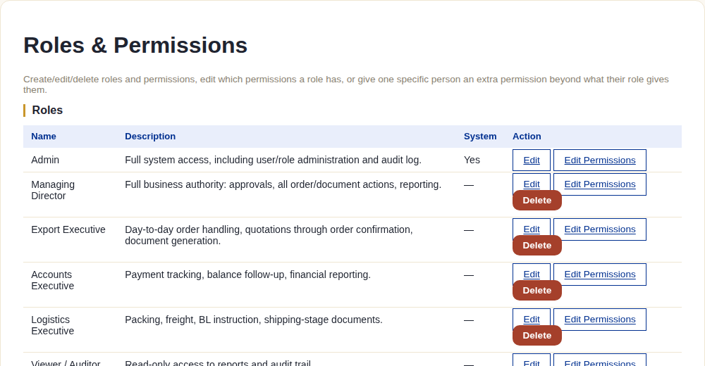
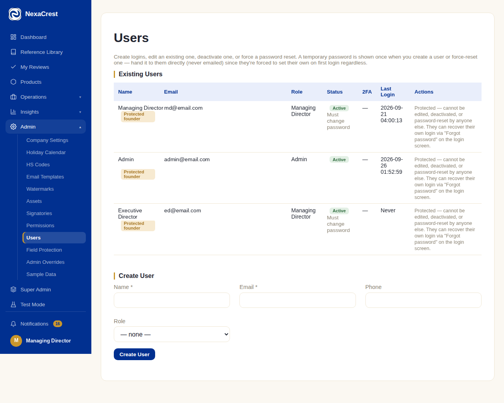
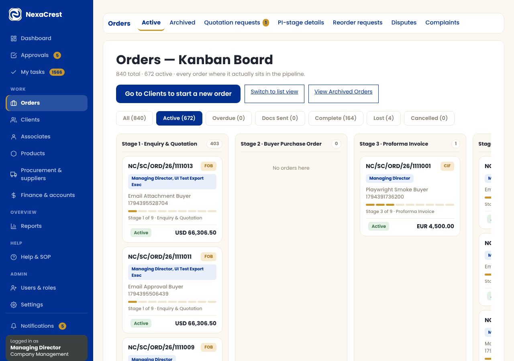

# Admin & Settings

## What this module is for

Everything that configures how the system behaves, rather than any single
order — roles and who can do what, users, company/bank details baked into
documents, the HS code master list, email templates, watermarks,
signatories, and a handful of override/protection mechanisms. Only visible
to staff who actually have the relevant permission — most of these pages
are simply absent for a role that isn't allowed to touch them.

**Where these pages are (since 11 Nov 2026).** The old "Admin" group is now
two left-menu entries, each with its own menu bar at the top of its pages
(see [Getting started → Finding your way around](./00-getting-started.md#finding-your-way-around)):

- **Users & roles** — Users · + Add user · Roles and permissions ·
  Departments · Task due days · Self-approval rules · SOP access · Field
  protection.
- **Settings** — Setup checklist · Company · E-mail · Security · Holidays ·
  Document clean-up · Backups · Zoho · Documents ▾ (email templates,
  watermarks, signatories, assets, UI templates) · Lists ▾ (ports, port
  routes, payment presets, dropdown lists, GST rates, import duty,
  compliance task types, remittance difference reasons, associate TDS
  rules, reference library categories) · Divisions · Admin overrides · Data
  export · Sample data · Test mode · Super Admin.
- Moved out of Admin: **HS codes** and **Pricing** are in **Products**;
  **Suppliers** and **Logistics partners** in **Procurement & suppliers**;
  **Team incentives** in **Finance & accounts**.

Since 11 Nov 2026 every chapter of this manual uses these menu names; the old "Admin → X" paths are gone.

## The system does this automatically

- A **Super Admin** bypasses every permission check outright — this tier
  exists specifically so there's always at least one account that can never
  be locked out of its own system by a permissions misconfiguration.
- **System roles** (marked "Yes" under System) can't be deleted — only
  edited — since core behavior depends on them existing.
- A brand-new **permission** does nothing on its own the moment it's
  created here — a developer still has to add a check for it somewhere in
  the code before it actually gates anything. Creating one is bookkeeping,
  not a live switch.

## What staff do

### Reading Settings › Company (D-332, 12 Nov 2026)

Every setting shows a plain name (for example "Staff: log out after …
minutes idle") with one sentence under it saying what it does. The small
grey text under that is the setting's technical name — quote it when you
ask for support. The sections have plain titles too ("Security and logging
in", "RBI purpose codes", "Screen layout", "Zoho Books" …) and are in A–Z
order.

### Changing the Managing Director's name or title (D-349, 12 Nov 2026)

When you change **Managing Director name** or **Managing Director title** on
Settings › Company and press **Save changes** (with your reason), nothing is saved
yet. A page opens: *"The Managing Director's name changed from "…" to "…". Apply it to:"*

- ☑ **N open orders** whose kept company details still show the old name
  (orders whose PI is approved keep their own copy — closed, lost and cancelled
  orders are never touched). Click **Show the orders** beside the count to see
  their order numbers.
- ☑ **N documents still in Draft / In review** that print the company's
  fallback signatory with the old name. Click **Show the documents** beside the
  count to see their numbers.
- If the person who signs is a founder login, a note says the name under the
  signature comes from that login, which the app cannot change on purpose —
  change it with the founder SQL block in the README (First-time setup).
- *Not changed:* documents already approved or sent; closed and cancelled orders.

Press **Save and apply** to save the setting and update the ticked items, or
**Save setting only** to save just the setting. Untick a box to leave that group
as it is. Going back to Settings saves nothing. Every change is in the Audit Log
(old → new, which orders, which documents). A draft PDF already made keeps the
old name until it is regenerated; the final copy made on approval shows the new one.

### Sign-in security (D-265)

Every staff member, in every role, and every buyer enters a 6-digit code
e-mailed at each login. It cannot be switched off for anyone; the Users list
shows "2FA: Required". Admin's only choice is **Settings › Security → Remember an office computer
for … days** (`login_remember_browser_days`; default **7**, 0–90; 0 = the
code at every login). Above 0, staff (never buyers or associates) see **"This is my own
office computer"** on the code screen and skip the code on that computer for
that many days (D-283). A password change or reset forgets every remembered
computer; putting the setting back to 0 ends them all at once. **Forget all
remembered computers**: each person on My Account, and Admin for any person
in Users → Edit (both audit-logged).

### Staying logged in (owner, 11 Nov 2026, D-283)

**Settings › Security** has one idle timeout per area: **Staff: log out
after … minutes idle** (**240** = 4 hours), **Buyers: log out after …
minutes idle** (**120**) and **Associates: log out after … minutes idle**
(**120**), each 5 to 1440 minutes; and **Staff: log in again at least every
… hours** (**12**, 1 to 24): staff log in again at least this often,
however active. The app now keeps
these itself — the server no longer drops a session after about 24 minutes.
Two minutes before an idle sign-out every page shows "You will be signed out
soon" with **Stay logged in**; before the 12-hour limit it only warns.

### E-mail settings (owner, 11 Nov 2026, D-280 / D-281)

**Settings › E-mail** lists every e-mail the app sends, with one switch
per audience (Staff, Associate, Buyer, Supplier). Saving needs a reason and is
in the Audit Log.

- **MUST** (locked on, cannot be switched off): login codes, set-password
  invites (buyer portal and associate portal), forgot-password links (staff,
  buyers, associates), the "bank details changed — if this wasn't you" alert,
  the two bank-details confirmations (the 6-digit code an associate enters to
  confirm new bank details, and the "please confirm your new bank details"
  link to a supplier or logistics partner — listed since 12 Nov 2026, D-332),
  the backup-code alert, the quotation verification code.
- **SHOULD** (on when installed): everything else — documents, links and
  messages to buyers, supplier links, every associate e-mail, staff approvals
  (one e-mail per approval), buyer/supplier/associate actions, compliance
  alerts, Zoho failures, the daily summary, "order assigned / department owner".
- **OPTIONAL** (off when installed): only the copy of buyer documents to the
  associate who introduced the buyer.
- **Testing mode — hold all e-mails to buyers and suppliers** (top of the page;
  replaces the old "mail sending" switch; **on** in a fresh installation since
  D-347 — switch it off on go-live day): while on, buyer and supplier
  e-mails are not sent and the screens say so and show the link to copy;
  staff and associate e-mails and every MUST e-mail still go out. While buyer
  document e-mails are held there is no Send to Buyer: an approved document
  counts as sent and staff send the PDF themselves.
- **Who on the staff side gets an e-mail.** Only the people of the event's
  department on that order (its department owner and the department's
  assignees). Nobody from that department on the order: the department's
  manager, with "please assign someone"; no manager: the Managing Director.
  The MD, ED and Order Coordinator see routine events in the app only.
- **E. Company compliance alerts — who is told.** For LUT, RCMC, agreements,
  TDS, merchant-trade RBI limits, the ECGC policy and the monthly eBRC list,
  choose a **responsible person** and a **backup** (for leave). Not set: the
  department's manager, then the MD.

The screen never says "e-mailed" when nothing was sent; links (set-password,
PI form, Buyer Action, Payment Action, Supplier Action, Vendor Details) are
shown with a **Copy** button so you can send them yourself.

**Backup codes.** The MD, ED, Admin and any Super Admin make 10 emergency
backup codes on **My Account** (current password needed). They are shown once
and stored hashed; making a new set cancels the old one. On the code screen
"Use a backup code instead" signs them in if e-mail is down. Each use is in
the audit log (`LOGIN_BACKUP_CODE_USED`) and every holder of "Manage company
settings" gets a notice and an e-mail. If a backup code is used unexpectedly,
reset that person's password at once (Users → Reset password).

### Roles & Permissions

> **Departments come first (D-214).** Most access is now given by adding a person to a department on their user page — see [Departments & Log in as](./21-departments.md). Edit a role's permissions only when a designation's rights themselves change. **Users & roles › Departments** lists every department and the role behind each designation.

Left menu: **Users & roles › Roles and permissions**. Create, edit, or delete roles; edit which permissions a role has; or grant
one specific person an extra permission beyond what their role normally
gives them (with a mandatory, logged reason):

Below the roles list (not shown here) sits the full **Role Matrix** — every
permission against every role in one table — and a **Permission
Definitions** list for creating new permission keys.

`manage_orders` has always been the single gate for both *seeing* and
*editing* the Orders and Clients modules — there was no way to let
someone look without also being able to touch anything. Two narrower
permissions, **View Orders (read-only)** (`view_orders`) and **View
Clients (read-only)** (`view_clients`), now admit a read-only visitor to
the Orders list/detail page and the Clients list/detail page
respectively, alongside `manage_orders` — never instead of it, and never
touching any mutating route or button, which all stay gated on
`manage_orders` (or its existing finer siblings like `manage_payments`,
`manage_shipping`, `close_orders`). The seeded **Viewer / Auditor** role
carries both, so it can finally see real order and client data instead
of only reports and the audit log.

Every order now also has a list of staff **assignees** (whoever created
it is auto-assigned as the first one), and most roles only see orders
they're assigned to — in the Orders list, the Kanban board, and the
order detail page itself (a bookmarked or guessed URL to someone else's
order is refused, not just hidden). The same rule — and the archived-
order rule — covers every page and action of that order too (editing,
Annexure A, amendments, the Full Report, its document and file
downloads), not only its main page (QA Round 5). Links and buttons a
person's permissions don't allow are no longer shown to them at all —
on the order page, in the left menu and menu bars, and in the SOP / Getting Started text
(a link there turns into plain text). An order can have more than one
assignee at once: for example an Export Executive handling office/
documentation work and a Logistics Executive handling CHA/factory work
can both be assigned to the same order concurrently, since the two of
them may genuinely need to work it at the same time. **Admin, Managing
Director, Executive Director, Accounts Executive,** and **Viewer /
Auditor** hold a separate permission, **View All Orders**
(`view_all_orders`), which bypasses this and shows every order
regardless of who's assigned — Accounts Executive needs this because
they touch payment steps across orders they didn't create. Adding or
removing an assignee (small controls on the order detail page itself)
needs its own permission, **Manage Order Assignees**
(`assign_order_owner`), held only by Admin/Managing Director/Executive
Director — not by any of the order's own current assignees, and not by
anyone who merely holds `manage_orders`. This is purely about who can
*see* an order; it never changes who can *act* on it — `manage_payments`,
`manage_shipping`, `close_orders`, and the rest of the permission system
work exactly as before, completely independent of who's assigned to the
order.

### Who may give which rights (owner decision A-8, 1 Nov 2026)

- Nobody can give a permission they do not hold themselves — not on a
  role, not as a personal extra permission, not by giving someone a role
  or a department membership. Removing a permission is always allowed.
- Nobody can change their own rights: their own role's permissions, their
  own role, or a personal exception or membership for themselves.
- A Super Admin is the exception, so nobody can be locked out.
- System Administrator manages users, settings and lists, but has no
  full data export.

### Self-approval rules (owner decision D-221, 1 Nov 2026)

Normally a second person approves what someone else created. **Self-approval
rules** (left menu, Super Admins only) sets, for each rule, the roles whose
holders may approve their **own** work:

| Rule | Default | Refused with |
|---|---|---|
| Approve the payment terms of an order they created | Managing Director, Executive Director | "You created this order, so its payment terms must be approved by someone else." |
| Review (approve) a document they generated | Managing Director, Executive Director | "This document's own generator cannot be assigned as its reviewer — a different person must review it." |
| Approve an e-mail send they requested | Managing Director, Executive Director | "You requested this send — a different person must approve it." |
| Approve or reject the cancellation of an order they requested | Managing Director, Executive Director | "You requested this cancellation — a different privileged person must approve it." (rejecting: "… must decide on it.") |
| Approve a purchase award they made | Managing Director, Executive Director | "You awarded this purchase, so someone else must approve it." |
| MD-approve an amendment they requested | Managing Director, Executive Director | "You requested this amendment — a different privileged user must MD-approve it." |
| Clear short a buyer payment whose receipts they recorded | Managing Director, Executive Director | "You recorded this payment's receipts, so a different manager with "Approve short payment" must clear it short." |
| Approve a price discount on an order where they set the discounted price (D-240) | Managing Director, Executive Director | "You set a discounted price on this order — a different MD/ED must approve the discount." |

QA Round 8 (R8-N09): all the rules are on this page (eight since D-240, 2 Nov 2026). There is **no other
exception** — a Super Admin, an Admin or a System Administrator (anyone
holding "Manage permissions") approves their own work only if one of their
roles is ticked here, like everyone else.

1. Tick or untick the roles under each rule, then **Save rules**. The page
   says "Self-approval rules saved. They apply from the next approval."
2. A person qualifies when any of their roles (main role, the department
   they are logged in as, or a department membership) is ticked. Leave a
   rule empty so that nobody self-approves.
3. Every self-approval is written to the audit log (PAYMENT_TERMS_SELF_APPROVED,
   DOCUMENT_SELF_REVIEWED, EMAIL_SEND_SELF_APPROVED, ORDER_CANCELLATION_SELF_APPROVED
   or ORDER_CANCELLATION_SELF_REJECTED, PURCHASE_AWARD_SELF_APPROVED,
   AMENDMENT_SELF_APPROVED, SHORT_PAYMENT_SELF_APPROVED, PRICE_DISCOUNT_SELF_APPROVED); a self-review shows a
   **self-review** badge in the document's review list. Every change to the
   rules is logged as SELF_APPROVAL_RULE_CHANGED with the roles before and
   after.
4. A self-review that was assigned while allowed is refused at approval if
   the rule has since been withdrawn.

**Bank details** (`bank_details`, owner decision 11 Nov 2026, D-293; seeded
Managing Director and Executive Director): someone with this rule may verify
bank details (an associate's, a supplier's or a logistics partner's) that they
entered themselves — only after the holder has confirmed them, and with a
written reason that is kept on the record and in the audit log. Everyone else
sees "Someone else must verify details you entered."

### Permissions added 1 Nov 2026

| Permission | Who has it | What it allows |
|---|---|---|
| Manage associates (`manage_associates`) | MD, ED, Admin | The associate register, rates, status, portal access, personal codes, client links, holds and claw-backs, standard rates, the report ([Chapter 24](./24-associates.md)) |
| View associates (`view_associates`) | Export Executive, Sales/Export Manager, Sales Director (and MD, ED, Admin) | Who introduced which client — no amounts |
| Associate bank & tax details (`manage_associate_bank`) | Finance Manager, Finance Director, MD, Admin | Associates' bank details: verify (after the associate has confirmed them), full number |
| See associate commission rules (`view_associate_commission_rules`) — added 11 Nov 2026 (D-292) | Admin, MD, ED, Finance Director, Finance Manager | An associate's commission rule, the % and level of their next order, orders counted and the ladder steps; others see "Set by the MD" ([Chapter 24](./24-associates.md)) |
| Override shipment gates (`override_shipment_gates`) | MD, ED, Admin | Release the Bill of Lading step (10f) with a written reason when the before-shipment balance or the inspection is not cleared ([Stage 7](./07-stage7-packing-bl.md)) |
| Approve short payment (`approve_short_payment`) | MD, ED, Admin, Finance Director | Clear a buyer payment that is less than due, with a written reason ([Stage 3](./03-stage3-pi-advance.md), [Stage 8](./08-stage8-ci-balance.md)) |
| Manage approval limits (`manage_approval_limits`) | MD, ED (and Super Admins) | Change a designation's approval limit or make it 'director' level — never on a designation the person holds ([Chapter 21](./21-departments.md)). Added by QA Round 8 (R8-N10) |

### Products & pricing (owner decision D-245)

Pricing (margin, buffer, pricing exchange rate, team-incentive reserve, stale days, and
"Goods lines must be picked from Products" — on by default) is set under **Products › Global pricing settings**
(MD only); a category's margin, other costs and buffer under **Products › Category price rules**, and a
product's own values under **Products › Configure** (D-361, D-362) — see [Pricing](./27-pricing.md). The D-240 reference-price
note settings and the "Approve price discount" permission were removed by D-245 P2.

### Changing a setting does not change orders already agreed (owner decision D-262)

A change under Admin (T&C clauses, company details, the shortfall tolerance, validity days,
a product category, a payment preset's "Requires MD approval", the pricing exchange rate, a
product's Zoho item) applies to new orders and to orders whose PI is not yet approved. The
pricing exchange rate and the line prices are fixed even earlier, when the order's first
Quotation is approved (D-342). An
order whose PI is approved keeps its own copy — see [Stage 3](./03-stage3-pi-advance.md).
Other masters behave the same way: renaming the "Pre-Shipment Inspection" compliance task
never switches its gate off (the task has a fixed code); a vendor bill keeps the vendor's
name, GSTIN and PAN it was recorded with; an associate payout keeps the GST % and the
associate's GSTIN it was locked with.

### Scheduled jobs (set up once on the server)

| Job | When | What it does |
|---|---|---|
| Deferred e-mail dispatch | every 10 minutes | Sends approved e-mails that are due |
| OC auto-confirm | every 15 minutes | Confirms an Order Confirmation the buyer has not answered within 48 hours of it being sent (e-mail off: from **Mark Order Confirmation Sent to Buyer**) |
| Alerts | daily 06:00 IST | LUT / RCMC expiry, freight and balance payments overdue, the LC's last shipment date, document deadline and expiry (7 days before), quotation / PI validity expired, dispute replies overdue |
| Zoho Books sync | hourly | Sends and checks the records that go to Zoho Books ([CA-03](./ca-03-zoho-sync.md)) |
| Daily digest | 08:15 IST | One e-mail per person with their open tasks and documents to review; also the associates' reminders (protection and agreement ending in 30 and 7 days) |
| Document copies clean-up | daily 02:15 | Removes the document copies switched on under **Document copies clean-up** (below); nothing while every rule is off |
| Database backup | daily 02:00 IST | Encrypted copy of the database, kept 10 years ([SOP 32](./32-backups-restore.md)) |
| Documents backup | daily 02:30 IST | Copy of every order document, each file stored once ([SOP 32](./32-backups-restore.md)) |
| Backup test-restore | 1st of the month, 04:00 IST | Proves the newest copy can be restored, into a separate scratch database ([SOP 32](./32-backups-restore.md)) |

The server set-up is in each stack's README ("Bluehost cron setup" for PHP,
"Background jobs" for Node).

### Admin pages added 5–6 Nov 2026

Each one has its own chapter; this list is only where to find them.

| Page | Who | Chapter |
|---|---|---|
| **Settings › Divisions** (activation check list, division settings) | MD | [SOP 28](./28-divisions.md) |
| **Settings › Lists › GST rates** (shown once Domestic Trade or Import & Distribution is active) | MD | [SOP 29](./29-domestic-trade.md) |
| **Settings › Lists › Import duty** (shown once Import & Distribution is active) | MD | [SOP 30](./30-import-distribution.md) |
| **Finance & accounts › Team incentive settings** — eligibility per designation and caps per role | MD | [SOP 20](./20-incentives.md) |
| **Associates › Access levels** — what Starter, Quoting and Full show | MD | [SOP 24](./24-associates.md) |
| **Settings › Backups** — last database and documents copies, test-restore, settings (read only) | Manage company settings | [SOP 32](./32-backups-restore.md) |

### SOP access (owner, 7 Nov 2026, D-266)

**Users & roles › SOP access** (`/admin/sop-access`, Manage company
settings): who sees which chapter of this SOP.

- **SOP library** — one switch. Off hides the SOP menu, every chapter, its
  screenshots and the Gallery from all staff except MD and Admin; Getting
  Started stays open.
- **Role** — choose a role, tick the chapters it sees, press **Save**.
  "Copy ticks from" fills the ticks from another role (check them, then
  Save). "Show" narrows the list (ticked, new, switched off); ticks you
  cannot see are kept when you save.
- **On for everyone** — each chapter's button switches it off (or on) for
  everyone except MD and Admin, even where it is ticked.
- **New** — a chapter added to the SOP later is shown only to MD and Admin
  until you tick it for a role or a person, or switch it on.
- **Extra chapters for one person** — on **Users → Edit**, "Extra SOP
  chapters for this person": add or remove chapters for someone covering
  for a colleague. They see "Extra for you" next to them.

A person sees the chapters of their own role and of every department role
they hold. MD and Admin always see every chapter; the CA chapters still
need the CA permission. Every change is in the Audit Log.

### Associate TDS (owner, 2 Nov 2026, D-235)

**Settings › Lists › Associate TDS rules** (`/settings/associate-tds`, Manage company
settings; Settings › Lists): the values the app uses to
work out TDS on associate commission — TDS section (194H), rate (2 %),
threshold per associate per financial year (₹20,000), rate without a
verified PAN (20 %, section 206AA), whether associates abroad have TDS
deducted (off), whether Form 15CB is required with Form 15CA (on), and the
Zoho Books TDS tax id (blank = the CA books the TDS). Every change needs a
reason and is audited (ASSOCIATE_TDS_SETTING_CHANGED); payments already
recorded keep the TDS they were paid with. How the rules work: [Chapter
24](./24-associates.md#tds-on-associate-commission-owner-decision-2-nov-2026-d-235).

### Remittance difference reasons (owner, 2 Nov 2026)

**Settings › Lists › Remittance difference reasons** (link at the top of Company
Settings; needs *Manage company settings*). The list behind **"Why is it
different?"** on the advance, freight, balance and milestone remittance
forms, used when the money a buyer sends differs from what is due. Each
reason has a name, an order and how it is **treated**:

| Treated as | What happens to the receipt |
|---|---|
| Bank charges deducted by the banks | Counted as received in full; the charges become an order cost "Bank Charges" and go to Zoho Books with the payment at the next sync (hourly, or Sync now) |
| Buyer paid less (short payment) | Recorded as received; the rest is awaited, or a manager clears it short with a reason |
| Buyer paid more | Recorded as received; on the advance the balance due goes down by the same amount |

Eleven usual reasons come ready (four bank-charges, four buyer-paid-less,
three buyer-paid-more). On the page you can **add** a reason, **rename**
it, change its **order**, and **switch it off** (it disappears from the
forms; receipts that used it keep it) or on again. Once a reason is on a
receipt **how it is treated cannot change** — switch it off and add a new
one instead, so past receipts keep meaning what they meant. Every change is
in the audit log (REMITTANCE_REASON_ADDED / _UPDATED / _DEACTIVATED /
_REACTIVATED).

The forms offer only the reasons that fit the amount typed and always end
with **"Other — type the reason"** (a reason in the person's own words plus
how to treat it). The page's **"Reasons typed in by hand"** table lists
those, most used first — add the frequent ones to the list so the team can
pick them.

### Setup checklist (owner, 11 Nov 2026, D-312 / D-313)

**Settings › Setup checklist** (needs *Manage company settings*; the menu shows
how many items are still Needed). Use it on installation day and whenever the
menu shows a number. Each line says **Done** or **Needed** (Optional for ECGC
and Zoho) and has a button to the page where it is set:

1. **Company identity** and **Bank details, GSTIN, IEC/PAN** — the new
   installation starts with placeholders (e.g. "Bank name (to be entered)",
   GSTIN 29AAAAA0000A1ZY). Enter the real values on Settings › Company (Unlock the protected rows, give a reason).
2. **LUT and RCMC** numbers and expiry dates; **ECGC** if the company has a
   policy.
3. **E-mail server** — SMTP in `app/.env` (server side); then send a test
   e-mail from Settings › Company. Testing mode (Settings › E-mail) is on in a fresh
   installation (D-347): switch it off on go-live day, once the test e-mail
   arrives.
4. **Zoho** (optional), **Backups** (folder, encryption, off-site copy).
5. **Pricing** (exchange rate and margins) and **Commission levels** — the MD
   checks them and ticks (only someone who manages pricing may tick). The row's
   link opens **Products**, where Global pricing settings and Category price rules
   are on the link bar (D-362).
6. **TDS and export-benefit deadlines** — tick once confirmed with the CA.
7. **This year's holidays** — the national holidays (26 Jan, 15 Aug, 2 Oct)
   come pre-filled for this year and next; add the state and festival
   holidays in the Holiday Calendar, then tick. A new tick is asked for every
   year.
8. **The MD's real e-mail** — no user may keep md@email.com, ed@email.com or
   admin@email.com.
9. **storage/sessions writable** (PHP only).
10. **Settings at the recommended values** — the list underneath shows every
    setting that differs (document clean-up 90 / 365 / latest only, password
    expiry off, "my own office computer" 30 days, idle sign-out staff 4 h,
    buyers 2 h, associates 2 h, staff log in again every 12 h, Test Mode
    e-mail = company e-mail). Tick the rows, give a reason and press **Apply
    recommended**; every change is in the Audit Log with the reason.

New installations also start with: document clean-up on (drafts 90 days,
never-sent superseded revisions 365 days, CAFIN latest only), password expiry
off, and the Test Mode e-mail set to the company e-mail.

### Document copies clean-up (owner, 2 Nov 2026)

**Settings › Document clean-up** (link at the top of Company
Settings; needs *Manage company settings*). Every generated document keeps
several copies: the **DRAFT** copy made when it is generated, the **final**
copy made on approval (the one the buyer gets), a **SUPERSEDED** copy when a
newer revision is approved, the internal Word copy, and every **CAFIN** ever
generated. Three rules remove the ones nobody needs. Since 11 Nov 2026
(D-313) a new installation starts with all three **on**: drafts 90 days,
never-sent superseded revisions 365 days, CAFIN latest only.

| Rule | Options | What it removes |
|---|---|---|
| Draft copies of approved documents | Off / 30 / 90 / 180 days after approval | Only the DRAFT-watermarked PDF, once the final copy exists |
| Superseded revisions never sent to the client | Off / 90 / 180 / 365 days after it was superseded | The draft, final and Word copies of an older revision the client never received; the one SUPERSEDED-stamped copy stays so the history still opens |
| Old CAFIN copies | Keep all / Keep only the latest per order | Every CAFIN except the order's latest, 30 days after a newer one was made |

**Never removed**, whatever is switched on: anything sent to the client
(e-mailed, counted as sent with e-mail off, or downloaded in the client
portal); the current copy of every document; the Word copy of a document
that is still current; uploaded files (signed copies, bills, payment
screenshots, the buyer's PO, BL scans …); every file of an order with an
open dispute; documents generated in a financial year the CA has locked.

1. Choose an option for each rule, give a reason (at least 10 characters)
   and **Save**. The change is in the Audit Log.
2. The page shows, for each rule, about how many files and how much space
   it would free now — also for a rule that is still off.
3. **Preview what would be removed** lists every copy (order, document,
   revision, file, size, why).
4. The daily job removes them; or tick *I understand removed copies cannot
   be restored* and press **Run clean-up now**.
5. Each removed copy is in the Audit Log as `DOCUMENT_COPY_REMOVED` (document,
   file name, size, reason), each run as `DOCUMENT_COPY_CLEANUP_RUN`. A
   removed copy cannot be restored.

Why keep anything: the final copy is the record of what the buyer was
given; a sent revision may be needed in a dispute or by customs or the CA;
drafts and never-sent revisions only show the work in between.

### Users

Create logins, edit an existing one, deactivate one, archive one, delete
one, or force a password reset. A temporary password is shown **once**, at
creation or reset — staff hand it to the person directly, since it's never
emailed and they're forced to set their own on first login regardless:

The list is a 3-way filter — **Active / Inactive / Archived** tabs, each
showing its own count — rather than one unfiltered list of everyone.
**Archive** is a separate, stronger state than **Deactivate**: it marks
someone who has genuinely left (not just temporarily suspended), moves
them out of both the Active and Inactive tabs into their own, and always
forces the account inactive too. An archived account can be **Unarchive**d
back to Inactive, then separately **Reactivate**d if they ever return.

**Delete** is a real, permanent delete — it only succeeds for a user with
no order, document, or audit-log history on file anywhere (the database's
own referential-integrity rules decide this, not a hand-picked checklist),
so it only ever actually removes an account created by mistake with zero
real activity. Any user who has done anything at all — even just logged in
once — can only be archived, never deleted; trying anyway shows a clear
message naming where they still appear ("… can't be deleted — they still
appear in: …. History is never removed, so archive (deactivate) them
instead.") rather than failing silently.

**Renaming a signatory (D-349).** When you change the name of a user who can
sign documents (not a founder login), their documents still in Draft / In review
take the new name; the message after saving says how many. Approved and sent
documents keep the name they were issued with.

Notice the **"Protected — founder"** tag on certain accounts: these
specific users can't be edited, deactivated, archived, deleted, or
password-reset by anyone else at all, even an Admin — they can only
recover their own login via "Forgot password" on the login screen
themselves. This exists so the
people who set the company up can never be locked out by another admin's
mistake (or malice).

Any logged-in staff user — admin-reset, forced-first-login, or neither —
can also change their own password voluntarily at any time from **My
Account** (90-item backlog #26), without needing an admin to force a reset
first. It asks for the current password (re-verified before anything
changes) plus the new password twice, enforces the same DB-driven password
policy (`password_min_length`/`password_complexity_json`) as every other
password-change path, and is audited the same way (`PASSWORD_CHANGED`).

### The rest of Admin

- **Settings › Company** — legal name, registered/corporate office, GSTIN/IEC,
  bank details, LUT number — the exact fields snapshotted onto every
  generated document (see the note in [Chapter 1](./01-stage1-enquiry-quotation.md)
  about data integrity). The Zoho client secrets and refresh tokens are
  never shown: the field says "•••• stored, ends in 1a2b"; type a new
  value to replace one, leave it empty to keep it, and the audit log keeps
  only the last 4 characters (owner decision 1 Nov 2026). The LUT expiry date and RCMC validity date each
  carry their own alert-days setting; once either is within that many
  days of expiring (or already past it), a warning shows on the
  Dashboard **and** a count appears beside **Settings** in the left menu and beside **Company** on its menu bar — visible from every page, not just the Dashboard. The same screen's **Mail Redirect** section holds
  four settings, independent of [Test Mode](./16-test-mode.md)'s own email
  redirect: a **Redirect all mail** toggle plus address — when on, every
  non-security outbound email (order updates, document sends, and so on)
  goes to that one address instead of its real recipient, useful for
  rehearsing real mail without touching Test Mode at all — and a **CC
  emails** list (comma-separated) plus a single **Default CC email**,
  both applied to every non-security outbound email regardless of whether
  redirect is on. Both are set only here — there is no `.env` fallback,
  so leaving them blank means nothing is CC'd. Staff 2FA codes and password-reset links are
  never redirected or CC'd, the same carve-out Test Mode uses, so a
  lockout can never happen because of either switch. The CC list and
  default CC are marked **Super Admin only** right on the screen — anyone
  else sees them
  read-only, with no unlock option, since a standing CC address silently
  sees every client email that goes out. Below the main form, a **Send
  Test Email** button for the SMTP server configured in `.env` sends one
  real email straight through it, bypassing Test Mode and Mail Redirect,
  so a connection/credential problem shows up as an actual error on
  screen instead of a silent log line. **All mail goes through that SMTP
  server (Bluehost)** — owner decision 2026-10-29: NexaCrest's mail is
  hosted with Bluehost and Zoho Mail is used only as a mail client, so the
  app never sends through Zoho Mail and its settings are not shown here.
  The **Zoho Books** section of the same screen holds the Zoho Books
  connection: the on/off switch (**Send accounts to Zoho Books**), the login
  details, organisation ID, deposit bank account and the go-live date
  (**Zoho Books start date**). A second button, **Test Books
  Connection** (2026-10-29), logs in to Zoho Books with those settings and
  checks the organisation, the deposit account and the currencies: it
  shows the organisation name and the bank account payments go into, and
  lists any buyer currency still to be turned on in Zoho Books — or the
  exact error. It only reads — nothing is created in Zoho Books. Above it, a line shows
  what this server's `.env` allows: Zoho integration on or off, test or
  production, and whether GST e-invoice / e-way bill / GST filing is
  blocked; a warning lists any of those `.env` lines that are missing (they
  are then read as the safe choice: Zoho off, test, e-invoice off). See
  [Zoho Books Sync](./ca-03-zoho-sync.md).
  Two more switches there (owner decision 2 Nov 2026, D-238), both **off**
  until you tick them, each saved with a reason like every setting:
  **`zoho_sync_clients`** sends clients to Zoho Books as customers on their
  own, and **`zoho_sync_products`** sends the products of the Products menu
  as Zoho Books items. One way, app → Zoho, at the hourly sync (or Sync
  now) — no extra scheduled job. See
  [Clients and products in Zoho Books](./ca-03-zoho-sync.md#clients-and-products-in-zoho-books-owner-decision-2-nov-2026).
  Two limits there too (owner decision 2 Nov 2026, D-239): **Max Zoho calls
  per day for this app** (`zoho_api_daily_limit`, 800) and **Max Zoho calls
  per minute for this app** (`zoho_api_minute_limit`, 30). Zoho's own limits
  are per organisation and shared with the company's other Zoho apps; when
  the day's allowance is used, syncing pauses until midnight (India time);
  the scheduled sync waits out the per-minute limit, while a person's Sync
  Now / Sync this order stops and asks to try again in a minute. Today's
  usage is on the Zoho Sync page. See [Zoho Books Sync](./ca-03-zoho-sync.md).

  **Which emails staff receive** (owner decision 2026-10-26). The audit
  trail records every action, but **recording an action never sends an
  email** — it used to, and one order produced 90+ emails, burying the
  few that needed someone to act. Staff now get an email only when
  something is **waiting on them** or **a client did something on their
  order**, and every one also appears in the in-app notification bell:

  - a document was assigned to you to review, or a send waits on your
    approval; an amendment or cancellation waits on your decision
    (once an approved cancellation's refund has been sent, **Mark Refund
    Completed** on the order asks for the date it was paid and its bank
    reference — rule D-212);
  - the buyer acknowledged the OC, uploaded their signed PO, or reported
    a payment — sent to that order's own assignees (or, while nobody is
    assigned, to everyone who manages orders);
  - a client submitted or corrected an intake form, posted a message,
    raised a complaint or dispute, left feedback, or asked for a reorder.

  The email's subject is the notification itself (e.g. "NexaCrest — The
  buyer reported an advance payment on order SC/ORD/26/014 — verify it
  against the bank statement"), so an inbox shows at a glance what each
  one is. Each staff member can turn these emails off on their own **My
  Account** page (**Email me my notifications**); they still appear in
  the bell. Client-facing emails (documents sent to the buyer, portal
  invites, password resets) are separate and unchanged.

  The three **RBI
  Purpose Code** fields (advance/balance/freight payment wires) are
  **dropdowns, not free text** — fed from the same `dropdown_options`
  admin list used elsewhere on this page (`list_key = 'rbi_purpose_code'`),
  so a code can't be mistyped on a document that a bank actually reads.
  If the current value isn't on the seeded list (e.g. it was set before
  this change, or a bank has since asked for a different code), the
  dropdown still shows it as a selectable option labeled "(not in admin
  list)" rather than silently discarding it — add the real code to the
  admin list first, then switch to it properly. **`storage_base_path`**
  is shown marked **read-only** for a different reason: it was never
  actually wired to anything — the app always reads the real file
  storage path from `STORAGE_BASE_PATH` in `.env`, never from this row —
  so an edit here silently had zero effect. It's now genuinely
  read-only (enforced both in the form and server-side, so a crafted
  request can't bypass it either); to actually change where files are
  stored, edit `.env` directly and restart the app.
- **Holiday Calendar** — the dates the Working Days Calculator (used for
  dispute response deadlines, see [Disputes](./11-disputes.md)) excludes.
- **HS Codes** — the master list product HS codes must come from; an order
  can never use a code that isn't on this list. Every code is **6 or 8
  plain digits, never dotted** (e.g. `68022310`, not `6802.23`) — this is
  enforced on both manual add and bulk import, so a customs reference that
  still uses the dotted convention needs its dots stripped before typing
  or pasting it in. A real customs reference sheet can be onboarded in one
  pass via Bulk Import (paste straight from Excel — Tab-separated, or
  comma-separated for hand-typed lines) rather than adding codes one at a
  time, and each code can carry its own short usage note. The Product
  Guide underneath it is a separate, read-only "which code do I actually
  use for this product" reference (also bulk importable) — most useful
  for a fresher who has never had to classify a product before.
- **Email Templates** — subject/body/footer for every system email, with
  template-key placeholders merged in at send time (see
  [Document Review & Approval](./13-document-review-approval.md)). This
  also covers 7 system/transactional emails that used to be hardcoded and
  not admin-editable at all: the 2FA login code, the staff and client
  portal password-reset emails, the client portal invite, and the
  quotation-correction/PI-form/Buyer-Action one-time links. Each has its
  own, much smaller token set than a buyer-document template (shown on
  that template's own edit screen) — e.g. `{code}` for the 2FA email,
  `{reset_link}`/`{email}` for a password reset. These are security- or
  access-critical, so editing or deactivating one never blocks the actual
  send: if the row is missing or switched off, the original wording goes
  out instead, exactly as it did before this template existed.
- **Watermarks** — the draft vs. final watermark text/styling swapped
  automatically when a document is approved. Each of the two (draft/final)
  independently supports Text only, Image only, or Text and image
  together — "Both" really does render both layers, they're independent
  overlays, not either/or. The watermark image itself comes from Company
  Assets (upload it there first). If the active watermark image's file
  ever goes missing from server storage (moved, deleted, or not carried
  over by a deploy), the Watermarks screen shows a clear warning instead
  of a silently incomplete PDF, and saving Image/Both mode is refused
  until a fresh image is re-uploaded — this replaced an earlier gap where
  such a save could succeed and every subsequent PDF would quietly show
  the text watermark only, with nothing indicating why.
- **Logistics Partners** — the CHA (Customs House Agent) and transportation
  contact directory, gated by its own `manage_logistics_partners`
  permission (same tier as HS Codes: Admin/MD/ED and Super Admin by
  default). Each partner carries a **Service Type** — CHA only,
  Transportation only, **CHA + Transportation**, or **Freight Forwarder**
  (the list Step 9a picks the order's forwarder from) — since the same
  company sometimes handles both and sometimes only one; a "both" partner
  shows up whichever way staff filter the list. Alongside name/address/
  city/state, every entry can carry a WhatsApp number and phone for both
  the company and a named contact person, plus GSTIN and PAN for the
  paperwork side. Step 9a (Save Freight Terms) picks the order's freight
  forwarder from this directory.
- **Bank details & the Vendor Details Link** (Suppliers and Logistics
  Partners, owner request 2026-10-27) — each supplier and partner has a
  **Bank Details** section: account holder, bank, branch, IFSC, account
  number (typed twice; stored encrypted, shown masked in lists), account
  type and UPI ID. Fill it in on their behalf (e.g. from their email), or
  press **Generate & Email Details Link** on their edit page: they get a
  no-login page to fill in their company and bank details themselves. The
  link works **once** and for 30 days, and their existing account number is
  never shown back to them (only the last four digits).
  **Owner decisions 11 Nov 2026 (D-294) — the same rules as for associates:**
  new or changed bank details do **not** replace the account in use. A
  confirmation link goes to their **registered e-mail** (the one on file
  before the change): they see current vs new, re-type the last 4 digits and
  tick "These are our bank details" → Confirm, or "This is not us — cancel
  it" (cancelled; MD and Finance alerted). No answer in 7 days → cancelled,
  the old account stays. Below the form, **Bank details changes** shows each
  change: "Send the link again" (e.g. after adding their e-mail), **Verify**
  — only after they confirmed, by one person other than the one who typed
  them, ticking at least two of: matches the cancelled cheque / bank letter,
  phone call on their registered number, ₹1 test payment with its UTR (the
  "Two people" setting and the MD/ED self-approval rule apply as for
  associates) — and Reject. A first account is used at once, a changed
  account after 15 days (Associates › Commission › Commission settings and ladder); then it is copied
  onto the supplier as ✓ Verified. The old "I have verified these bank
  details" tick is gone. The directory lists show a **Bank** column (✓
  Verified / ⚠ Not verified / —), and Steps 7e and 10a show the supplier's
  bank details ("Pay to") with the same status, so Accounts pay the right,
  checked account.
- **Suppliers** (`/suppliers`) — the supplier directory every Supplier PO
  is raised against, gated by its own `manage_suppliers` permission (same
  tier as Logistics Partners: Admin/MD/ED and Super Admin by default).
  Built the same way as Logistics Partners: filter by type, search by
  name, add, edit, deactivate/reactivate. A supplier can hold **several
  types** (Quarry Owner, Processor (Job-Work Basis), Trader, Factory
  Owner — the list itself is edited under Dropdown Options), and carries
  address/city/state, phone, WhatsApp, email, a contact person with phone
  and WhatsApp, GSTIN, PAN, notes, and its factory addresses. A
  deactivated supplier drops out of the Supplier PO supplier list but
  stays on old orders. **Delete** is only offered for a supplier never
  used on an order — once used, deactivate it instead. Edits here never
  change an existing order: each Supplier PO keeps its own copy of the
  supplier's details from when its terms were saved.
- **Ports** (`/ports`) — the Port of Loading / Port of Discharge options
  offered on the New Order form, gated by its own `manage_ports`
  permission (same tier as Logistics Partners: Admin/MD/ED and Super
  Admin by default). 90-item backlog #59: this used to be unreachable —
  only one loading port (Chennai) was ever seeded and nothing let staff
  add another, so the Port of Discharge dropdown was always empty and
  every order fell back to its free-text "not listed" field. Each port
  carries a **Role** — Loading only, Discharge only, or **Loading &amp;
  Discharge** — a "both" port appears in whichever dropdown staff open,
  same pattern as Logistics Partners' Service Type. One port per role (or
  one "Loading &amp; Discharge" port) can be marked **Default**, which
  pre-selects it on a fresh New Order form; setting a new default clears
  the flag from every port that would otherwise appear alongside it in
  that same dropdown. A port already used on a real order is never
  deleted outright — deactivate it instead, same convention as every
  other admin-editable list on this page. 90-item backlog "ports city
  field": each port also carries an optional **City** — Incoterms® 2020
  labels print the city alone (e.g. "FOB Mumbai"), never the formal
  terminal/port name that's entered above it (e.g. "Nhava Sheva (JNPT)"),
  so generated documents' Incoterm label and port-of-loading/discharge
  fields read the City when one is on file, falling back to the port's
  own name when it isn't. The plain "Port of Loading"/"Port of Discharge"
  informational fields on the Order Detail page and the Bill of Lading's
  own endorsement defaults are unaffected — those conventionally show the
  specific terminal name, not the city. 90-item backlog "standalone
  order": a port's name and city are copied onto the order the moment
  it's picked — renaming a port, changing its city, or deactivating it
  afterward only affects new orders; every order already created against
  it keeps printing the name/city that were on file the day it was made.
- **Port Routes** (`/port-routes`) — 90-item backlog item 15: a reference
  document of known port-to-port sailing times, gated by the same
  `manage_ports` permission as Ports itself (linked from the Ports
  screen). Each route carries a **Port of Loading**, a **Port of
  Discharge**, a **Sailing Days Min/Max** range, and optional **Notes**
  (e.g. "Direct service, no transshipment"). One route per port pair —
  recording the same pair twice is refused with a message pointing at the
  existing entry; edit that one instead. A route already quoted from is
  never deleted outright — deactivate it instead, same convention as
  every other admin-editable list on this page. Once both ports are
  picked on the New Order form or the order's own Edit Details screen, a
  matching active route auto-fills the order's **Sailing Lead Time
  Min/Max (days)** fields (see below) — a suggestion only: it never
  overwrites a value staff already typed, and staff can always change it
  afterward.
- **Lead Time Display Unit** — a single Settings › Company field
  (`lead_time_display_unit`, in the Orders category, Days by default)
  controlling whether the Order Detail page's Production Lead Time and
  Sailing Lead Time rows show in days or weeks. 90-item backlog item 16:
  display only — the stored figures and every order form's input field
  always stay in days regardless of this setting; only the label and the
  rendered range on the Order Detail page change (e.g. "45–60" days vs.
  "6.4–8.6" weeks).
- **Payment Presets** (`/payment-presets`) — full CRUD for the advance/
  balance split every order picks up, gated by its own
  `manage_payment_presets` permission (same tier as Logistics Partners:
  Admin/MD/ED and Super Admin by default). Each preset carries **Advance
  %** and **Balance %** (must add to 100), the **Advance Trigger Text**
  (the second half of the printed advance sentence), a **Balance Trigger
  Option** (Before Shipment vs. Against Scanned BL Copy), **Balance
  Days**, a **Currency**, a **Default** flag (exactly one preset may be
  default — saving one as default silently clears the flag on every
  other preset), whether it **Requires MD Approval** (MD/ED — anyone
  holding **Approve payment terms** — must approve an order's terms on this
  preset before its Quotation can be generated or sent; see Stage 1), and whether it
  **Includes BL Type / BL Consignee Instruction** on the generated BL
  Instruction Sheet (90-item backlog #32) — unchecking this on a preset
  omits both rows from every Stage 7 BL Instruction Sheet generated for
  orders on it, for payment terms (e.g. balance paid before shipment)
  that don't need NexaCrest to retain the BL as leverage; every seeded
  preset ships with it checked, reproducing the sheet's content exactly
  as before this field existed. Creating a new
  preset — say a 20% advance / 80% balance trial-order preset — needs no
  further code change anywhere: every order on that preset calculates
  its advance/balance amounts and prints the right percentages
  automatically, since the figures are computed purely from whatever
  `advance_pct`/`balance_pct` the assigned preset carries, never a
  hardcoded 40/60 split. 90-item backlog "standalone order": a preset's
  terms are copied onto the order the moment it's created — editing a
  preset's percentages, trigger wording, or BL Instruction Sheet flag
  afterward only changes what a *new* order picks up; every order
  already created on that preset keeps printing exactly what was true
  the day it was made, even years later.
  Balance Trigger Wording is a free-text field holding the exact sentence
  printed on the Quotation, Proforma Invoice, Buyer PO, and Commercial
  Invoice — every document whose balance clause varies by preset
  (external QA report L-06: the Commercial Invoice used to print a
  hardcoded, company-wide "Calendar Days after NexaCrest emails the
  scanned BL copy" wording regardless of preset; it now follows the
  order's own preset like the other three always did). It must contain
  the literal token `{days}`, substituted with that preset's own Balance
  Days value
  at render time; leaving it blank falls back to one of two built-in
  sentences depending on the Balance Trigger Option, so an admin never
  needs to backfill older preset rows. Both seeded presets ship
  **protected** — unlock via **Field Protection** before editing or
  deactivating, same as a protected Company Setting or T&C clause — since
  they drive where money is actually sent and received. A preset is never
  hard-deleted: deactivating one only removes it from the picklist on new
  orders — every order already created against it, active or closed,
  already has its own copy of the preset's terms and is entirely
  unaffected.
  **May run without an advance (0%)**: only a Letter of Credit preset may
  carry this switch, and only a preset with it may have 0% advance — the
  owner's rule is that the advance is zero only for LC (owner decision
  1 Nov 2026). An amendment cannot take a cash-advance order to 0% either.
- **Legal Terms & Definitions** — on every buyer-facing document except
  the BL Instruction Sheet, a final numbered section ("N. LEGAL TERMS &
  DEFINITIONS") prints a red **Legal Terms** box and a blue
  **Definitions** box, each a plain list of admin-editable clauses — same
  table, same edit screen, and the same `tc_clauses` rows as the
  ordinary numbered Terms & Conditions list already uses, just tagged
  with `clause_group` set to `legal_terms` or `definitions` instead of
  the default `standard`. There is no separate admin screen for these:
  editing one is an ordinary clause edit on the same **Admin Overrides**
  screen as the regular T&C list — shown under its own **Legal Terms**
  and **Definitions** subheadings (below the numbered **Terms &
  Conditions** list) so the three groups are easy to tell apart, though
  all three are still saved together in one form.
  One further per-clause setting, **visibility_rule**,
  can scope a Legal Terms clause to only the orders on a matching
  **Balance Trigger Option** — used for a Bill of Lading Policy clause
  that only makes sense on a "balance against scanned BL copy" preset,
  so it never shows on an order using a "before shipment" preset instead
  (and vice versa). Leaving visibility_rule on its default ("always")
  shows the clause on every order regardless of preset, same as every
  ordinary T&C clause already does.
  A Legal Terms clause's own **"Shown on"** checkbox row (next to its
  title/text, same screen) sets which document types it actually prints
  on — only customer-facing document types are offered, since Legal
  Terms is a buyer-facing section only (an internal-only document like
  CAFIN, or a procurement one like the Supplier PO, is never offered as
  an option, whatever an admin ticks). A protected clause's checkboxes
  are disabled the same way its title/text fields are, until unlocked.
  Changing which document types a clause reaches is logged exactly like
  a text edit (old/new document-type codes, reason required).
- **Bold/italic/underline in clause text** — 90-item backlog Phase 5: every
  clause's **Text**/**Definition** textarea (all three groups above) takes
  a small markdown-like syntax directly in the plain text — `**bold**`,
  `*italic*`, `_underline_` — with a toolbar above the textarea (Bold/
  Italic/Underline buttons) that wraps the current text selection in the
  right markers as a convenience; typing the markers directly works
  identically. Deliberately NOT a rich-text/WYSIWYG editor like the
  Annexure's free-text field: the clause text itself stays plain text in
  the database (so decades of existing legal wording never needs
  migrating), and only the Order Detail/document generation step turns
  the markers into real bold/italic/underline formatting on both the PDF
  and the internal DOCX. An unpaired marker (e.g. a stray `_` in running
  prose) is always left as a literal character, never guessed at.
- **Compliance Task Types** (`/compliance-task-types`) — the admin-editable
  list of names (ECGC Cover, Pre-Shipment Inspection, Fumigation
  Certificate, Phytosanitary Certificate, Due Diligence by default) that
  appears as a checklist on every order's own page — see
  [Stage 9 — Document Despatch & Closure](./09-stage9-despatch-closure.md)
  for the checklist itself. Gated by `manage_compliance_task_types`, same
  tier as HS Codes/Logistics Partners (Admin/MD/ED and Super Admin by
  default). This screen only edits the list of names; it does not itself
  grant access to the checklist on an order's page — that uses the
  existing `close_orders` permission, "the person who has permission to
  close the order must able to see this otherwise no meaning for this."
  Deactivating a type removes it from every order's checklist going
  forward without touching any status already recorded against it;
  deleting one outright only works if no order has ever recorded a status
  against it, otherwise the screen asks you to deactivate instead.
- **Surface finish — the one list of finish names (D-357, 12 Nov 2026).**
  Settings › Lists › **surface_finish** is the only place to name a finish:
  its name, sort order, default and Active tick. Pick from Products and
  Pricing › Specifications › Surface finish take their names from it;
  Pricing keeps only each finish's price change.
  - The list shows "Used in: …" and a read-only column **Price change (from
    Pricing › Specifications)** — base price, +1.00 USD / SQM, or "no price
    change yet" with a link "set it in Pricing › Specifications".
  - **Add a finish** here: it appears in Pick from Products and in Pricing ›
    Specifications at once, with no price change. Then set its price there.
  - **Untick Active**: the finish disappears from Pick from Products.
  - **Rename** a finish and press Save: the new name reaches Pick from
    Products, Pricing › Specifications and the lines of orders whose
    Quotation is not approved yet. The page then says, e.g. "Saved.
    "Honed" is now "Honed Matt" everywhere: … 4 lines on 2 draft
    orders (quotation not yet approved)" and "Not changed: 9 orders with an
    approved quotation or later, and every document already issued — they
    keep "Honed"." Every rename and every changed line is in the audit log.
  - Since 12 Nov 2026 the base finish is **Natural Polish** (the old
    "Polished" and "Mirror Finish" were merged into it; Natural and
    Sandblasted into Sandblasted; Leather and Satin into Leather).
  - A finish name is at most 80 characters and can be in the list only once.
- **Dropdown Option Lists** (`/admin/dropdown-options`) — the admin screen
  for `dropdown_options`, the generic small-option-list table several
  dropdowns elsewhere in the app already read from (Container Type,
  Certificate of Origin Type, Unit, Package Type, Supplier Type, Surface
  Finish, GST Rate, and others) but that, until now, could only be edited
  by hand-editing `seed.sql`. Unit (`list_key = 'unit'`) feeds every
  product-line Unit field across New Order, Order Detail, Reorder Request
  review, and the client portal's own reorder form; Package Type
  (`list_key = 'package_type'`) feeds the Estimated Package Type field on
  New Order and Edit Order Details; Surface Finish (`list_key =
  'surface_finish'`) feeds the Supplier PO form's own Surface Finish field
  (see [Chapter 5](./05-stage5-supplier-po.md)) **and** the product-line
  Finish field across New Order, Order Detail, and the client portal's own
  reorder form — the same physical attribute viewed from the procurement
  side and the sale side of the same order, so editing this one list keeps
  every Finish field in sync; GST Rate (`list_key = 'gst_rate'`) feeds the
  matching field on the Supplier PO form — all five were previously
  free-text inputs with no validation against the values actually used
  elsewhere on the order. Gated by `manage_dropdown_options`,
  same tier as HS Codes/Logistics Partners/Compliance Task Types (Admin/MD/
  ED and Super Admin by default). One group per `list_key`, each with its
  own bulk-save form (Value/Sort Order/Default radio/Active checkbox per
  row) and its own "Add Option" field underneath — mirrors the Admin
  Overrides screen's per-section pattern. An option is never deleted
  outright, only deactivated (the **Active** checkbox) — an existing order
  or submission may still carry its exact text in a plain VARCHAR column
  with no foreign key back to this table, so removing the row itself could
  orphan that reference. Exactly one option per list may be the **Default**
  (the radio column) — marking a new one silently clears the previous
  default, same convention as Payment Presets below. Every option needs a
  name and a **Sort Order** that is a whole number (0 or more); if any row
  breaks that, the whole save is refused with a message and nothing is
  changed (QA Round 5, R5-30/R5-28 — a cleared name used to save an empty
  option).
- **Reference Library** (`/reference-docs`) — any authenticated staff
  member can view and download every entry here by default; adding,
  deleting, or re-uploading a file requires `manage_company_settings`,
  the same gate as Company Settings itself. The system's own fixed
  documents can't be saved empty — clearing the text and saving is
  refused, so a slip can't wipe them (QA Round 5, R5-30). Alongside the system's own
  fixed reference documents (SOPs, the Stage Gate Reference, the
  Cross-Verification Checklist), this is where documents a client might
  ask to see to verify the business live — the Factory SOP, Quarry SOP,
  Factory Processing Agreement template, and Quarry Block Supply
  Agreement template are the first four seeded here, each downloadable
  straight from the list. A custom entry can optionally be filed under a
  **Category** (**Manage Categories**, from the Reference Library page):
  uncategorized stays visible to everyone (the default, unchanged
  behaviour), but a category can carry a **Required Permission** — only
  staff holding that permission then see documents filed under it, e.g. a
  CA/Accounts-only working-papers folder restricted to `ca_module_view`.
  Deleting a category never deletes its documents — they fall back to
  uncategorized (visible to everyone again). The fixed 8 system reference
  documents are never scoped this way.
- **Assets** — logo, company seal, and signature images used across every
  document template.
- **Signatories** — which users are eligible to sign which document types,
  and their designation. Each document type can be pointed at a specific
  signatory (falling back to one global default if not set); whoever is
  resolved prints with their own name, designation, signature and
  designation seal. The Payment Terms Amendment (AMD) document type is
  seeded to default to the Managing Director for exactly this reason — it's
  not hardcoded, so it can be repointed here to any other eligible user
  (and designation) at any time, the same as any other document type.
- **Field Protection** — which specific fields are locked from casual
  editing once set (e.g. the BL type field mentioned in Stage 7).
- **Team Incentives** and **Associates** — management only ("Manage team
  incentives": the owner and the MD). The incentive program's settings,
  each person's incentive role, and the register of associates. See
  [Incentives](./20-incentives.md) for what staff and Accounts see.
- **Admin Overrides** — a log/interface for the various "override" actions
  scattered through this system (amendment reference, locked client data,
  etc.) — every one of them requires a logged reason, never a silent edit.
- **Sample Data** — populate or clear sample/demo data; see
  [Test Mode](./16-test-mode.md) for the safer, sandboxed version of this.
- **UI Templates** (`/ui-templates`) — the master on/off switch for which
  templates exist at all; see the dedicated section below for what each
  one actually looks like and where the other two controls live.

### UI Template Preference — Standard vs Kanban

Two templates exist out of the box: **Standard** (the ordinary list/table
screens used everywhere in this manual's screenshots) and **Kanban** (the
same underlying data, shown as a board of cards in columns instead). This
is purely a different way of looking at the same records — switching
templates never changes what data exists, who can act on it, or any
permission check; it only changes how a handful of list screens render:

Three places control this, and they resolve in order — a person's own
choice wins if they made one, otherwise the company default applies,
and if neither resolves to something usable, Standard is always the
final fallback:

1. **A user's own preference** — each person sets this on their own
   **My Account** page (**UI Template** section): pick a specific
   template, or leave it on **"Use company default"** to automatically
   follow whatever the company default is set to, even if that changes
   later.
2. **The company default** (**Settings › Company**, UI group, the `default_ui_template`
   setting) — what anyone with no personal preference set sees.
3. **Standard, hard-coded** — the fallback if the resolved template (a
   personal pick or the company default) turns out to be deactivated.
   **Standard can never itself be deactivated** from the UI Templates
   screen above, specifically so this fallback always has somewhere
   real to land — nobody can ever be locked out of every list screen at
   once by a template being switched off.

Deactivating a template on the UI Templates screen doesn't delete
anything or affect anyone's underlying data — anyone currently resolved
to it (by personal preference or because it was the company default)
automatically falls back to the company default, or to Standard if
that's also inactive, the next time they load an affected page.

**Where Kanban actually changes the screen** — the same switch, applied
independently on each of these nine list pages, each rendering columns
that match the real states that list already tracks elsewhere in this
manual:

- **Orders** (the main Orders list) — one column per pipeline stage
  (Stage 1 through Stage 9, every column shown even when empty), plus a
  **Docs Sent — Awaiting Benefits** column and a **Complete** column for
  the two-phase closure (see [Stage 9](./09-stage9-despatch-closure.md)),
  with **Lost** and **Cancelled** rolled up as compact count-chips
  linking to the existing filtered list rather than given full columns —
  they're dead ends, not pipeline stages worth a whole column of cards.
  The board opens on **Active** orders, exactly as the Standard list does;
  choose **Docs Sent**, **Complete** or **All** in the filter row to see
  the others (QA Round 7, R7-N08). Each column shows 25 cards, then
  **Show more (N more)** adds 25 at a time; the count on the column is the
  whole column (owner decision A-5, 1 Nov 2026).
- **Disputes** ([Chapter 11](./11-disputes.md)) — one column per
  `dispute_status` dropdown option, in whatever order Admin has them
  configured in (Open / Under Review / Resolved / Escalated by default).
- **Reorder Requests** ([Chapter 17](./17-order-edit-duplication.md)) —
  Pending / Approved / Rejected.
- **Quotation Intake Review** ([Chapter 1](./01-stage1-enquiry-quotation.md)) —
  Pending / Converted / Rejected.
- **PI Intake Review** ([Chapter 3](./03-stage3-pi-advance.md)) — Pending
  Review / Applied / Rejected.
- **Complaints** ([Chapter 19](./19-complaints.md)) — Open / Acknowledged
  / Resolved.
- **Procurement** ([Chapter 22](./22-procurement.md)) — Waiting for quotes /
  Quotes in / Awarded — waiting for approval / Approved — with the supplier /
  Received (the last 60 days), with **Cancelled** as a count-chip linking to
  the list.
- **My tasks** ([Chapter 23](./23-coordination.md)) — Escalated / Overdue /
  Due today / Coming up, with the same "Only orders I own" switch.
- **Associates** ([Chapter 24](./24-associates.md)) — Invited / Active /
  Suspended / Agreement ended, with the same status chips and search.

**Both templates do exactly the same (owner rule, 1 Nov 2026).** Anyone can
use either template, so a board offers everything its list offers, and the
other way round:

- the **same cards**: every field, badge, stage bar and amount the list
  shows (Orders, Disputes and Complaints use the very same card in both);
- the **same filters**: the status chips with their counts (Orders, Disputes,
  Complaints) or the Status choice (Procurement) — on a board, choosing a
  status shows that status only (Orders: Lost and Cancelled get their own
  columns when chosen);
- the **same actions**: Accept / Reject / Resend Link on Quotation Intake,
  Accept & Apply / Reject on PI Intake, Review on Reorder Requests, Open on
  My tasks — right on the card;
- the **same links**: the source order, the new order or client, each record.

Every board has a **Switch to list view** button, and a Kanban user on the
list has **Switch to board view** to go back (filters stay as chosen). A test
on each stack (`KanbanParityTest` / `kanbanParity.test.js`) compares both
views of all nine pages with real data and fails if either one lacks a link,
action or filter the other has. The money each department may see is the same on a board as in
the list: for example the Orders board shows an order's value only to
departments that see selling prices. The order page itself is the same in
both templates, including the payment schedule, the Export Service Invoice
and product categories.

Every other screen in this manual — including the client portal, which
stays the simple grouped list described in
[Client Portal](./12-client-portal.md) — is unaffected either way, since
a board only makes sense for a cross-order queue, not a single order's
own detail page or a one-client view.

## What the client does (or doesn't)

Nothing — Admin & Settings is entirely internal, with no client-facing
surface of any kind.

## What happens next

Nothing changes anywhere else automatically — every setting here takes
effect the next time the relevant action happens (the next document
generated picks up the current company settings/watermark, the next login
attempt respects the current role permissions, and so on), never
retroactively.
