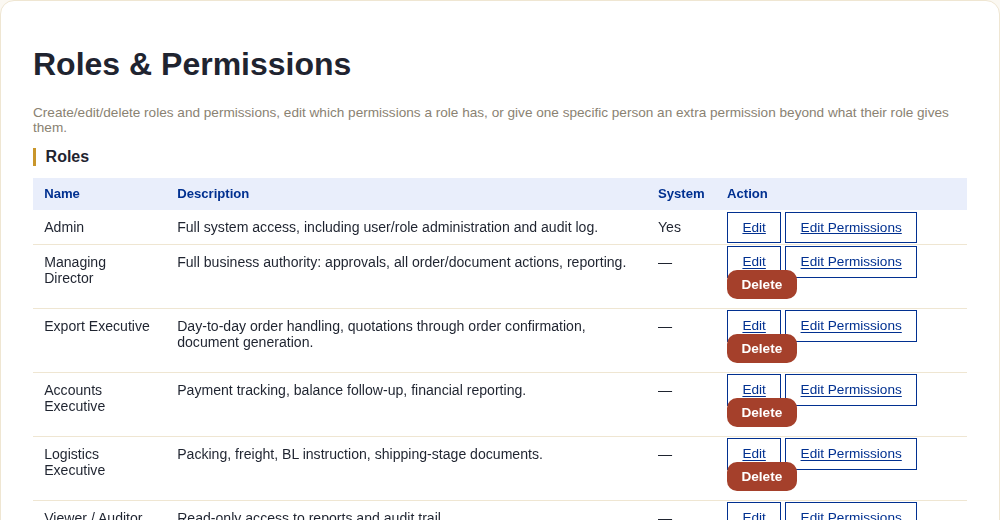
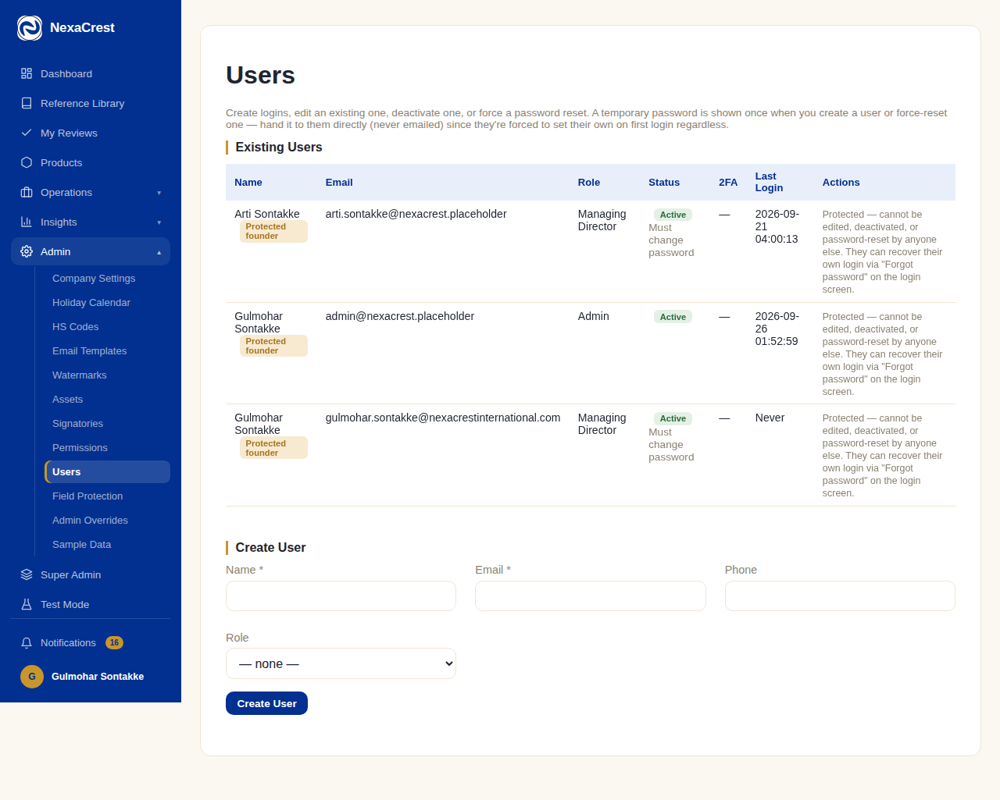

# Admin & Settings

## What this module is for

Everything that configures how the system behaves, rather than any single
order — roles and who can do what, users, company/bank details baked into
documents, the HS code master list, email templates, watermarks,
signatories, and a handful of override/protection mechanisms. Only visible
in the sidebar to staff who actually have the relevant permission — most
Admin sub-items are simply absent for a role that isn't allowed to touch
them.

## The system does this automatically

- A **Super Admin** bypasses every permission check outright — this tier
  exists specifically so there's always at least one account that can never
  be locked out of its own system by a permissions misconfiguration.
- **System roles** (marked "Yes" under System) can't be deleted — only
  edited — since core behavior depends on them existing.
- A brand-new **permission** does nothing on its own the moment it's
  created here — a developer still has to add a check for it somewhere in
  the code before it actually gates anything. Creating one is bookkeeping,
  not a live switch.

## What staff do

### Roles & Permissions

Create, edit, or delete roles; edit which permissions a role has; or grant
one specific person an extra permission beyond what their role normally
gives them (with a mandatory, logged reason):

Below the roles list (not shown here) sits the full **Role Matrix** — every
permission against every role in one table — and a **Permission
Definitions** list for creating new permission keys.

`manage_orders` has always been the single gate for both *seeing* and
*editing* the Orders and Clients modules — there was no way to let
someone look without also being able to touch anything. Two narrower
permissions, **View Orders (read-only)** (`view_orders`) and **View
Clients (read-only)** (`view_clients`), now admit a read-only visitor to
the Orders list/detail page and the Clients list/detail page
respectively, alongside `manage_orders` — never instead of it, and never
touching any mutating route or button, which all stay gated on
`manage_orders` (or its existing finer siblings like `manage_payments`,
`manage_shipping`, `close_orders`). The seeded **Viewer / Auditor** role
carries both, so it can finally see real order and client data instead
of only reports and the audit log.

Every order now also has a list of staff **assignees** (whoever created
it is auto-assigned as the first one), and most roles only see orders
they're assigned to — in the Orders list, the Kanban board, and the
order detail page itself (a bookmarked or guessed URL to someone else's
order is refused, not just hidden). The same rule — and the archived-
order rule — covers every page and action of that order too (editing,
Annexure A, amendments, the Full Report, its document and file
downloads), not only its main page (QA Round 5). Links and buttons a
person's permissions don't allow are no longer shown to them at all —
on the order page, in the sidebar, and in the SOP / Getting Started text
(a link there turns into plain text). An order can have more than one
assignee at once: for example an Export Executive handling office/
documentation work and a Logistics Executive handling CHA/factory work
can both be assigned to the same order concurrently, since the two of
them may genuinely need to work it at the same time. **Admin, Managing
Director, Executive Director, Accounts Executive,** and **Viewer /
Auditor** hold a separate permission, **View All Orders**
(`view_all_orders`), which bypasses this and shows every order
regardless of who's assigned — Accounts Executive needs this because
they touch payment steps across orders they didn't create. Adding or
removing an assignee (small controls on the order detail page itself)
needs its own permission, **Manage Order Assignees**
(`assign_order_owner`), held only by Admin/Managing Director/Executive
Director — not by any of the order's own current assignees, and not by
anyone who merely holds `manage_orders`. This is purely about who can
*see* an order; it never changes who can *act* on it — `manage_payments`,
`manage_shipping`, `close_orders`, and the rest of the permission system
work exactly as before, completely independent of who's assigned to the
order.

### Users

Create logins, edit an existing one, deactivate one, archive one, delete
one, or force a password reset. A temporary password is shown **once**, at
creation or reset — staff hand it to the person directly, since it's never
emailed and they're forced to set their own on first login regardless:

The list is a 3-way filter — **Active / Inactive / Archived** tabs, each
showing its own count — rather than one unfiltered list of everyone.
**Archive** is a separate, stronger state than **Deactivate**: it marks
someone who has genuinely left (not just temporarily suspended), moves
them out of both the Active and Inactive tabs into their own, and always
forces the account inactive too. An archived account can be **Unarchive**d
back to Inactive, then separately **Reactivate**d if they ever return.

**Delete** is a real, permanent delete — it only succeeds for a user with
no order, document, or audit-log history on file anywhere (the database's
own referential-integrity rules decide this, not a hand-picked checklist),
so it only ever actually removes an account created by mistake with zero
real activity. Any user who has done anything at all — even just logged in
once — can only be archived, never deleted; trying anyway shows a clear
message naming where they still appear ("… can't be deleted — they still
appear in: …. History is never removed, so archive (deactivate) them
instead.") rather than failing silently.

Notice the **"Protected — founder"** tag on certain accounts: these
specific users can't be edited, deactivated, archived, deleted, or
password-reset by anyone else at all, even an Admin — they can only
recover their own login via "Forgot password" on the login screen
themselves. This exists so the
people who set the company up can never be locked out by another admin's
mistake (or malice).

Any logged-in staff user — admin-reset, forced-first-login, or neither —
can also change their own password voluntarily at any time from **My
Account** (90-item backlog #26), without needing an admin to force a reset
first. It asks for the current password (re-verified before anything
changes) plus the new password twice, enforces the same DB-driven password
policy (`password_min_length`/`password_complexity_json`) as every other
password-change path, and is audited the same way (`PASSWORD_CHANGED`).

### The rest of Admin

- **Company Settings** — legal name, registered/corporate office, GSTIN/IEC,
  bank details, LUT number — the exact fields snapshotted onto every
  generated document (see the note in [Chapter 1](./01-stage1-enquiry-quotation.md)
  about data integrity). The LUT expiry date and RCMC validity date each
  carry their own alert-days setting; once either is within that many
  days of expiring (or already past it), a warning shows on the
  Dashboard **and** a count badge appears on the sidebar's **Company
  Settings** link itself — visible from every page, not just the
  Dashboard. The same screen's **Mail Redirect** section holds
  four settings, independent of [Test Mode](./16-test-mode.md)'s own email
  redirect: a **Redirect all mail** toggle plus address — when on, every
  non-security outbound email (order updates, document sends, and so on)
  goes to that one address instead of its real recipient, useful for
  rehearsing real mail without touching Test Mode at all — and a **CC
  emails** list (comma-separated) plus a single **Default CC email**,
  both applied to every non-security outbound email regardless of whether
  redirect is on. Both are set only here — there is no `.env` fallback,
  so leaving them blank means nothing is CC'd. Staff 2FA codes and password-reset links are
  never redirected or CC'd, the same carve-out Test Mode uses, so a
  lockout can never happen because of either switch. The CC list and
  default CC are marked **Super Admin only** right on the screen — anyone
  else sees them
  read-only, with no unlock option, since a standing CC address silently
  sees every client email that goes out. Below the main form, a **Send
  Test Email** button for the SMTP server configured in `.env` sends one
  real email straight through it, bypassing Test Mode and Mail Redirect,
  so a connection/credential problem shows up as an actual error on
  screen instead of a silent log line. **All mail goes through that SMTP
  server (Bluehost)** — owner decision 2026-10-29: NexaCrest's mail is
  hosted with Bluehost and Zoho Mail is used only as a mail client, so the
  app never sends through Zoho Mail and its settings are not shown here.
  A second button, **Test Books Connection** (2026-10-29), logs in to
  Zoho Books with the `zoho_books` settings and shows the organisation
  name and the bank account payments go into, or the exact error. It
  only reads — nothing is created in Zoho Books. Above it, a line shows
  what this server's `.env` allows: Zoho integration on or off, test or
  production, and whether GST e-invoice / e-way bill / GST filing is
  blocked. See [Zoho Books Sync](./ca-03-zoho-sync.md).

  **Which emails staff receive** (owner decision 2026-10-26). The audit
  trail records every action, but **recording an action never sends an
  email** — it used to, and one order produced 90+ emails, burying the
  few that needed someone to act. Staff now get an email only when
  something is **waiting on them** or **a client did something on their
  order**, and every one also appears in the in-app notification bell:

  - a document was assigned to you to review, or a send waits on your
    approval; an amendment or cancellation waits on your decision;
  - the buyer acknowledged the OC, uploaded their signed PO, or reported
    a payment — sent to that order's own assignees (or, while nobody is
    assigned, to everyone who manages orders);
  - a client submitted or corrected an intake form, posted a message,
    raised a complaint or dispute, left feedback, or asked for a reorder.

  The email's subject is the notification itself (e.g. "NexaCrest — The
  buyer reported an advance payment on order SC/ORD/2026/014 — verify it
  against the bank statement"), so an inbox shows at a glance what each
  one is. Each staff member can turn these emails off on their own **My
  Account** page (**Email me my notifications**); they still appear in
  the bell. Client-facing emails (documents sent to the buyer, portal
  invites, password resets) are separate and unchanged.

  The three **RBI
  Purpose Code** fields (advance/balance/freight payment wires) are
  **dropdowns, not free text** — fed from the same `dropdown_options`
  admin list used elsewhere on this page (`list_key = 'rbi_purpose_code'`),
  so a code can't be mistyped on a document that a bank actually reads.
  If the current value isn't on the seeded list (e.g. it was set before
  this change, or a bank has since asked for a different code), the
  dropdown still shows it as a selectable option labeled "(not in admin
  list)" rather than silently discarding it — add the real code to the
  admin list first, then switch to it properly. **`storage_base_path`**
  is shown marked **read-only** for a different reason: it was never
  actually wired to anything — the app always reads the real file
  storage path from `STORAGE_BASE_PATH` in `.env`, never from this row —
  so an edit here silently had zero effect. It's now genuinely
  read-only (enforced both in the form and server-side, so a crafted
  request can't bypass it either); to actually change where files are
  stored, edit `.env` directly and restart the app.
- **Holiday Calendar** — the dates the Working Days Calculator (used for
  dispute response deadlines, see [Disputes](./11-disputes.md)) excludes.
- **HS Codes** — the master list product HS codes must come from; an order
  can never use a code that isn't on this list. Every code is **6 or 8
  plain digits, never dotted** (e.g. `68022310`, not `6802.23`) — this is
  enforced on both manual add and bulk import, so a customs reference that
  still uses the dotted convention needs its dots stripped before typing
  or pasting it in. A real customs reference sheet can be onboarded in one
  pass via Bulk Import (paste straight from Excel — Tab-separated, or
  comma-separated for hand-typed lines) rather than adding codes one at a
  time, and each code can carry its own short usage note. The Product
  Guide underneath it is a separate, read-only "which code do I actually
  use for this product" reference (also bulk importable) — most useful
  for a fresher who has never had to classify a product before.
- **Email Templates** — subject/body/footer for every system email, with
  template-key placeholders merged in at send time (see
  [Document Review & Approval](./13-document-review-approval.md)). This
  also covers 7 system/transactional emails that used to be hardcoded and
  not admin-editable at all: the 2FA login code, the staff and client
  portal password-reset emails, the client portal invite, and the
  quotation-correction/PI-form/Buyer-Action one-time links. Each has its
  own, much smaller token set than a buyer-document template (shown on
  that template's own edit screen) — e.g. `{code}` for the 2FA email,
  `{reset_link}`/`{email}` for a password reset. These are security- or
  access-critical, so editing or deactivating one never blocks the actual
  send: if the row is missing or switched off, the original wording goes
  out instead, exactly as it did before this template existed.
- **Watermarks** — the draft vs. final watermark text/styling swapped
  automatically when a document is approved. Each of the two (draft/final)
  independently supports Text only, Image only, or Text and image
  together — "Both" really does render both layers, they're independent
  overlays, not either/or. The watermark image itself comes from Company
  Assets (upload it there first). If the active watermark image's file
  ever goes missing from server storage (moved, deleted, or not carried
  over by a deploy), the Watermarks screen shows a clear warning instead
  of a silently incomplete PDF, and saving Image/Both mode is refused
  until a fresh image is re-uploaded — this replaced an earlier gap where
  such a save could succeed and every subsequent PDF would quietly show
  the text watermark only, with nothing indicating why.
- **Logistics Partners** — the CHA (Customs House Agent) and transportation
  contact directory, gated by its own `manage_logistics_partners`
  permission (same tier as HS Codes: Admin/MD/ED and Super Admin by
  default). Each partner carries a **Service Type** — CHA only,
  Transportation only, **CHA + Transportation**, or **Freight Forwarder**
  (the list Step 9a picks the order's forwarder from) — since the same
  company sometimes handles both and sometimes only one; a "both" partner
  shows up whichever way staff filter the list. Alongside name/address/
  city/state, every entry can carry a WhatsApp number and phone for both
  the company and a named contact person, plus GSTIN and PAN for the
  paperwork side. Step 9a (Save Freight Terms) picks the order's freight
  forwarder from this directory.
- **Bank details & the Vendor Details Link** (Suppliers and Logistics
  Partners, owner request 2026-10-27) — each supplier and partner has a
  **Bank Details** section: account holder, bank, branch, IFSC, account
  number (typed twice; stored encrypted, shown masked in lists), account
  type and UPI ID. Fill it in on their behalf (e.g. from their email) and
  tick **"I have verified these bank details"** once checked against a
  cancelled cheque or bank letter. Or press **Generate & Email Details
  Link** on their edit page: they get a no-login page to fill in their
  company and bank details themselves. The link works **once** and for
  30 days; what they enter lands as **not verified** until you check it,
  and their existing account number is never shown back to them (only the
  last four digits). The directory lists show a **Bank** column (✓
  Verified / ⚠ Not verified / —), and Steps 7e and 10a show the supplier's
  bank details ("Pay to") with the same status, so Accounts pay the right,
  checked account.
- **Suppliers** (`/suppliers`) — the supplier directory every Supplier PO
  is raised against, gated by its own `manage_suppliers` permission (same
  tier as Logistics Partners: Admin/MD/ED and Super Admin by default).
  Built the same way as Logistics Partners: filter by type, search by
  name, add, edit, deactivate/reactivate. A supplier can hold **several
  types** (Quarry Owner, Processor (Job-Work Basis), Trader, Factory
  Owner — the list itself is edited under Dropdown Options), and carries
  address/city/state, phone, WhatsApp, email, a contact person with phone
  and WhatsApp, GSTIN, PAN, notes, and its factory addresses. A
  deactivated supplier drops out of the Supplier PO supplier list but
  stays on old orders. **Delete** is only offered for a supplier never
  used on an order — once used, deactivate it instead. Edits here never
  change an existing order: each Supplier PO keeps its own copy of the
  supplier's details from when its terms were saved.
- **Ports** (`/ports`) — the Port of Loading / Port of Discharge options
  offered on the New Order form, gated by its own `manage_ports`
  permission (same tier as Logistics Partners: Admin/MD/ED and Super
  Admin by default). 90-item backlog #59: this used to be unreachable —
  only one loading port (Chennai) was ever seeded and nothing let staff
  add another, so the Port of Discharge dropdown was always empty and
  every order fell back to its free-text "not listed" field. Each port
  carries a **Role** — Loading only, Discharge only, or **Loading &amp;
  Discharge** — a "both" port appears in whichever dropdown staff open,
  same pattern as Logistics Partners' Service Type. One port per role (or
  one "Loading &amp; Discharge" port) can be marked **Default**, which
  pre-selects it on a fresh New Order form; setting a new default clears
  the flag from every port that would otherwise appear alongside it in
  that same dropdown. A port already used on a real order is never
  deleted outright — deactivate it instead, same convention as every
  other admin-editable list on this page. 90-item backlog "ports city
  field": each port also carries an optional **City** — Incoterms® 2020
  labels print the city alone (e.g. "FOB Mumbai"), never the formal
  terminal/port name that's entered above it (e.g. "Nhava Sheva (JNPT)"),
  so generated documents' Incoterm label and port-of-loading/discharge
  fields read the City when one is on file, falling back to the port's
  own name when it isn't. The plain "Port of Loading"/"Port of Discharge"
  informational fields on the Order Detail page and the Bill of Lading's
  own endorsement defaults are unaffected — those conventionally show the
  specific terminal name, not the city. 90-item backlog "standalone
  order": a port's name and city are copied onto the order the moment
  it's picked — renaming a port, changing its city, or deactivating it
  afterward only affects new orders; every order already created against
  it keeps printing the name/city that were on file the day it was made.
- **Port Routes** (`/port-routes`) — 90-item backlog item 15: a reference
  document of known port-to-port sailing times, gated by the same
  `manage_ports` permission as Ports itself (linked from the Ports
  screen). Each route carries a **Port of Loading**, a **Port of
  Discharge**, a **Sailing Days Min/Max** range, and optional **Notes**
  (e.g. "Direct service, no transshipment"). One route per port pair —
  recording the same pair twice is refused with a message pointing at the
  existing entry; edit that one instead. A route already quoted from is
  never deleted outright — deactivate it instead, same convention as
  every other admin-editable list on this page. Once both ports are
  picked on the New Order form or the order's own Edit Details screen, a
  matching active route auto-fills the order's **Sailing Lead Time
  Min/Max (days)** fields (see below) — a suggestion only: it never
  overwrites a value staff already typed, and staff can always change it
  afterward.
- **Lead Time Display Unit** — a single Company Settings field
  (`lead_time_display_unit`, in the Orders category, Days by default)
  controlling whether the Order Detail page's Production Lead Time and
  Sailing Lead Time rows show in days or weeks. 90-item backlog item 16:
  display only — the stored figures and every order form's input field
  always stay in days regardless of this setting; only the label and the
  rendered range on the Order Detail page change (e.g. "45–60" days vs.
  "6.4–8.6" weeks).
- **Payment Presets** (`/payment-presets`) — full CRUD for the advance/
  balance split every order picks up, gated by its own
  `manage_payment_presets` permission (same tier as Logistics Partners:
  Admin/MD/ED and Super Admin by default). Each preset carries **Advance
  %** and **Balance %** (must add to 100), the **Advance Trigger Text**
  (the second half of the printed advance sentence), a **Balance Trigger
  Option** (Before Shipment vs. Against Scanned BL Copy), **Balance
  Days**, a **Currency**, a **Default** flag (exactly one preset may be
  default — saving one as default silently clears the flag on every
  other preset), whether it **Requires MD Approval** (MD/ED — anyone
  holding **Approve payment terms** — must approve an order's terms on this
  preset before its Quotation can be generated or sent; see Stage 1), and whether it
  **Includes BL Type / BL Consignee Instruction** on the generated BL
  Instruction Sheet (90-item backlog #32) — unchecking this on a preset
  omits both rows from every Stage 7 BL Instruction Sheet generated for
  orders on it, for payment terms (e.g. balance paid before shipment)
  that don't need NexaCrest to retain the BL as leverage; every seeded
  preset ships with it checked, reproducing the sheet's content exactly
  as before this field existed. Creating a new
  preset — say a 20% advance / 80% balance trial-order preset — needs no
  further code change anywhere: every order on that preset calculates
  its advance/balance amounts and prints the right percentages
  automatically, since the figures are computed purely from whatever
  `advance_pct`/`balance_pct` the assigned preset carries, never a
  hardcoded 40/60 split. 90-item backlog "standalone order": a preset's
  terms are copied onto the order the moment it's created — editing a
  preset's percentages, trigger wording, or BL Instruction Sheet flag
  afterward only changes what a *new* order picks up; every order
  already created on that preset keeps printing exactly what was true
  the day it was made, even years later.
  Balance Trigger Wording is a free-text field holding the exact sentence
  printed on the Quotation, Proforma Invoice, Buyer PO, and Commercial
  Invoice — every document whose balance clause varies by preset
  (external QA report L-06: the Commercial Invoice used to print a
  hardcoded, company-wide "Calendar Days after NexaCrest emails the
  scanned BL copy" wording regardless of preset; it now follows the
  order's own preset like the other three always did). It must contain
  the literal token `{days}`, substituted with that preset's own Balance
  Days value
  at render time; leaving it blank falls back to one of two built-in
  sentences depending on the Balance Trigger Option, so an admin never
  needs to backfill older preset rows. Both seeded presets ship
  **protected** — unlock via **Field Protection** before editing or
  deactivating, same as a protected Company Setting or T&C clause — since
  they drive where money is actually sent and received. A preset is never
  hard-deleted: deactivating one only removes it from the picklist on new
  orders — every order already created against it, active or closed,
  already has its own copy of the preset's terms and is entirely
  unaffected.
- **Legal Terms & Definitions** — on every buyer-facing document except
  the BL Instruction Sheet, a final numbered section ("N. LEGAL TERMS &
  DEFINITIONS") prints a red **Legal Terms** box and a blue
  **Definitions** box, each a plain list of admin-editable clauses — same
  table, same edit screen, and the same `tc_clauses` rows as the
  ordinary numbered Terms & Conditions list already uses, just tagged
  with `clause_group` set to `legal_terms` or `definitions` instead of
  the default `standard`. There is no separate admin screen for these:
  editing one is an ordinary clause edit on the same **Admin Overrides**
  screen as the regular T&C list — shown under its own **Legal Terms**
  and **Definitions** subheadings (below the numbered **Terms &
  Conditions** list) so the three groups are easy to tell apart, though
  all three are still saved together in one form.
  One further per-clause setting, **visibility_rule**,
  can scope a Legal Terms clause to only the orders on a matching
  **Balance Trigger Option** — used for a Bill of Lading Policy clause
  that only makes sense on a "balance against scanned BL copy" preset,
  so it never shows on an order using a "before shipment" preset instead
  (and vice versa). Leaving visibility_rule on its default ("always")
  shows the clause on every order regardless of preset, same as every
  ordinary T&C clause already does.
  A Legal Terms clause's own **"Shown on"** checkbox row (next to its
  title/text, same screen) sets which document types it actually prints
  on — only customer-facing document types are offered, since Legal
  Terms is a buyer-facing section only (an internal-only document like
  CAFIN, or a procurement one like the Supplier PO, is never offered as
  an option, whatever an admin ticks). A protected clause's checkboxes
  are disabled the same way its title/text fields are, until unlocked.
  Changing which document types a clause reaches is logged exactly like
  a text edit (old/new document-type codes, reason required).
- **Bold/italic/underline in clause text** — 90-item backlog Phase 5: every
  clause's **Text**/**Definition** textarea (all three groups above) takes
  a small markdown-like syntax directly in the plain text — `**bold**`,
  `*italic*`, `_underline_` — with a toolbar above the textarea (Bold/
  Italic/Underline buttons) that wraps the current text selection in the
  right markers as a convenience; typing the markers directly works
  identically. Deliberately NOT a rich-text/WYSIWYG editor like the
  Annexure's free-text field: the clause text itself stays plain text in
  the database (so decades of existing legal wording never needs
  migrating), and only the Order Detail/document generation step turns
  the markers into real bold/italic/underline formatting on both the PDF
  and the internal DOCX. An unpaired marker (e.g. a stray `_` in running
  prose) is always left as a literal character, never guessed at.
- **Compliance Task Types** (`/compliance-task-types`) — the admin-editable
  list of names (ECGC Cover, Pre-Shipment Inspection, Fumigation
  Certificate, Phytosanitary Certificate, Due Diligence by default) that
  appears as a checklist on every order's own page — see
  [Stage 9 — Document Despatch & Closure](./09-stage9-despatch-closure.md)
  for the checklist itself. Gated by `manage_compliance_task_types`, same
  tier as HS Codes/Logistics Partners (Admin/MD/ED and Super Admin by
  default). This screen only edits the list of names; it does not itself
  grant access to the checklist on an order's page — that uses the
  existing `close_orders` permission, "the person who has permission to
  close the order must able to see this otherwise no meaning for this."
  Deactivating a type removes it from every order's checklist going
  forward without touching any status already recorded against it;
  deleting one outright only works if no order has ever recorded a status
  against it, otherwise the screen asks you to deactivate instead.
- **Dropdown Option Lists** (`/admin/dropdown-options`) — the admin screen
  for `dropdown_options`, the generic small-option-list table several
  dropdowns elsewhere in the app already read from (Container Type,
  Certificate of Origin Type, Unit, Package Type, Supplier Type, Surface
  Finish, GST Rate, and others) but that, until now, could only be edited
  by hand-editing `seed.sql`. Unit (`list_key = 'unit'`) feeds every
  product-line Unit field across New Order, Order Detail, Reorder Request
  review, and the client portal's own reorder form; Package Type
  (`list_key = 'package_type'`) feeds the Estimated Package Type field on
  New Order and Edit Order Details; Surface Finish (`list_key =
  'surface_finish'`) feeds the Supplier PO form's own Surface Finish field
  (see [Chapter 5](./05-stage5-supplier-po.md)) **and** the product-line
  Finish field across New Order, Order Detail, and the client portal's own
  reorder form — the same physical attribute viewed from the procurement
  side and the sale side of the same order, so editing this one list keeps
  every Finish field in sync; GST Rate (`list_key = 'gst_rate'`) feeds the
  matching field on the Supplier PO form — all five were previously
  free-text inputs with no validation against the values actually used
  elsewhere on the order. Gated by `manage_dropdown_options`,
  same tier as HS Codes/Logistics Partners/Compliance Task Types (Admin/MD/
  ED and Super Admin by default). One group per `list_key`, each with its
  own bulk-save form (Value/Sort Order/Default radio/Active checkbox per
  row) and its own "Add Option" field underneath — mirrors the Admin
  Overrides screen's per-section pattern. An option is never deleted
  outright, only deactivated (the **Active** checkbox) — an existing order
  or submission may still carry its exact text in a plain VARCHAR column
  with no foreign key back to this table, so removing the row itself could
  orphan that reference. Exactly one option per list may be the **Default**
  (the radio column) — marking a new one silently clears the previous
  default, same convention as Payment Presets below. Every option needs a
  name and a **Sort Order** that is a whole number (0 or more); if any row
  breaks that, the whole save is refused with a message and nothing is
  changed (QA Round 5, R5-30/R5-28 — a cleared name used to save an empty
  option).
- **Reference Library** (`/reference-docs`) — any authenticated staff
  member can view and download every entry here by default; adding,
  deleting, or re-uploading a file requires `manage_company_settings`,
  the same gate as Company Settings itself. The system's own fixed
  documents can't be saved empty — clearing the text and saving is
  refused, so a slip can't wipe them (QA Round 5, R5-30). Alongside the system's own
  fixed reference documents (SOPs, the Stage Gate Reference, the
  Cross-Verification Checklist), this is where documents a client might
  ask to see to verify the business live — the Factory SOP, Quarry SOP,
  Factory Processing Agreement template, and Quarry Block Supply
  Agreement template are the first four seeded here, each downloadable
  straight from the list. A custom entry can optionally be filed under a
  **Category** (**Manage Categories**, from the Reference Library page):
  uncategorized stays visible to everyone (the default, unchanged
  behaviour), but a category can carry a **Required Permission** — only
  staff holding that permission then see documents filed under it, e.g. a
  CA/Accounts-only working-papers folder restricted to `ca_module_view`.
  Deleting a category never deletes its documents — they fall back to
  uncategorized (visible to everyone again). The fixed 8 system reference
  documents are never scoped this way.
- **Assets** — logo, company seal, and signature images used across every
  document template.
- **Signatories** — which users are eligible to sign which document types,
  and their designation. Each document type can be pointed at a specific
  signatory (falling back to one global default if not set); whoever is
  resolved prints with their own name, designation, signature and
  designation seal. The Payment Terms Amendment (AMD) document type is
  seeded to default to the Managing Director for exactly this reason — it's
  not hardcoded, so it can be repointed here to any other eligible user
  (and designation) at any time, the same as any other document type.
- **Field Protection** — which specific fields are locked from casual
  editing once set (e.g. the BL type field mentioned in Stage 7).
- **Admin Overrides** — a log/interface for the various "override" actions
  scattered through this system (amendment reference, locked client data,
  etc.) — every one of them requires a logged reason, never a silent edit.
- **Sample Data** — populate or clear sample/demo data; see
  [Test Mode](./16-test-mode.md) for the safer, sandboxed version of this.
- **UI Templates** (`/ui-templates`) — the master on/off switch for which
  templates exist at all; see the dedicated section below for what each
  one actually looks like and where the other two controls live.

### UI Template Preference — Standard vs Kanban

Two templates exist out of the box: **Standard** (the ordinary list/table
screens used everywhere in this manual's screenshots) and **Kanban** (the
same underlying data, shown as a board of cards in columns instead). This
is purely a different way of looking at the same records — switching
templates never changes what data exists, who can act on it, or any
permission check; it only changes how a handful of list screens render:

Three places control this, and they resolve in order — a person's own
choice wins if they made one, otherwise the company default applies,
and if neither resolves to something usable, Standard is always the
final fallback:

1. **A user's own preference** — each person sets this on their own
   **My Account** page (**UI Template** section): pick a specific
   template, or leave it on **"Use company default"** to automatically
   follow whatever the company default is set to, even if that changes
   later.
2. **The company default** (**Settings → UI**, the `default_ui_template`
   setting) — what anyone with no personal preference set sees.
3. **Standard, hard-coded** — the fallback if the resolved template (a
   personal pick or the company default) turns out to be deactivated.
   **Standard can never itself be deactivated** from the UI Templates
   screen above, specifically so this fallback always has somewhere
   real to land — nobody can ever be locked out of every list screen at
   once by a template being switched off.

Deactivating a template on the UI Templates screen doesn't delete
anything or affect anyone's underlying data — anyone currently resolved
to it (by personal preference or because it was the company default)
automatically falls back to the company default, or to Standard if
that's also inactive, the next time they load an affected page.

**Where Kanban actually changes the screen** — the same switch, applied
independently on each of these six list pages, each rendering columns
that match the real states that list already tracks elsewhere in this
manual:

- **Orders** (the main Orders list) — one column per pipeline stage
  (Stage 1 through Stage 9, every column shown even when empty), plus a
  **Docs Sent — Awaiting Benefits** column and a **Complete** column for
  the two-phase closure (see [Stage 9](./09-stage9-despatch-closure.md)),
  with **Lost** and **Cancelled** rolled up as compact count-chips
  linking to the existing filtered list rather than given full columns —
  they're dead ends, not pipeline stages worth a whole column of cards.
- **Disputes** ([Chapter 11](./11-disputes.md)) — one column per
  `dispute_status` dropdown option, in whatever order Admin has them
  configured in (Open / Under Review / Resolved / Escalated by default).
- **Reorder Requests** ([Chapter 17](./17-order-edit-duplication.md)) —
  Pending / Approved / Rejected.
- **Quotation Intake Review** ([Chapter 1](./01-stage1-enquiry-quotation.md)) —
  Pending / Converted / Rejected.
- **PI Intake Review** ([Chapter 3](./03-stage3-pi-advance.md)) — Pending
  Review / Applied / Rejected.
- **Complaints** ([Chapter 19](./19-complaints.md)) — Open / Acknowledged
  / Resolved.

Every other screen in this manual — including the client portal, which
stays the simple grouped list described in
[Client Portal](./12-client-portal.md) — is unaffected either way, since
a board only makes sense for a cross-order queue, not a single order's
own detail page or a one-client view.

## What the client does (or doesn't)

Nothing — Admin & Settings is entirely internal, with no client-facing
surface of any kind.

## What happens next

Nothing changes anywhere else automatically — every setting here takes
effect the next time the relevant action happens (the next document
generated picks up the current company settings/watermark, the next login
attempt respects the current role permissions, and so on), never
retroactively.
