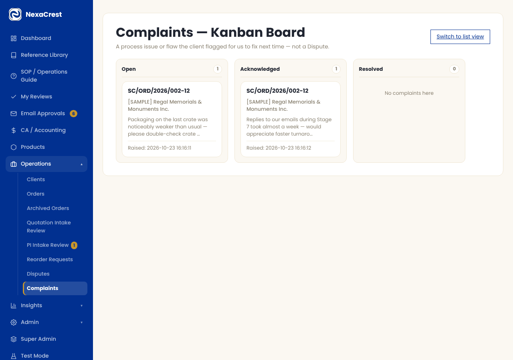
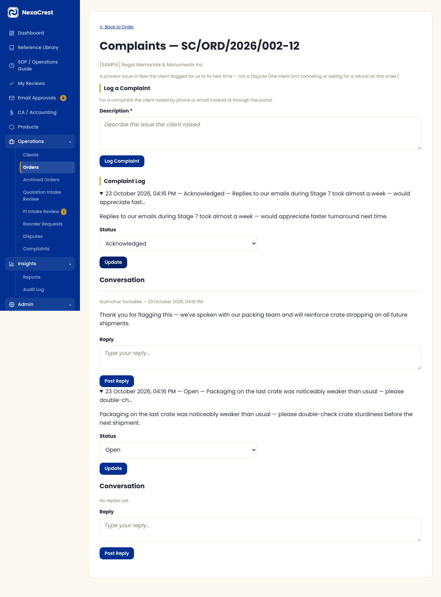
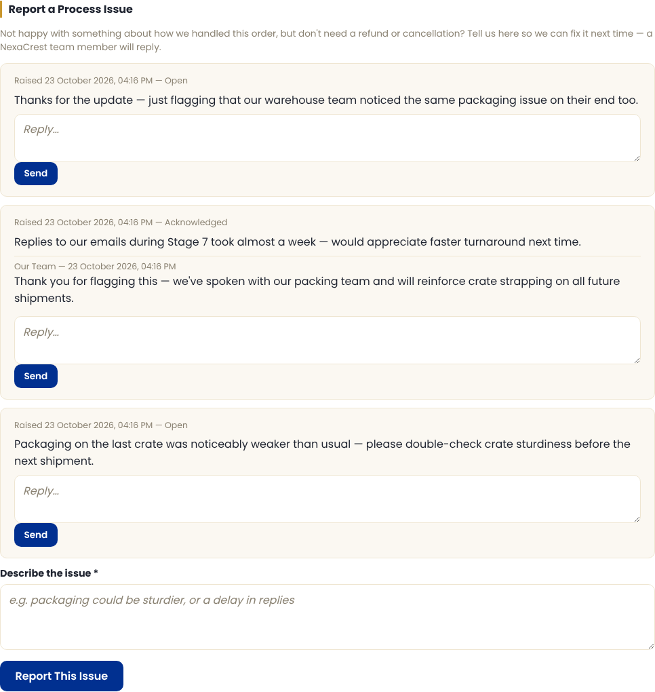

# Complaints

## What this module is for

A documented, two-way conversation about a **process flaw the buyer wants
fixed next time** — packing was sloppy, communication was slow, a document
had an error that got caught late, and so on. The order itself is fine: the
buyer isn't asking to cancel it, isn't asking for a refund, and the order
may already be complete or still mid-pipeline — it genuinely doesn't matter
either way, because a Complaint is never gated on order status.

> **Not the same thing as a Dispute.** If a buyer's message means "please
> cancel this / I don't want to continue," that's a
> [**Dispute**](./11-disputes.md) instead — a separate feature, with its
> own response-due clock and the per-order client-facing toggle that only
> staff can turn on. A Complaint carries none of that cancel-intent
> machinery and is **always** available to the buyer, regardless of the
> order's status and regardless of whether Disputes are enabled for that
> client. The two used to be tagged variants of the same record — they no
> longer are, precisely because they call for a different response: a
> Dispute is adversarial and time-boxed; a Complaint is a mutual
> conversation about doing better next time.

Like Amendments and Disputes, this isn't part of the 9-stage pipeline — a
complaint can be logged at any point on any order and never blocks or
unlocks a stage gate.

## Who can do what

Two separate permissions gate this module, the same split used for
Disputes:

- **Manage complaints** (`manage_complaints`) — view the complaint log
  (global and per-order), log a complaint on the client's behalf, and
  change a complaint's status. Privileged by default: only Admin, Managing
  Director, Executive Director, and Super Admin hold it out of the box —
  same tier as `manage_disputes`. It is **not** auto-inherited from
  `manage_orders`; grant it to another role from **Roles & Permissions**
  if that business needs it more broadly.
- **Respond to complaints** (`respond_to_complaints`) — post a reply in a
  complaint's own conversation thread. Granted to Export Executive by
  default, same reasoning as `respond_to_disputes`: day-to-day sales staff
  are usually the ones actually answering a buyer, without needing the
  broader ability to log complaints or change their status.

Holding either permission is enough to open a given order's Complaints
screen; what's shown on it (the Log Complaint form, Status control) depends
on which of the two permissions you actually have.

Either permission also opens the **Complaints** list in the sidebar (owner
decision 2026-10-30, QA Round 6 Q-R6-3). The list, like every complaint
page, shows only complaints on orders you may open: orders assigned to you,
or every order if you hold **View all orders** — archived orders only with
**View archived orders** (QA Round 6, R6-N08).

## The system does this automatically

- **A complaint always starts at status "Open."** There's no automatic
  progression from there — staff move it to **Acknowledged** or
  **Resolved** themselves, whenever that's actually true.
- Every status change is recorded in the order's own Audit Log, under
  `COMPLAINT_STATUS_CHANGED`, same as any other status field in this
  system.
- **Notifications fire on every action, in both directions** (see "Who
  gets notified" below) — this module follows the same non-negotiable
  dual-channel rule as every other feature in the app.

## What staff do

A standalone **Complaints** nav item (visible to anyone holding either
permission above) opens the **global complaint log** — every complaint
across every order, filterable by status — the same pattern as the global
Disputes log. This is deliberately its own page rather than folded into
Disputes: a complaint has nothing to do with cancellation, so mixing the
two logs would make neither one easy to scan. On the Kanban UI template
(see [Admin & Settings](./15-admin-settings.md#ui-template-preference--standard-vs-kanban)),
this same list renders as a board instead, columned by status:

From **Complaints** on the order page itself:

**Log Complaint** — a mandatory description (e.g. "Buyer, via email: BL
copy sent 4 days late"), nothing else required. Staff log a complaint on
the buyer's behalf the same way they can log a Dispute, if the buyer
reported the issue by phone or email rather than through their portal.

For each logged complaint, anyone holding **Manage complaints** can update
its **Status**: **Open** → **Acknowledged** → **Resolved**. There's no
required order to these — a complaint can jump straight to Resolved if
that's genuinely what happened.

### The conversation

Each complaint has its own **Conversation** thread, directly underneath
its status control — unlike a Dispute's reply thread (staff-only, one
direction), a Complaint's thread is genuinely two-way:

- Anyone holding **Respond to complaints** can post a reply. Posting a
  staff reply **emails the client directly** — the same way a staff reply
  in the order-wide [Client Portal](./12-client-portal.md) conversation
  does — since the client has no in-app inbox of their own to check.
- The client can also reply from their own portal (see below), which
  **notifies every `manage_complaints`/`respond_to_complaints` holder
  in-app** (deduplicated, so nobody gets the same notification twice even
  if they hold both permissions).

Because the thread lives on the complaint, and the complaint itself is
reached from the order's own Complaints screen, a complaint's entire
history — the original description, every status change, and every reply
in both directions — is always part of that order's record:

## Who gets notified

- **Client raises a complaint, or replies on an existing one** → every
  staff member holding `manage_complaints` or `respond_to_complaints`
  gets an in-app notification (`complaint_raised` /
  `complaint_reply_from_client`). Nobody is emailed for this — staff check
  their own in-app notifications, the same as for any other staff-facing
  alert in this system.
- **Staff logs a complaint on the buyer's behalf** → no notification fires
  (staff already know, since they're the one who just did it).
- **Staff posts a reply** → the client is emailed directly, with the
  replying staff member's own email signature (or a default
  Regards/MD-title block if they haven't set one) — nobody at NexaCrest
  is separately notified for their own colleague's reply.

## What the client does

A **"Report a Process Issue"** section is always visible on the client's
own order page in their portal — regardless of the order's status, and
regardless of whether the per-order "Raise a Dispute" toggle is on or off
for that client. They submit a description; that's the only field they
have, same as the Dispute form's client side. Once submitted, staff see it
immediately in the global Complaints log and on that order's Complaints
screen.

If staff or the client has already posted a reply, the client sees the
full conversation on their own portal page and can reply again themselves
— there's no limit on how many messages either side can send, and no
status visible to the client (Open/Acknowledged/Resolved is an internal
staff field; the client just sees the conversation itself):

## What happens next

Nothing is automatically unlocked or triggered elsewhere in the system.
Resolving a complaint is purely a record update — the order's own pipeline
progress, and anything else about the order, is entirely unaffected by a
complaint being open, acknowledged, or resolved.
